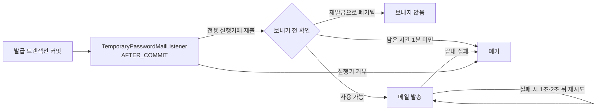

# 5. 비밀번호 초기화

비밀번호를 잊은 사용자에게 임시 비밀번호를 메일로 보냅니다. 기존 비밀번호는 바꾸지 않고, 임시 비밀번호를 별도로 저장해 만료 전까지만 로그인에 쓸 수 있게 합니다.

## API

| 요청 | 응답 |
| --- | --- |
| `POST /api/auth/reset-password` `{ "email": "..." }` | `204` 발급 완료. 메일 도착은 보장하지 않습니다 |

| 실패 | 상태 | 코드 |
| --- | --- | --- |
| 가입되지 않은 이메일 | 404 | 사용자 미존재 |
| 소셜 로그인으로 가입해 비밀번호가 없는 계정 | 400 | `A_002` |
| 재요청 제한 초과 | 429 | `A_001`. `details.retryAfterSeconds`에 다시 요청할 수 있을 때까지 남은 초를 담습니다 |

## 발급 규칙

| 항목 | 값 | 이유 |
| --- | --- | --- |
| 유효 시간 | 3분 | 메일이 유출돼도 쓸 수 있는 시간을 줄입니다 |
| 재요청 간격 | 같은 계정 1분 | 연속 요청으로 메일이 쌓이는 것을 막습니다 |
| 시간당 발급 | 같은 계정 5회 | 두 제한에 모두 걸리면 더 늦게 풀리는 시각으로 안내합니다 |
| 사용 가능한 임시 비밀번호 | 사용자당 1개 | 재발급하면 이전 임시 비밀번호를 폐기합니다 |
| 저장 형식 | BCrypt 해시 | 원문은 DB에 남기지 않고 메일로만 전달합니다 |
| 형식 | 12자, 대문자·소문자·숫자·특수문자 각 1개 이상 | 메일을 보고 입력하므로 `0 O 1 l I`처럼 헷갈리는 문자는 쓰지 않습니다 |

같은 계정의 요청은 사용자 행 잠금(`findByIdForUpdate`)으로 한 줄로 세웁니다. 뒤 요청은 앞 요청이 커밋한 발급 기록을 보고 제한을 판단합니다.

## 임시 비밀번호로 로그인

1. 이메일 로그인에서 `DaoAuthenticationProvider`가 원래 비밀번호를 확인합니다.
2. 실패하면 `TemporaryPasswordAuthenticationProvider`가 이어서 만료 전·폐기 전 임시 비밀번호와 비교합니다.
3. 일치하면 원래 비밀번호 로그인과 같은 형태로 인증을 반환하므로 로그인 세션 발급과 중복 로그인 처리가 같습니다.

- 원래 비밀번호도 계속 쓸 수 있습니다.
- 임시 비밀번호는 만료되거나 폐기되기 전까지 여러 번 쓸 수 있습니다.
- 잠긴 계정은 임시 비밀번호가 맞아도 로그인할 수 없습니다.
- 실패 사유는 구분하지 않고 같은 인증 실패로 응답해 가입 여부가 드러나지 않게 합니다.

로그인한 사용자가 `PATCH /api/users/{userId}/password`로 비밀번호를 바꾸면 남아 있는 임시 비밀번호를 모두 폐기합니다.

## 메일 발송

| 결정 | 이유 |
| --- | --- |
| 커밋 후 발송 | SMTP 응답을 기다리는 동안 DB 커넥션과 행 잠금을 잡지 않습니다. 발급이 롤백되면 메일도 나가지 않습니다 |
| 전용 실행기 (스레드 2개, 대기열 100) | 요청 스레드가 메일 발송을 기다리지 않습니다. 대기열이 차면 바로 거부하고 폐기해 Tomcat 스레드를 붙잡지 않습니다 |
| 보내기 직전 상태 확인 | 대기 중 재발급됐으면 이전 임시 비밀번호는 보내지 않습니다 |
| 남은 시간을 계산해 안내 | 대기·재시도로 늦어진 만큼 메일의 "N분 동안 사용 가능" 문구를 줄입니다. 1분 미만이면 보내지 않고 폐기합니다 |
| 실패 시 폐기 (`REQUIRES_NEW`) | 사용자가 모르는 임시 비밀번호가 남지 않게 합니다. 커밋 후 단계라 새 트랜잭션에서 실행합니다 |
| 종료 시 최대 20초 대기 | 배포로 태스크가 내려갈 때 진행 중인 발송을 마무리합니다 |

로그에는 임시 비밀번호 ID와 예외 타입만 남기고 이메일과 원문은 남기지 않습니다. 메일 서버 상태는 헬스 체크에서 제외해, 메일 장애로 서버가 비정상으로 표시되지 않게 합니다.

## 운영 설정

`EVERYONE_MAIL_USERNAME`, `EVERYONE_MAIL_PASSWORD`가 없으면 발송이 실패합니다. Gmail은 계정 비밀번호 대신 앱 비밀번호를 사용합니다. 변수 목록은 [환경변수 예시](../../.env.example)를 참고합니다.

## 테스트

| 테스트 | 검증하는 것 |
| --- | --- |
| `PasswordResetServiceTest` | 발급 제한, 소셜 계정 거부, 이전 임시 비밀번호 폐기, 이벤트 발행 |
| `PasswordResetServiceIntegrationTest` | 커밋 후 별도 스레드 발송, 재요청 시 이전 메일 미발송, 실행기 종료 시 폐기 |
| `TemporaryPasswordMailListenerTest` | 재시도, 최종 실패·실행기 거부 시 폐기, 남은 시간 계산 |
| `TemporaryPasswordAuthenticationProviderTest` | 만료·폐기 거부, 잠긴 계정 거부, 실패 사유 통일 |
| `TemporaryPasswordGeneratorTest`, `TemporaryPasswordTest` | 생성 규칙, 만료 경계 |
| `PasswordResetSecurityTest` | 인증 없이 호출 가능, CSRF 적용 |
| `PasswordChangeServiceTest` | 비밀번호 변경 시 임시 비밀번호 폐기 |