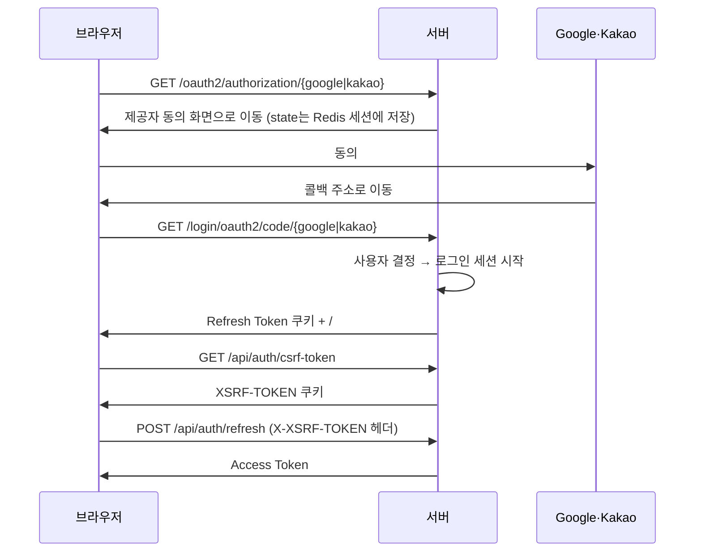

# 6. 소셜 로그인

Google·Kakao 계정으로 가입하거나 로그인합니다. 로그인에 성공하면 이메일 로그인과 같은 로그인 세션을 시작합니다.

## 흐름



토큰은 주소에 넣지 않습니다. 서버는 Refresh Token 쿠키만 발급하고, 프런트가 CSRF 토큰을 받은 뒤 재발급 API로 Access Token을 받습니다.

## 제공자별 차이

| 항목 | Google | Kakao |
| --- | --- | --- |
| 방식 | OpenID Connect. ID 토큰의 claim 사용 | 사용자 정보 API(`/v2/user/me`) 응답 사용 |
| 회원 식별 | `sub` (이메일은 바뀔 수 있어 사용하지 않음) | 회원번호 `id` |
| 요청 범위 | `openid`, `profile`, `email` | `profile_nickname` |
| 가입 이메일 | Google이 확인한 이메일만 사용 | 이메일을 받지 않아 `kakao_{회원번호}@kakao.com`으로 생성 |
| 이름 | 프로필 이름. 없으면 `Google 사용자` | 닉네임. 없으면 `카카오 사용자` |

이름이 100자를 넘으면 이모지가 깨지지 않도록 코드 포인트 기준으로 자릅니다.

## 계정 정책

| 상황 | 처리 |
| --- | --- |
| 이미 연결된 소셜 계정 | 연결된 사용자로 로그인합니다 |
| 처음 로그인 | 비밀번호 없이 가입하고 소셜 계정을 연결합니다 |
| 같은 이메일로 가입한 계정이 있음 | 자동으로 연결하지 않고 거부합니다. 일반 가입에 이메일 인증이 없어, 다른 사람이 먼저 가입한 계정에 연결되는 것을 막습니다 |
| 잠긴 계정 | 거부합니다 |

소셜로 가입한 계정은 비밀번호가 없어 [비밀번호 초기화](05-password-reset.md) 대상이 아닙니다. 같은 제공자의 같은 회원 ID는 한 사용자에게만 연결됩니다.

## 실패 처리

실패하면 `{서비스 주소}/#/sign-in?error=oauth_failed&error_message={코드}`로 이동합니다.

| 코드 | 상황 |
| --- | --- |
| `email_already_exists` | 같은 이메일의 계정이 이미 있음 |
| `email_not_verified` | Google 이메일이 확인되지 않음 |
| `account_locked` | 잠긴 계정 |
| `access_denied` | 사용자가 동의 화면에서 취소 |
| `login_failed` | 그 밖의 오류. DB·Redis 오류 등 사유는 노출하지 않습니다 |

이메일 등 사용자 정보는 주소와 로그에 남기지 않고 사유 코드와 예외 타입만 기록합니다. 동의 취소는 정상 흐름이라 로그를 남기지 않습니다.

## 다중 서버와 프록시

| 결정 | 이유 |
| --- | --- |
| 로그인 요청(state)을 Redis 세션에 저장 | 로그인을 시작한 태스크와 콜백을 받는 태스크가 달라도 이어집니다. 세션은 `everyone:oauth:session` 아래에 10분 동안 보관합니다 |
| 세션 필터를 소셜 로그인 경로에만 등록 | 다른 API 요청은 Redis 세션을 만들지 않습니다 |
| 세션 쿠키 `OAUTH_SESSION` (HttpOnly, SameSite=Lax) | 제공자에서 돌아오는 최상위 GET 이동에도 쿠키가 함께 전송됩니다. Secure는 Refresh Token 쿠키 설정을 따릅니다 |
| 제공자 인증 결과(SecurityContext)를 세션에 남기지 않음 | 서비스의 로그인 상태는 Refresh Token 쿠키로만 관리합니다. 제공자 Access Token은 로그인 세션(Redis)에만 보관되어 10분 뒤 함께 만료되며, 로그인 후에는 사용하지 않습니다 |
| 콜백과 결과 이동 주소를 설정값으로 고정 | CloudFront를 거치면 요청 Host가 ALB 주소로 바뀝니다. 상대 경로로 이동하면 Tomcat이 ALB 주소로 바꿔 버려 `EVERYONE_OAUTH2_REDIRECT_BASE_URL` 기준 절대 주소를 사용합니다 |

## 운영 설정

제공자 콘솔에 아래 콜백 주소를 등록합니다. `{서비스 주소}`는 `EVERYONE_OAUTH2_REDIRECT_BASE_URL`과 같아야 합니다.

```text
{서비스 주소}/login/oauth2/code/google
{서비스 주소}/login/oauth2/code/kakao
```

클라이언트 ID와 시크릿은 [운영 환경변수](../DEPLOYMENT.md#필수)를 참고합니다.

## 테스트

| 테스트 | 검증하는 것 |
| --- | --- |
| `SocialIdentityExtractorTest` | 제공자별 회원 ID·이메일·이름 추출 |
| `SocialAccountServiceTest` | 기존 연결 로그인, 최초 가입, 같은 이메일 거부, 잠긴 계정 거부, 이름 자르기 |
| `SocialLoginHandlerTest` | 성공 시 쿠키와 이동 주소, 실패 사유 코드 변환 |
| `SocialLoginSecurityIntegrationTest` | 시작·콜백 경로 처리, state의 Redis 세션 저장(10분), 다른 브라우저의 state 거부, OAuth 경로 밖 세션 미생성 |
| `SocialAccountTest`, `SocialAccountRepositoryTest` | 연결 정보 검증과 중복 제약 |