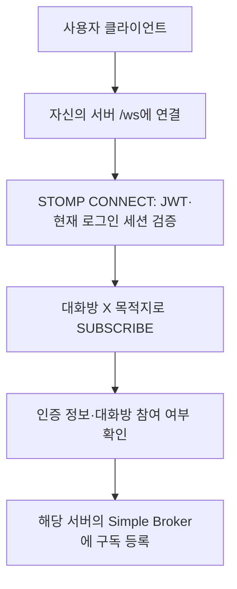
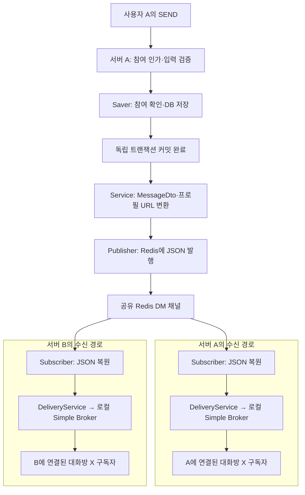

# DM 전체 흐름

이 문서는 팀원이 DM 연결부터 저장·분산 전달·읽음 처리까지 먼저 살펴보는 안내입니다. 아래 예시는 사용자 A와 B가 같은 대화방 X에 참여하고, 각각 서버 A와 B에 연결된 상황입니다. 대화방은 기존 [REST 생성·조회 API](01-api-security.md)로 준비합니다.

**같은 Redis DM 채널을 구독하는 각 서버가 메시지를 받고, 자기 서버에 연결된 해당 대화방 구독자에게 전달합니다.** 발행 서버도 같은 수신 경로를 거칩니다.

## 1. 연결하고 대화방을 구독한다

각 사용자는 자신이 접속한 서버에서 아래 과정을 거칩니다. 구독 정보는 해당 서버의 Simple Broker가 관리합니다.

구독 목적지는 `/sub/conversations/{conversationId}/direct-messages`입니다. 같은 사용자가 여러 탭에서 구독하면 각각의 연결이 전달 대상이 될 수 있습니다. 다른 대화방을 구독한 사용자에게는 대화방 X의 메시지를 보내지 않습니다.

## 2. 저장한 메시지를 모든 구독 서버에 전달한다

사용자 A가 `/pub/conversations/{conversationId}/direct-messages`로 내용을 전송하면 다음 흐름으로 처리합니다.

두 서버의 Redis 자동 구독이 활성화되어 있고 같은 채널을 사용한다는 전제입니다. 서버 시작 시 `DirectMessageSubscription`이 Redis 리스너를 등록합니다. 이 구독은 사용자가 대화방을 열 때마다 만드는 것이 아닙니다.

서버 A도 Redis를 거쳐 자신의 구독자에게 전달합니다. 따라서 발신자도 대화방을 구독 중이면 자신이 보낸 메시지를 받습니다. 발행 직후 A에 별도로 전달하는 경로는 두지 않습니다.

서버 C도 같은 Redis 채널을 구독한다면 메시지를 받습니다. 다만 C에 대화방 X 구독자가 없으면 실제 전달할 클라이언트가 없습니다. Redis 수신 측에서는 DB를 다시 저장하거나 Redis에 재발행하지 않습니다.

## 두 종류의 구독을 구분한다

| 구분 | Redis 구독 | STOMP 구독 |
| --- | --- | --- |
| 구독 주체 | 애플리케이션 서버의 리스너 | 사용자의 WebSocket 연결 |
| 구독 대상 | 공통 DM 채널, 기본 `everyone:dm:events` | 특정 대화방의 `/sub/conversations/{conversationId}/direct-messages` |
| 관리 위치 | Redis와 서버의 리스너 컨테이너 | 해당 서버의 Simple Broker |
| 전달 범위 | 같은 채널을 구독하는 각 서버 | 해당 서버에서 그 대화방을 구독한 연결 |

현재 구조는 수신자 ID로 상대 서버를 찾지 않습니다. 각 서버의 `DeliveryService`가 메시지의 `conversationId`로 로컬 목적지를 만들고, Simple Broker가 일치하는 구독 연결에 전달합니다. 서버 간 Redis 수신과 사용자에게 보내는 WebSocket 전송은 별개의 단계입니다.

## 3. 읽음과 누락된 메시지는 REST로 처리한다

- **읽음:** 메시지 전달 자체는 읽음 상태를 바꾸지 않습니다. 제공된 프론트가 수신 후 REST 읽음 API를 호출하면, 서버가 참여자·기준 메시지를 확인하고 수신한 미읽음 메시지를 누적 갱신합니다.
- **재조회:** 연결이 끊겼거나 구독자가 없어 실시간으로 받지 못한 메시지는 REST 메시지 목록에서 확인합니다. Redis Pub/Sub은 이전 메시지를 보관·재생하지 않습니다.
- **실패:** DB 커밋에 실패하면 발행하지 않습니다. 커밋 이후 변환·발행에 실패하면 이미 저장된 메시지는 유지됩니다. 오류 응답·연결 종료와 후속 조회는 아래 상세 문서에서 구분합니다.

## 상세 설명으로 이동

[컴포넌트·트랜잭션·실패 결과](11-websocket-flow.md) · [인가·오류·연결 종료](12-websocket-security-errors.md) · [환경 설정](10-websocket-settings.md) · [테스트](13-websocket-testing.md) · [다중 서버 수동 검증](14-websocket-multi-node.md)

---

[목차](README.md) · [REST API와 보안](01-api-security.md)
