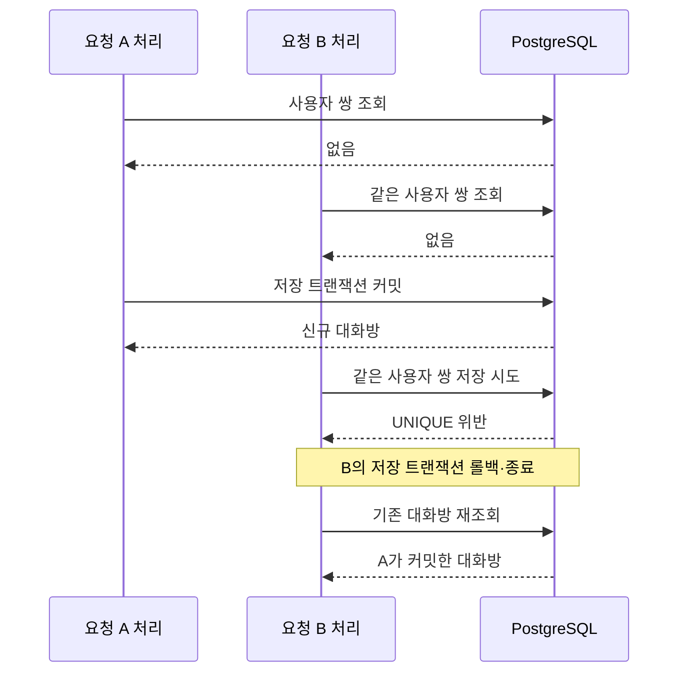

# 2. 생성과 트랜잭션

같은 두 사용자의 요청은 방향이 달라도 하나의 대화방으로 처리합니다.
서비스의 사전 조회와 DB UNIQUE를 함께 사용하고, 중복 저장 충돌은 기존 대화방 재조회로 복구합니다.

## 사용자 쌍을 저장하는 규칙

| 항목 | 현재 규칙 |
| --- | --- |
| 테이블 | `conversations` |
| 사용자 연관관계 | `userA`, `userB`를 필수 LAZY 연관관계로 참조 |
| 정렬 | 두 UUID의 `toString()` 값을 사전순으로 비교 |
| UNIQUE | `(user_a_id, user_b_id)` |
| 제약조건 이름 | `uq_conversations_user_pair` |
| 자기 대화 | 서비스에서 조회·저장 전에 거절 |

저장할 때 `ConversationCommand`, 조회할 때 `ConversationReader`가 같은 문자열 정렬 규칙을 적용합니다.
`userA`와 `userB`는 저장 순서이며, 요청자와 상대방을 고정해서 의미하지 않습니다.
UNIQUE만 적용하면 `(A, B)`와 `(B, A)`는 다른 값이므로 애플리케이션의 정렬이 함께 필요합니다.

엔티티 선언과 [사용자 쌍 UNIQUE 마이그레이션](../../src/main/resources/db/migration/V202611102245__add_conversations_user_pair_unique.sql)의 이름·컬럼을 맞췄습니다.
이 마이그레이션은 기존 대화방 데이터가 없는 초기 구현을 전제로 하며, 기존 데이터 정규화나 중복 정리 작업은 포함하지 않습니다.

## 일반 생성 흐름

1. 서비스가 요청자와 상대방 ID를 비교하여 자기 대화를 거절합니다.
2. Reader가 사용자 쌍으로 대화방을 조회합니다. 있으면 조회 결과를 응답으로 변환합니다.
3. 없으면 Saver가 사용자 두 명을 조회하고, 정렬된 사용자 쌍으로 엔티티를 저장합니다.
4. Saver의 저장 트랜잭션이 커밋되어 호출이 정상 반환됩니다.
5. 서비스가 Mapper로 상대방 정보와 신규 메시지 초기 상태를 구성합니다.

상대방 미존재는 `ConversationTargetNotFoundException`으로 변환합니다.
요청자 조회 오류와 그 밖의 사용자 조회 오류는 Saver에서 원래 예외를 전달합니다.

## 트랜잭션을 분리한 이유

| 컴포넌트 | 트랜잭션 역할 |
| --- | --- |
| Service | 직접 트랜잭션을 선언하지 않고 조회·저장·변환 순서 조정 |
| Reader | `readOnly = true`, 기본 전파 방식 `REQUIRED` |
| Saver | `REQUIRES_NEW`로 사용자 조회와 대화방 저장을 독립적으로 커밋 |
| Mapper | 트랜잭션을 선언하지 않고 응답과 프로필 이미지 URL 생성 |

Saver를 별도 빈으로 호출하므로 Spring 프록시를 통해 저장 트랜잭션 경계가 적용됩니다.
`repository.save()` 직후가 아니라 **Saver 프록시 호출이 정상 반환되는 시점에 커밋까지 완료**됩니다.
명시적인 flush를 강제하지 않으며, 커밋 과정에서 발생한 UNIQUE 오류도 서비스로 전달됩니다.

상위 트랜잭션이 없는 일반 HTTP 호출에서는 Reader의 조회 트랜잭션이 끝난 뒤 변환하고,
신규 저장도 Saver의 커밋 이후에 응답을 변환합니다.
상위 트랜잭션에서 호출하면 Reader는 해당 트랜잭션에 참여하고, Saver는 이를 잠시 중단한 뒤 독립적으로 저장합니다.
Saver 호출 종료 후에는 상위 트랜잭션이 재개되므로 응답 변환이 언제나 트랜잭션 밖이라고 볼 수는 없습니다.
상위 트랜잭션을 나중에 롤백해도 이미 커밋한 대화방은 유지됩니다.

## 동시에 같은 대화방을 만들면

사전 조회 결과가 비어 있다는 사실만으로 저장 성공을 보장할 수는 없습니다.
아래 그림은 두 요청 모두 사전 조회에서 대화방을 찾지 못한 경우입니다.

서비스는 `DataIntegrityViolationException`의 원인 체인을 순회하여 Hibernate 예외를 확인합니다.
**SQLState `23505`와 제약조건 이름 `uq_conversations_user_pair`가 모두 일치할 때만** 재조회합니다.

| 저장 오류 또는 재조회 결과 | 처리 |
| --- | --- |
| 사용자 쌍 UNIQUE 충돌 후 기존 대화방 발견 | 기존 ID와 조회 상태를 변환하여 200 반환 |
| 같은 충돌이지만 재조회 결과 없음 | `ConversationCreationFailedException` |
| 다른 UNIQUE·FK·NOT NULL 등의 무결성 오류 | 재조회하지 않고 `ConversationCreationFailedException` |

재조회는 실패한 Saver 트랜잭션이 종료된 뒤 수행합니다.
일반 HTTP 호출에서는 새 읽기 트랜잭션을 사용하지만, 상위 트랜잭션이 있으면 Reader는 그 트랜잭션에 참여합니다.
외부 트랜잭션의 모든 격리 수준에서 같은 조회 가시성을 보장하는 것으로 해석하지 않습니다.

## 저장 이후 응답 생성이 실패하면

프로필 이미지 URL은 저장 커밋 이후 사용자 요약을 만드는 과정에서 생성합니다.
이 과정이 실패하면 오류 응답을 반환하며, 이미 커밋된 대화방은 삭제하거나 롤백하지 않습니다.
같은 사용자 쌍으로 다시 요청하면 기존 대화방을 조회하는 경로로 진행합니다.
URL 생성 문제가 계속되면 기존 대화방의 응답 변환도 다시 실패할 수 있습니다.

이 정책은 [서비스 통합 테스트](../../src/test/java/com/codeit/sb13/playlist_for_everyone/domain/conversation/service/ConversationServiceIntegrationTest.java)에서 저장 커밋, 외부 롤백, URL 생성 실패, 실제 UNIQUE 충돌을 나누어 검증합니다.

## 관련 코드

[서비스와 충돌 분류](../../src/main/java/com/codeit/sb13/playlist_for_everyone/domain/conversation/service/impl/ConversationServiceImpl.java) ·
[저장 트랜잭션](../../src/main/java/com/codeit/sb13/playlist_for_everyone/domain/conversation/service/impl/ConversationSaver.java) ·
[조회 트랜잭션](../../src/main/java/com/codeit/sb13/playlist_for_everyone/domain/conversation/service/impl/ConversationReader.java) ·
[저장용 사용자 쌍](../../src/main/java/com/codeit/sb13/playlist_for_everyone/domain/conversation/dto/command/ConversationCommand.java)

---

[← API와 보안](01-api-security.md) · [목차](README.md) · [다음: 조회와 응답 변환 →](03-query-mapping.md)
