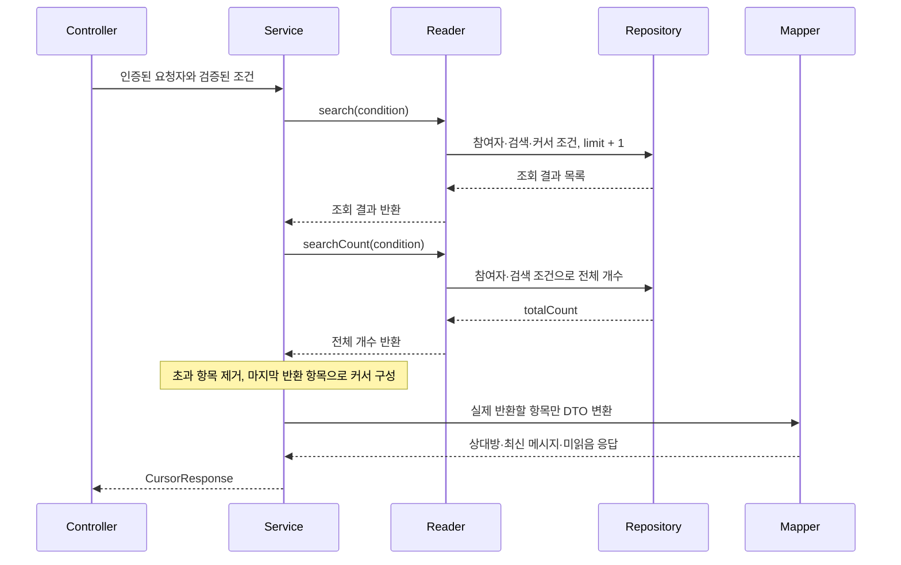

# 검색과 커서 페이지 처리

`GET /api/conversations`는 본인이 참여한 대화방을 검색하고 생성 시각·ID 순서로 조회합니다.
최신 메시지·미읽음 계산과 프로필 조회는 [공통 조회와 응답 변환](03-query-mapping.md)을 사용합니다.

## 목록 요청 계약

| 파라미터 | 필수 여부 | 값과 의미 |
| --- | --- | --- |
| `keywordLike` | 선택 | 상대방 이름 또는 전체 메시지 본문에서 찾을 검색어 |
| `limit` | 필수 | 1 이상의 정수. 서버 기본값 없음 |
| `sortBy` | 필수 | `createdAt`만 허용. 대화방 생성 시각 |
| `sortDirection` | 필수 | `ASCENDING` 또는 `DESCENDING` |
| `cursor` | 다음 페이지에서 필수 | 이전 응답의 `nextCursor`, 시간대 없는 ISO LocalDateTime |
| `idAfter` | 다음 페이지에서 필수 | 이전 응답의 `nextIdAfter`, 대화방 UUID |

첫 페이지는 cursor·idAfter를 모두 생략합니다. 다음 페이지는 두 값을 함께 전달합니다.
빈 cursor 문자열은 생략으로 보지 않으며, 한 값만 전달하거나 형식이 잘못되면 400입니다.
컨트롤러가 요청 DTO를 검증한 뒤 인증된 사용자 ID를 추가하여 `ConversationSearchCondition`을 만듭니다.
내부 조건 객체는 양수·커서 형식·조합을 다시 검증하지 않으므로 HTTP 외 호출자도 같은 계약을 지켜야 합니다.

첫 페이지 요청 예시:

```http
GET /api/conversations?limit=20&sortBy=createdAt&sortDirection=DESCENDING
Authorization: Bearer <Access Token>
```

이후 요청에서도 검색어·정렬 조건을 유지하고, 응답의 커서 두 값을 그대로 사용합니다.
아래 시각과 UUID는 이전 응답에서 받았다고 가정한 예시입니다.

```http
GET /api/conversations?limit=20&sortBy=createdAt&sortDirection=DESCENDING&cursor=2026-11-13T10:30:00.123456&idAfter=00000000-0000-0000-0000-000000000010
Authorization: Bearer <Access Token>
```

## 검색 대상과 중복 방지

참여자 조건은 항상 적용합니다. 검색어가 있든 없든 본인이 속하지 않은 대화방은 목록·전체 개수에서 제외합니다.

| 조건 | 처리 |
| --- | --- |
| 검색어 생략·공백만 입력 | 검색 조건 생략 |
| 검색어 앞뒤 공백 | 제거 후 검색 |
| 이름·본문 | 대소문자를 구분하지 않는 부분 검색 |
| `%`, `_` 입력 | 와일드카드가 아닌 문자 그대로 검색 |
| 이름 검색 | 본인 이름을 제외하고 상대방 이름 검색 |
| 메시지 검색 | 과거 메시지를 포함한 전체 본문 검색 |

메시지 검색은 별도 `EXISTS` 서브쿼리로 구현합니다.
일치하는 메시지가 여러 개여도 대화방 행이 늘어나지 않아 페이지와 집계가 중복되지 않습니다.
응답의 `lastestMessage`는 검색된 메시지가 아니라 **그 대화방의 실제 최신 메시지**입니다.

## 정렬과 커서 비교

목록은 대화방의 `createdAt`을 먼저 정렬하고, 같으면 ID를 같은 방향으로 정렬합니다.
내부 enum `CREATED_AT`은 요청·응답에서 `createdAt`으로 표현합니다.
메시지의 최신성 기준이나 최근 대화 활동 시각으로 목록을 정렬하는 기능은 아닙니다.

| 방향 | 커서 다음에 포함되는 대화방 |
| --- | --- |
| ASCENDING | 생성 시각이 더 크거나, 같은 시각에서 ID가 더 큰 항목 |
| DESCENDING | 생성 시각이 더 작거나, 같은 시각에서 ID가 더 작은 항목 |

커서에 해당하는 DB 행을 다시 읽지 않고 전달받은 시각·ID로 비교합니다.
따라서 기준 대화방이 삭제되어도 다음 항목을 조회할 수 있습니다.

## 목록 응답을 만드는 흐름



Repository는 다음 페이지를 확인할 수 있도록 최대 `limit + 1`건을 가져옵니다.
Service는 초과 한 건을 제외하고, **마지막으로 반환하는 항목**으로 다음 커서를 만듭니다.
초과 항목으로 커서를 만들면 그 항목이 다음 페이지에서 누락될 수 있습니다.

| 응답 필드 | 의미 |
| --- | --- |
| `data` | 최대 limit개의 대화방 응답. 결과가 없으면 빈 배열 |
| `hasNext` | 조회 결과가 limit보다 많으면 true |
| `nextCursor`, `nextIdAfter` | 다음 페이지가 있을 때 마지막 반환 항목의 생성 시각·ID. 마지막 페이지는 둘 다 null |
| `totalCount` | 커서·limit을 제외한 본인 참여·검색 조건의 전체 개수 |
| `sortBy`, `sortDirection` | 요청에 적용한 정렬값 |

## 조회 트랜잭션의 경계

페이지 조회와 전체 개수 조회는 별도 Reader 호출입니다.
상위 트랜잭션이 없는 일반 HTTP 호출에서는 각각의 읽기 트랜잭션이 종료된 뒤 응답을 변환합니다.
두 조회 사이에 데이터가 바뀔 수 있으므로 목록과 전체 개수가 같은 시점의 결과임을 보장하지 않습니다.

Reader는 상위 트랜잭션이 있으면 참여합니다. 서비스에 트랜잭션 선언이 없다는 이유만으로
모든 호출에서 프로필 URL 생성이 트랜잭션 밖이라고 해석하지 않습니다.

## 관련 코드

[입력 검증](../../src/main/java/com/codeit/sb13/playlist_for_everyone/domain/conversation/dto/request/ConversationSearchRequest.java) ·
[검색·커서 쿼리](../../src/main/java/com/codeit/sb13/playlist_for_everyone/domain/conversation/repository/impl/ConversationCustomRepositoryImpl.java) ·
[페이지 응답 조립](../../src/main/java/com/codeit/sb13/playlist_for_everyone/domain/conversation/service/impl/ConversationServiceImpl.java) ·
[CursorResponse](../../src/main/java/com/codeit/sb13/playlist_for_everyone/global/dto/response/CursorResponse.java)

---

[← 조회와 응답 변환](03-query-mapping.md) · [목차](README.md) · [다음: 테스트 읽기와 실행 →](04-testing.md)
