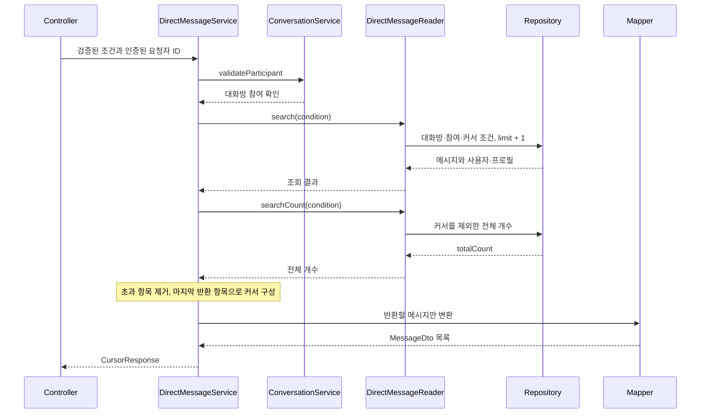

# DM 메시지 조회

`GET /api/conversations/{conversationId}/direct-messages`는 참여한 대화방의 메시지를 커서 기반으로 조회합니다.
조회로 메시지의 읽음 상태를 변경하지 않습니다. JWT·오류 응답의 공통 계약은 [API와 보안](01-api-security.md)을 참고합니다.

## 메시지 도메인의 기본 규칙

`DirectMessageCommand`가 생성 입력을 검증하고, `DirectMessage`는 그 값을 받아 미읽음 상태로 생성됩니다.
이 생성 규칙이 메시지 송신 API나 WebSocket 송수신 구현까지 의미하지는 않습니다.

| 항목 | 규칙 |
| --- | --- |
| 대화방·발신자·수신자 | 필수이며 발신자와 수신자 모두 해당 대화방의 참여자 |
| 사용자 비교 | 객체 참조가 아닌 사용자 ID로 비교. 발신자와 수신자는 서로 달라야 함 |
| 본문 | null·빈 문자열·공백만 있는 값 거절. 유효한 본문은 앞뒤 공백까지 그대로 보존 |
| 읽음 상태 | 수신자의 상태를 의미하며 신규 메시지는 `read = false` |
| 생성 규칙 위반 | `IllegalArgumentException`. 요청자의 로그인 검증과는 별개 |

## 조회 요청

경로의 `conversationId`는 필수 UUID입니다. 요청자 ID는 `SecurityUser`에서 추출하며 별도 파라미터로 받지 않습니다.

| 쿼리 파라미터 | 필수 여부 | 값과 의미 |
| --- | --- | --- |
| `limit` | 필수 | 1 이상의 정수. 서버 기본값·별도 최대값 없음 |
| `sortBy` | 필수 | `createdAt`만 허용. **메시지** 생성 시각 |
| `sortDirection` | 필수 | `ASCENDING` 또는 `DESCENDING` |
| `cursor` | 다음 페이지에서 전달 | 이전 응답의 `nextCursor`, 시간대 없는 ISO LocalDateTime |
| `idAfter` | 다음 페이지에서 전달 | 이전 응답의 `nextIdAfter`, **메시지** UUID |

첫 페이지에서는 커서 두 값을 모두 생략합니다. 이후에는 두 값을 함께 전달합니다.
빈 cursor, 잘못된 날짜·UUID·정렬값, 양수가 아닌 limit, 필수 값 누락 또는 커서 한쪽만 전달하면 400입니다.
이 API에는 대화방 목록의 `keywordLike` 검색 조건이 없습니다.

```http
GET /api/conversations/550e8400-e29b-41d4-a716-446655440000/direct-messages?limit=20&sortBy=createdAt&sortDirection=DESCENDING
Authorization: Bearer <Access Token>
```

다음 요청은 아래 시각·ID를 이전 응답에서 받았다고 가정한 예시입니다. 같은 대화방·정렬 조건을 유지합니다.

```http
GET /api/conversations/550e8400-e29b-41d4-a716-446655440000/direct-messages?limit=20&sortBy=createdAt&sortDirection=DESCENDING&cursor=2026-11-15T10:00:00.123456&idAfter=770e8400-e29b-41d4-a716-446655440000
Authorization: Bearer <Access Token>
```

Request가 Bean Validation을 마친 뒤 대화방·요청자 ID를 합쳐 `DirectMessageSearchCondition`을 만듭니다.
Condition 생성자는 필수 값의 null만 확인하므로 HTTP 외 호출자도 양수 limit·커서 형식·조합 검증을 먼저 해야 합니다.

## 조회에서 응답까지



대화방이 없거나 요청자가 참여하지 않으면 목록 쿼리 전에 `ConversationNotFoundException`으로 거절합니다.
Repository도 요청자가 실제 발신자 또는 수신자인 메시지만 조회합니다.
발신자·수신자와 각 프로필을 fetch join하여 변환 시 추가 조회를 방지하고, left join으로 프로필이 없는 메시지도 유지합니다.

## 커서와 전체 개수

생성 시각을 우선 정렬하고, 같은 시각에서는 ID를 **같은 방향**으로 정렬합니다.

| 방향 | 커서 다음에 포함되는 메시지 |
| --- | --- |
| ASCENDING | 생성 시각이 더 크거나, 같은 시각에서 ID가 더 큰 메시지 |
| DESCENDING | 생성 시각이 더 작거나, 같은 시각에서 ID가 더 작은 메시지 |

커서 기준 메시지를 다시 조회하지 않습니다. 그 메시지가 삭제되어도 전달된 시각·ID로 다음 범위를 계산합니다.
이는 기준 메시지의 존재를 확인하는 [읽음 처리](08-direct-message-read.md)와 다릅니다.

| 응답 필드 | 의미 |
| --- | --- |
| `data` | 최대 limit개의 `MessageDto`. 조회 결과가 없으면 빈 배열 |
| `hasNext` | Repository 결과가 limit보다 많으면 true |
| `nextCursor`, `nextIdAfter` | 다음 페이지가 있으면 마지막 **반환** 메시지의 시각·ID. 마지막 페이지는 둘 다 null |
| `totalCount` | 커서·limit을 제외한 같은 대화방·메시지 참여 조건의 전체 개수 |
| `sortBy`, `sortDirection` | 요청에 적용한 정렬값 |

초과 한 건을 커서로 사용하면 그 메시지가 다음 페이지에서 누락될 수 있으므로 서비스에서 먼저 제외합니다.
커서 이후 결과가 없어도 `totalCount`는 0이 아닐 수 있습니다. 전체 개수와 현재 페이지 개수는 다른 값입니다.

## 응답 변환과 트랜잭션

`DirectMessageMapper`는 실제 발신자·수신자 방향을 유지하고 `UserSummaryMapper`로 프로필 URL을 만듭니다.
이미지가 없으면 URL은 null이고, 이미지가 있을 때 URL 생성에 실패하면 예외를 그대로 전달합니다.
메시지 필드는 `id`, `conversationId`, `createdAt`, `sender`, `receiver`, `content`이며 읽음 상태는 응답에 포함하지 않습니다.

서비스는 직접 트랜잭션을 시작하지 않습니다. Reader는 `readOnly = true`, 기본 전파 `REQUIRED`를 사용합니다.
상위 트랜잭션이 없는 HTTP 호출에서는 목록·개수의 각 읽기 트랜잭션이 끝난 뒤 DTO와 URL을 만듭니다.
상위 트랜잭션이 있으면 Reader가 참여하므로 이 경계를 모든 호출에 일반화하지 않습니다.
목록과 전체 개수는 별도 조회여서 동시에 데이터가 바뀌면 서로 다른 시점의 결과일 수 있습니다.

## 관련 코드

[생성 규칙](../../src/main/java/com/codeit/sb13/playlist_for_everyone/domain/conversation/dto/command/DirectMessageCommand.java) ·
[입력 검증](../../src/main/java/com/codeit/sb13/playlist_for_everyone/domain/conversation/dto/request/DirectMessageSearchRequest.java) ·
[조회 서비스](../../src/main/java/com/codeit/sb13/playlist_for_everyone/domain/conversation/service/impl/DirectMessageServiceImpl.java) ·
[조회 쿼리](../../src/main/java/com/codeit/sb13/playlist_for_everyone/domain/conversation/repository/impl/DirectMessageCustomRepositoryImpl.java) ·
[메시지 Mapper](../../src/main/java/com/codeit/sb13/playlist_for_everyone/domain/conversation/mapper/DirectMessageMapper.java)

---

[← 대화방 조회 테스트](06-query-testing.md) · [목차](README.md) · [다음: DM 읽음 처리 →](08-direct-message-read.md)
