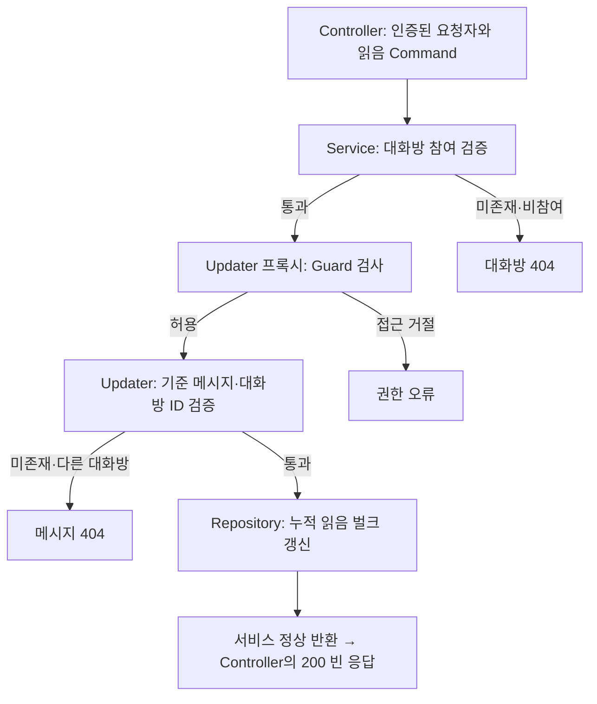

# DM 누적 읽음 처리

읽음 처리는 지정한 메시지 하나만 바꾸는 기능이 아니라, **기준 메시지까지 요청자가 받은 미읽음 메시지**를 갱신하는 기능입니다.
메시지 조회 GET과 분리되어 있으며, 성공하면 HTTP 200 빈 본문을 반환합니다.

## 요청과 성공 응답

`conversationId`와 `directMessageId`는 필수 경로 UUID이고 요청 본문은 없습니다.
요청자 ID는 인증 정보에서 추출합니다. JWT와 정상 CSRF 쿠키·헤더가 필요하며, 발급 방법은 [공통 보안 계약](01-api-security.md#jwt와-csrf)을 참고합니다.

```http
POST /api/conversations/550e8400-e29b-41d4-a716-446655440000/direct-messages/770e8400-e29b-41d4-a716-446655440000/read
Authorization: Bearer <Access Token>
Cookie: XSRF-TOKEN=<CSRF 토큰>
X-XSRF-TOKEN: <같은 CSRF 토큰>
```

성공 응답은 다음 상태와 빈 본문입니다. JSON 객체나 갱신 건수를 반환하지 않습니다.

```http
HTTP/1.1 200 OK
```

## 검증과 갱신 흐름



1. `ConversationService.validateParticipant()`가 대화방과 참여 여부를 확인합니다. 미존재·비참여 모두 `ConversationNotFoundException`입니다.
2. `DirectMessageGuard`는 요청한 대화방의 기준 메시지에서 요청자가 발신자 또는 수신자인지 확인합니다.
3. `DirectMessageUpdater`는 메시지 ID와 대화방 ID를 함께 검사합니다. 없거나 다른 대화방 소속이면 `DirectMessageNotFoundException`입니다.
4. 검증 후 요청자가 받은 미읽음 메시지 중 기준 이하의 범위만 갱신합니다.

Guard가 미존재·다른 대화방 메시지에서 반환하는 `true`는 검증 완료가 아닙니다.
보안 단계의 접근 거절 대신 **Updater의 404 검증으로 진행시키기 위한 값**입니다.
이 결과만으로 대화방 접근이나 메시지 존재 여부를 판단하면 안 됩니다.

## 어떤 메시지를 읽음 처리하는가

같은 대화방에서 `receiverId = requesterId`, `read = false`인 메시지에 아래 기준을 적용합니다.

- 생성 시각이 기준 메시지보다 이르면 포함합니다.
- 생성 시각이 같으면 DB의 ID 비교에서 기준 ID 이하인 메시지를 포함합니다.
- 기준 메시지는 요청자가 받은 메시지뿐 아니라 **요청자가 보낸 메시지**도 사용할 수 있습니다.

요청자 A가 10:03에 보낸 M4를 기준으로 요청하는 예시입니다. M1~M5는 설명용 이름이며 실제 ID는 UUID입니다.

| 메시지 | 시각 | 발신 → 수신 | 요청 전 | 요청 후 |
| --- | --- | --- | --- | --- |
| M1 | 10:00 | B → A | 미읽음 | 읽음으로 변경 |
| M2 | 10:01 | A → B | 미읽음 | 유지: 수신자가 B |
| M3 | 10:02 | B → A | 미읽음 | 읽음으로 변경 |
| M4: 기준 | 10:03 | A → B | 미읽음 | 유지: 기준으로만 사용 |
| M5 | 10:04 | B → A | 미읽음 | 유지: 기준 이후 |

이미 읽은 메시지와 다른 대화방 메시지도 갱신하지 않습니다.
기준 메시지가 유효하지만 갱신 대상이 없거나 동일·이전 기준으로 다시 요청하면 정상 종료합니다.

## 트랜잭션과 수정 시각

| 위치 | 역할 |
| --- | --- |
| Service | 직접 트랜잭션을 시작하지 않고 참여 검증과 Updater 호출을 조정 |
| ConversationReader | 읽기 전용 REQUIRED 트랜잭션으로 대화방 참여 검증 |
| DirectMessageUpdater | 쓰기 REQUIRED 트랜잭션에서 기준 메시지 검증과 벌크 갱신 |
| Repository | `read = true`, `updatedAt = 전달받은 시각`으로 대상 행을 일괄 변경 |

상위 트랜잭션이 있으면 Reader·Updater는 그 트랜잭션에 참여합니다. 일반 HTTP 호출의 참여 검증과 읽음 갱신은 하나의 트랜잭션으로 묶이지 않습니다.
벌크 갱신은 엔티티 감사 콜백에 의존하지 않으므로 Updater가 수정 시각을 직접 전달합니다.
`read = false` 조건은 이미 읽은 행을 제외하여 반복·이전 기준 요청에서 기존 수정 시각을 유지합니다.

`@Modifying(flushAutomatically = true, clearAutomatically = true)`는 다음 순서로 동작합니다.

1. 영속성 컨텍스트의 미반영 변경을 flush합니다.
2. 벌크 갱신을 실행합니다.
3. 영속성 컨텍스트 전체를 clear하여 오래된 조회 상태를 제거합니다.

이미 변수로 보관한 엔티티 객체의 필드가 자동으로 바뀌지는 않습니다. 최신 값이 필요하면 다시 조회해야 합니다.
[수정 시각 마이그레이션](../../src/main/resources/db/migration/V202611131640__add_direct_messages_updated_at.sql)은 nullable `updated_at`을 추가합니다.
기존 메시지의 수정 시각을 일괄 채우지 않으며, 신규 JPA 저장의 감사 처리와 읽음 벌크 갱신이 각 경로에서 값을 기록합니다.

## 대화방 미읽음 표시와의 연결

대화방 응답의 `hasUnread`는 메시지 상태에서 계산하며 대화방에 별도 값을 저장하지 않습니다.
수신한 미읽음 메시지가 남아 있으면 true, 모두 읽으면 다음 대화방 조회에서 false가 됩니다.
일부 읽음·전체 읽음·반복·동시 요청과 같은 트랜잭션 내 재조회는 [DM 테스트 가이드](09-direct-message-testing.md)에서 확인합니다.

## 관련 코드

[HTTP 진입점](../../src/main/java/com/codeit/sb13/playlist_for_everyone/domain/conversation/controller/DirectMessageController.java) ·
[참여 검증](../../src/main/java/com/codeit/sb13/playlist_for_everyone/domain/conversation/service/impl/ConversationReader.java) ·
[메시지 Guard](../../src/main/java/com/codeit/sb13/playlist_for_everyone/domain/conversation/security/DirectMessageGuard.java) ·
[읽음 Updater](../../src/main/java/com/codeit/sb13/playlist_for_everyone/domain/conversation/service/impl/DirectMessageUpdater.java) ·
[벌크 갱신 쿼리](../../src/main/java/com/codeit/sb13/playlist_for_everyone/domain/conversation/repository/DirectMessageRepository.java)

---

[← DM 메시지 조회](07-direct-message-query.md) · [목차](README.md) · [다음: DM 테스트·Swagger 검증 →](09-direct-message-testing.md)
