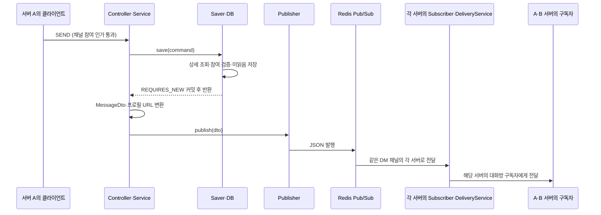

# 11. DM WebSocket 송수신 흐름

이 문서는 #61의 메시지 송신과 서버 간 전달을 설명합니다. REST 조회·읽음은 기존 API를 사용하며, 메시지 생성 이벤트를 통한 알림·SSE 연동은 #62의 범위입니다.

[DM 전체 흐름](00-overall-flow.md)에서 서버 A·B로 나뉘는 전달 그림을 먼저 확인할 수 있습니다. 이 페이지는 컴포넌트 역할과 트랜잭션·실패 결과를 자세히 설명합니다.

## 연결과 메시지 계약

| 단계 | 경로·입력 |
| --- | --- |
| 연결 | `/ws` 기본 WebSocket 또는 SockJS, STOMP CONNECT의 `Authorization: Bearer <Access Token>` |
| 전송 | `SEND /pub/conversations/{conversationId}/direct-messages`, 본문 `{"content":"안녕하세요"}` |
| 구독 | `SUBSCRIBE /sub/conversations/{conversationId}/direct-messages` |
| 수신 | `MessageDto`: `id`, `conversationId`, `createdAt`, `sender`, `receiver`, `content` |

Controller는 본문을 검증하고 인증 객체에서 요청자 ID를 가져옵니다. 발신자·수신자는 클라이언트 입력으로 결정하지 않습니다.
대화방의 저장 순서인 userA·userB와 송수신 방향도 다릅니다. 참여 검증을 마친 요청자를 발신자로, 다른 참여자를 수신자로 사용합니다.

## 저장에서 다른 서버의 수신까지

송신 서비스는 같은 호출 흐름에서 저장 결과를 변환하고 Publisher를 호출합니다. 현재 발행을 애플리케이션 이벤트 리스너에 위임하는 구조는 아닙니다. Redis 이후 수신은 별도의 리스너 흐름입니다.

## 컴포넌트의 책임

| 컴포넌트 | 책임과 경계 |
| --- | --- |
| `DirectMessageWebSocketController` | 입력 검증, 인증된 요청자로 Command 생성, 내부 예외의 요청 세션 전달 |
| `DirectMessageService` | 저장 → DTO 변환 → 발행 순서 조정 |
| `DirectMessageSaver` | 독립 쓰기 트랜잭션에서 참여 검증과 한 건 저장 |
| `ConversationReader` | 검증용 일반 조회와 참여자·프로필을 함께 로딩하는 상세 조회 구분 |
| `DirectMessagePublisher` | 서버 간 전송 계약. 현재 Redis 구현체 사용 |
| `DirectMessageSubscription` | 서버 단위 브로커 구독의 시작·종료. 브라우저 STOMP 구독과 별개 |
| `RedisDirectMessageSubscriber` | JSON 복원 후 로컬 전달 요청. 재저장·재발행 없음 |
| `DirectMessageDeliveryService` | 자신의 Simple Broker에 전달. 다른 서버 전송·읽음 처리 없음 |

발행 서버 A도 Redis 수신을 거쳐 로컬 전달합니다. Publisher가 A에 별도로 전달하면 같은 메시지를 두 번 보낼 수 있으므로 전송 경로를 하나로 유지합니다.

## 트랜잭션과 조회 범위

Saver는 별도 빈의 `REQUIRES_NEW`를 사용합니다. 서비스가 저장 결과를 받는 시점에는 해당 저장 트랜잭션의 커밋이 완료됩니다. 커밋 중 실패하면 DTO 변환·발행으로 진행하지 않습니다. 명시적 flush로 발행 순서를 보장하는 구조가 아닙니다.

저장용 상세 조회는 두 참여자와 프로필 엔티티를 함께 로딩합니다. URL 생성 자체는 저장 커밋 후 Mapper가 수행합니다. 상위 트랜잭션이 있는 호출에서는 복귀한 상위 트랜잭션의 영향을 구분해야 하지만, 이미 완료된 독립 저장 커밋은 외부 롤백으로 취소되지 않습니다.

채널 인가와 Saver의 참여 검증은 진입 경계가 다릅니다. 채널 인가는 SEND·SUBSCRIBE를 제한하고, Saver는 서비스가 직접 호출되더라도 저장 시점의 참여 규칙을 적용합니다.

## 실패하면 무엇이 남는가

| 실패 지점 | DB 메시지 | 후속 처리 |
| --- | --- | --- |
| 입력·채널 인가·저장 시 참여 검증 | 생성하지 않음 | 요청 경로의 오류 처리 |
| DB 저장·커밋 | 롤백 | DTO 변환·발행하지 않음 |
| 커밋 후 프로필 URL 등 DTO 변환 | 유지 | `DirectMessagePublishException`, 발행하지 않음 |
| JSON 직렬화·Redis 발행 | 유지 | 발행 예외 전달, 자동 재발행하지 않음 |
| Redis 수신 JSON 변환 | 유지 | 변환 오류를 기록하고 해당 메시지를 건너뜀. JSON null도 전달하지 않음 |
| 로컬 전달의 `MessagingException` | 유지 | ID 중심으로 기록, 재전송하지 않음 |

발행 예외의 `details`에는 `directMessageId`, `conversationId`, `persisted=true`가 담깁니다. 이는 **DB 저장 완료**를 뜻하며 실시간 수신 성공 여부는 알리지 않습니다. 같은 본문을 새로 SEND하면 다른 메시지가 생성되므로 기존 ID로 REST 목록을 확인합니다.

Pub/Sub에는 이력 재생이나 클라이언트 수신 확인이 없습니다. 구독자가 없거나 실시간 전달이 누락되어도 저장된 메시지는 [DM 조회 API](07-direct-message-query.md)로 확인할 수 있습니다. 테스트에서 관찰한 중복 없는 전달을 모든 장애 상황의 exactly-once 보장으로 해석하지 않습니다.

메시지 송신·구독·수신 자체는 읽음 상태를 바꾸지 않습니다. 제공된 프론트는 수신 후 [읽음 API](08-direct-message-read.md)를 별도로 호출합니다.

---

[← 환경 설정](10-websocket-settings.md) · [목차](README.md) · [다음: 보안과 오류 →](12-websocket-security-errors.md)
