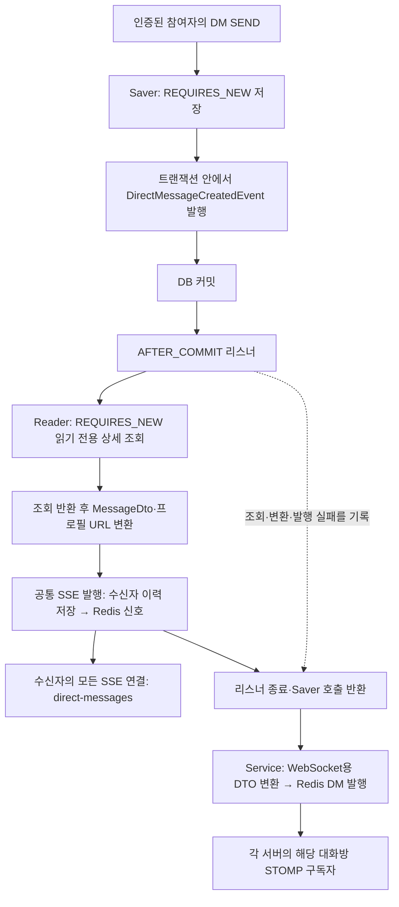

# 15. DM 생성 이벤트와 SSE 연동

#62는 DM 저장에서 생성 이벤트 발행, `direct-messages` SSE 전달·복구와 WebSocket 실패 격리까지 담당합니다. 알림 변환·저장·`notifications` SSE 및 알림을 포함한 통합 검증은 #159의 범위입니다.

## 저장부터 두 전송 경로까지



리스너는 현재 동기식 커밋 후 콜백입니다. SSE 발행 요청을 마친 뒤 기존 송신 서비스가 WebSocket 발행을 진행하지만, Redis·네트워크 이후 **브라우저의 두 채널 도착 순서는 보장하지 않습니다.** 공통 SSE 이력 저장과 브로커 발행은 DB 저장과 하나의 원자적 트랜잭션이 아닙니다.

## 이벤트와 수신 계약

`DirectMessageCreatedEvent(directMessageId, conversationId, senderId, senderName, receiverId)`는 저장한 메시지 ID·대화방 ID, 인증된 발신자와 상대 수신자, 생성 당시 발신자 이름을 담습니다. 메시지 본문·JPA 엔티티·완성된 알림 문구는 넣지 않습니다.

| 구분 | 계약 |
| --- | --- |
| SSE 연결 | 기존 인증된 `GET /api/sse` |
| 이벤트 이름 | `direct-messages` |
| SSE `id` | 저장된 DM의 `directMessageId` |
| SSE `data` | `MessageDto`: `id`, `conversationId`, `createdAt`, `sender`, `receiver`, `content` |
| 수신 대상 | `receiverId` 사용자의 모든 SSE 연결. 발신자·다른 사용자는 제외 |
| WebSocket | 기존 대화방 구독자에게 전달하므로 발신자도 구독 중이면 수신 |
| 읽음 | 수신·복구로 변경하지 않음. 프론트의 별도 REST 읽음 요청과 구분 |

수신자가 대화방 WebSocket을 구독하고 있어도 SSE를 생략하지 않습니다. 제공된 프론트는 WebSocket으로 말풍선을 추가하고 SSE로 대화방 목록의 마지막 메시지와 미읽음 표시를 갱신합니다. 목록만 연 다른 탭도 SSE를 통해 갱신할 수 있습니다.

## 트랜잭션·조회·실패 경계

- Saver의 독립 저장 트랜잭션 안에서 업무 이벤트를 발행합니다. `AFTER_COMMIT, fallbackExecution = false`이므로 커밋 전·롤백·저장 실패·트랜잭션 없는 이벤트에서는 SSE 처리를 실행하지 않습니다.
- Reader는 새 읽기 전용 트랜잭션에서 송수신자·프로필을 함께 조회합니다. Reader 반환 후 Mapper가 프로필 URL과 DTO를 구성하므로 이 조회 트랜잭션 안에서 외부 파일 저장소를 호출하지 않습니다.
- 독립 저장이 커밋된 뒤 상위 트랜잭션이 롤백해도 DM과 이미 수행된 SSE 처리는 유지됩니다.
- 조회·DTO 변환·공통 발행의 `RuntimeException`은 리스너에서 처리합니다. 메시지·대화방·수신자 ID와 예외 종류를 기록하며 본문·예외 메시지는 기록하지 않습니다. 저장된 DM을 취소하거나 새 자동 재시도를 추가하지 않습니다.
- SSE 처리가 실패해도 기존 WebSocket 발행은 진행합니다. WebSocket 변환·발행이 실패하면 기존 오류 응답 계약을 따르며, 앞선 DM 저장·SSE 처리를 취소하거나 다시 실행하지 않습니다.
- Redis WebSocket 수신자는 로컬 전달만 담당합니다. 메시지를 재저장하거나 업무 이벤트를 다시 발행하지 않습니다.

## 이력과 재연결

공통 `SseEventPublisher`가 수신자의 접속 여부와 관계없이 JSON 스냅샷을 이력에 먼저 저장합니다. 재연결은 기존 커서·보관기간·이력 상한 정책을 그대로 사용하며, 원래 이벤트 ID와 DTO를 재전달합니다. 이후 사용자 이름이 바뀌어도 과거 이력의 이름을 현재 값으로 다시 만들지 않습니다.

이미 읽은 DM도 이력 복구 대상이며, 복구가 DM의 읽음 상태·수정 시각을 바꾸지 않습니다. 이력 저장 전에 실패했거나 보관 범위를 벗어난 메시지는 SSE 복구를 보장하지 않으므로 REST 목록으로 확인합니다. 상세 정책은 [공유 이력](../sse/09-shared-history.md)과 [복구·재시도](../sse/10-recovery-and-retry.md)를 참고합니다.

## dev rebase 후 전체 검증 — 2026-11-18

`dev`의 `888021c4`를 반영한 `dfa9bcf5bd2a3ef73bc62ab76ce887317d88161e`에서 다음 명령을 실행했습니다. #62의 12개 커밋은 충돌 없이 rebase했고, `range-diff`로 내용과 순서가 유지됨을 확인했습니다.

```bash
./gradlew clean build --no-daemon --no-build-cache
```

| 항목 | 결과 |
| --- | --- |
| 전체 테스트 | 2,350건 중 2,342건 통과, 실패·오류 0건, 건너뜀 8건 |
| DM 이벤트·SSE 회귀 | 아래 7개 클래스·53건 모두 통과 |
| Origin·WebSocket 회귀 | Origin 설정·실제 연결·인가·오류 처리 설정 4개 클래스·77건 모두 통과 |
| 라인 커버리지 | 5,435줄 중 5,125줄, **94.30%** — 기준 80% 통과 |
| 빌드 | `BUILD SUCCESSFUL in 21m 36s` |

건너뛴 항목은 기존 `@Disabled` 시청 세션 테스트 6건과 환경변수로 활성화하는 외부 API 실호출 테스트 2건입니다. 이번 검증을 위해 테스트를 제외하거나 커버리지 기준을 변경하지 않았습니다. 이 결과는 로컬 전체 빌드의 결과이며, 원격 CI 결과와 구분합니다.

이 전체 실행 이후 PR 준비에서는 문서만 갱신했습니다. 아래 리팩터링·브라우저 검증은 rebase 이전 기록이며, 이번 전체 자동 테스트를 실제 브라우저 재검증으로 해석하지 않습니다.

## 검증 구성과 실행

| 테스트 클래스 | 검증 범위 | 기존 실행 건수 |
| --- | --- | ---: |
| `DirectMessageSaverTest` | 저장 결과로 이벤트 한 번 발행·송수신 방향 | 4 |
| `DirectMessageReaderTest` | 상세 조회·미존재 예외·실패 전달 | 3 |
| `DirectMessageRepositoryTest` | 영속성·상세 조회의 사용자·프로필 로딩 | 15 |
| `DirectMessageSseEventListenerTest` | 조회→변환→발행 순서와 각 단계 실패 처리 | 4 |
| `DirectMessageSseEventIntegrationTest` | 실제 저장·트랜잭션·SSE/WebSocket 양방향 실패 격리 | 11 |
| `DirectMessageSseIntegrationTest` | Redis·실제 HTTP SSE·수신자 다중 연결·재연결·서버 간 전달 | 6 |
| `DirectMessageSendServiceIntegrationTest` | 기존 저장·WebSocket 송신 계약 | 10 |
| **합계** | **7개 클래스** | **53** |

```bash
./gradlew test \
  --tests '*DirectMessageSaverTest' \
  --tests '*DirectMessageReaderTest' \
  --tests '*DirectMessageRepositoryTest' \
  --tests '*DirectMessageSseEventListenerTest' \
  --tests '*DirectMessageSseEventIntegrationTest' \
  --tests '*DirectMessageSseIntegrationTest' \
  --tests '*DirectMessageSendServiceIntegrationTest' \
  --rerun-tasks --no-build-cache
```

2026-11-18의 리팩터링 전 기준 `0f75edd9`에서 위 53건 통과를 확인했습니다. 생성 보고서는 `build/reports/tests/test/index.html`, `build/test-results/test/`에 있으며 다음 실행으로 변경될 수 있습니다.

위 7개 클래스의 자동 테스트는 Testcontainers의 PostgreSQL·Redis를 사용합니다. 서버 간 SSE 검증은 같은 JVM의 독립 Spring 컨텍스트 두 개와 실제 HTTP 수신이며, 별도 컨테이너·브라우저 검증과 구분합니다. 트랜잭션·실패 주입 테스트의 외부 파일 저장소와 발행기는 Mock이며, 실제 SSE 통합 테스트는 프로필 없는 사용자를 사용합니다. 이 필터 실행 자체는 전체 프로젝트 검증이 아니며 전체 실행 결과는 앞 절의 별도 기록을 따릅니다. #159 알림 연동의 통과를 뜻하지 않습니다.

실제 두 앱·브라우저의 말풍선 중복과 다른 탭 목록 갱신은 [수동 검증 절차와 결과](14-websocket-multi-node.md)에서 별도로 기록합니다.

## 리팩터링 후 검증 — 2026-11-18 (rebase 이전)

`52dfb42fce63e4cd9c004b56a52d55dc2b9520d4`에서 리스너의 조회·변환·발행을 별도 문장으로 나누고, 기존 기본값인 `AFTER_COMMIT, fallbackExecution = false`와 트랜잭션·실패 경계를 명시했습니다. 이벤트·SSE·REST·WebSocket의 공개 계약은 변경하지 않았습니다.

변경된 코드로 위 필터 명령을 실행해 **7개 클래스·53건 통과, 실패 0·오류 0·건너뜀 0**을 확인했습니다. 17:46 KST에 보고서가 생성됐고 `BUILD SUCCESSFUL in 3m 23s`로 종료됐습니다. 이 절의 커밋 해시는 rebase 이전 실행 당시의 기준이며, 최신 기준은 위 전체 검증 기록입니다.

한글 `@DisplayName`을 확인했으며, 기존 단계별 커밋과 이번 Refactor 커밋을 다음과 같이 추적합니다.

| 기능 | 기존 Red 커밋 | 기존 Green 커밋 |
| --- | --- | --- |
| 저장 후 생성 이벤트 | `7f31d665` | `7ed49f7c` |
| 상세 조회의 연관 정보 로딩 | `41f8aef9` | `8f4afb03` |
| 단건 조회와 예외 전달 | `f2126a35` | `9fd351f6` |
| SSE 리스너 발행·실패 처리 | `51ef7a0e` | `2453dfac` |

Refactor는 `52dfb42f`로 별도 커밋했습니다. 위 Red·Green은 기존 이력 확인이며 과거 커밋의 테스트를 이번에 다시 실행했다는 뜻은 아닙니다. 리팩터링 이후의 53건 재실행과 실제 두 앱·브라우저의 양방향 다중 탭 검증은 각각 새로 수행했습니다.

## 후속 알림 연동

#159는 같은 업무 이벤트를 받아 공통 알림 생성 요청으로 변환하고 알림 저장·`notifications` SSE를 연결합니다. 실제 DM 저장부터 알림까지의 트랜잭션·실패 격리·중복 방지 검증도 #159에서 담당합니다. 이 SSE 리스너에서 알림을 직접 저장하거나 수신자의 접속 상태로 알림 생성을 제한하지 않습니다.

---

[← 다중 서버 수동 검증](14-websocket-multi-node.md) · [목차](README.md)
