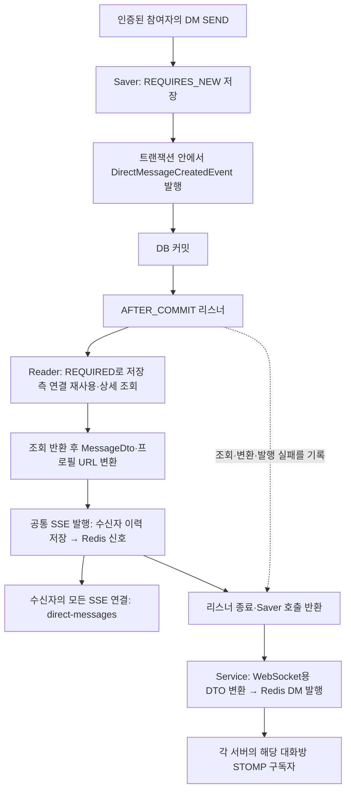

# 15. DM 생성 이벤트와 SSE 연동

#62는 DM 저장에서 생성 이벤트 발행, `direct-messages` SSE 전달·복구와 WebSocket 실패 격리까지 담당합니다. 알림 변환·저장·`notifications` SSE 및 알림을 포함한 통합 검증은 #159의 범위입니다.

## 저장부터 두 전송 경로까지



리스너는 현재 동기식 커밋 후 콜백입니다. SSE 발행 요청을 마친 뒤 기존 송신 서비스가 WebSocket 발행을 진행하지만, Redis·네트워크 이후 **브라우저의 두 채널 도착 순서는 보장하지 않습니다.** 공통 SSE 이력 저장과 브로커 발행은 DB 저장과 하나의 원자적 트랜잭션이 아닙니다.

## 컴포넌트별 책임과 읽기 순서

아래 순서로 코드를 읽으면 저장·커밋·조회·전송의 경계를 확인할 수 있습니다. 공통 SSE 발행기와 기존 WebSocket 송신 흐름을 재사용합니다.

| 컴포넌트 | 주요 메서드 | 책임 |
| --- | --- | --- |
| [`DirectMessageSaver`](../../src/main/java/com/codeit/sb13/playlist_for_everyone/domain/conversation/service/impl/DirectMessageSaver.java) | `save` | 참여 여부를 확인하고 실제 송수신자를 결정해 DM 저장 및 생성 이벤트 발행 |
| [`DirectMessageCreatedEvent`](../../src/main/java/com/codeit/sb13/playlist_for_everyone/domain/conversation/event/DirectMessageCreatedEvent.java) | record | 저장한 메시지·대화방·송수신자 ID와 발신자 이름 스냅샷 전달 |
| [`DirectMessageSseEventListener`](../../src/main/java/com/codeit/sb13/playlist_for_everyone/domain/conversation/event/listener/DirectMessageSseEventListener.java) | `handleDirectMessageCreated` | 커밋 후 조회 → DTO 변환 → 공통 SSE 발행, 단계별 런타임 실패 처리 |
| [`DirectMessageReader`](../../src/main/java/com/codeit/sb13/playlist_for_everyone/domain/conversation/service/impl/DirectMessageReader.java) | `getById` | REQUIRED로 저장 측 자원을 재사용한 조회와 메시지 미존재 예외 처리 |
| [`DirectMessageRepository`](../../src/main/java/com/codeit/sb13/playlist_for_everyone/domain/conversation/repository/DirectMessageRepository.java) | `findDetailedById` | EntityGraph로 송수신자·프로필을 함께 로딩 |
| [`DirectMessageMapper`](../../src/main/java/com/codeit/sb13/playlist_for_everyone/domain/conversation/mapper/DirectMessageMapper.java) | `toMessageDto` | 조회 결과로 사용자 요약·프로필 URL·메시지 응답 구성 |
| [`SseEvent`](../../src/main/java/com/codeit/sb13/playlist_for_everyone/global/sse/event/SseEvent.java) | `createDirectMessageEvent` | 기존 메시지 ID와 DTO를 `direct-messages` 내부 전달 형식으로 감쌈 |
| [`HistorySavingSseEventPublisher`](../../src/main/java/com/codeit/sb13/playlist_for_everyone/global/sse/event/impl/HistorySavingSseEventPublisher.java) | `publish` | JSON 스냅샷을 공유 이력에 저장한 뒤 브로커 발행 |
| [`DirectMessageServiceImpl`](../../src/main/java/com/codeit/sb13/playlist_for_everyone/domain/conversation/service/impl/DirectMessageServiceImpl.java) | `send` | Saver 호출이 반환된 뒤 WebSocket용 DTO 변환·기존 DM 발행기 호출 |

`getById`와 `findDetailedById`는 요청자 ID를 받지 않는 내부 조회입니다. 이 메서드 자체에 대화방 참여 인가가 있는 것은 아니므로 사용자 요청 경로에서 재사용할 때는 호출부가 접근 권한을 확인해야 합니다.

## 이벤트와 수신 계약

`DirectMessageCreatedEvent(directMessageId, conversationId, senderId, senderName, receiverId)`는 저장한 메시지 ID·대화방 ID, 인증된 발신자와 상대 수신자, 생성 당시 발신자 이름을 담습니다. 메시지 본문·JPA 엔티티·완성된 알림 문구는 넣지 않습니다.

이벤트의 `senderName`은 생성 시점에 읽은 값이고, SSE의 `MessageDto`는 커밋 후 상세 조회 결과로 만듭니다. 이 둘을 같은 스냅샷으로 취급하지 않습니다. 재연결에 사용하는 스냅샷은 공통 SSE 계층이 DTO를 JSON으로 변환해 이력에 저장한 값입니다.

| 구분 | 계약 |
| --- | --- |
| SSE 연결 | 기존 인증된 `GET /api/sse` |
| 이벤트 이름 | `direct-messages` |
| SSE `id` | 저장된 DM의 `directMessageId` |
| SSE `data` | `MessageDto`: `id`, `conversationId`, `createdAt`, `sender`, `receiver`, `content` |
| 수신 대상 | `receiverId` 사용자의 모든 SSE 연결. 발신자·다른 사용자는 제외 |
| WebSocket | 기존 대화방 구독자에게 전달하므로 발신자도 구독 중이면 수신 |
| 읽음 | 수신·복구로 변경하지 않음. 프론트의 별도 REST 읽음 요청과 구분 |

수신자가 대화방 WebSocket을 구독하고 있어도 SSE를 생략하지 않습니다. 제공된 프론트는 WebSocket으로 말풍선을 추가하고 SSE로 대화방 목록의 마지막 메시지와 미읽음 표시를 갱신합니다. 목록만 연 다른 탭도 SSE를 통해 갱신할 수 있습니다.

## 트랜잭션·조회·실패 경계

1. Saver가 `REQUIRES_NEW` 저장 트랜잭션을 시작하고 참여 검증·저장·업무 이벤트 발행을 수행합니다. 이때 이벤트가 발행됐다는 사실만으로 DB 커밋을 확정할 수는 없습니다.
2. Saver 본문이 반환된 뒤 트랜잭션 프록시가 커밋합니다. 리스너의 `AFTER_COMMIT, fallbackExecution = false`에 따라 커밋에 성공했을 때만 후속 처리를 시작합니다.
3. 리스너가 Reader를 호출하면 `REQUIRED`로 아직 바인딩된 저장 측 EntityManager·커넥션을 재사용해 메시지·송수신자·프로필을 조회합니다. 조회용 두 번째 커넥션을 기다리지 않으며, 미존재 시 `DirectMessageNotFoundException`이 발생합니다.
4. 상세 조회 후 Mapper가 프로필 URL과 DTO를 만듭니다. **Reader 반환이 저장 커넥션 반환을 뜻하지는 않습니다.** 동기 콜백의 외부 파일 저장소 호출·SSE 발행 동안에도 저장 측 연결이 남을 수 있습니다.
5. 공통 SSE 발행 호출이 끝나거나 리스너가 런타임 실패를 처리하면 Saver 호출이 서비스로 반환됩니다. 이후 서비스가 WebSocket용 DTO를 별도로 만들고 발행합니다.

`getById`의 `readOnly = true`는 새 트랜잭션이 필요할 때 적용됩니다. 커밋 후 기존 자원을 재사용하는 호출에서 독립적인 읽기 전용 트랜잭션을 보장하지 않습니다. 이 경로는 조회만 수행하며, 후속 커밋이 필요한 쓰기를 추가하면 별도의 경계를 설계해야 합니다.

현재 수정은 **저장 연결을 보유한 채 추가 조회 연결을 기다리는 구조**를 제거합니다. 외부 호출 동안의 연결 점유 시간 단축과 Executor·큐·작업 거절 정책은 후속 비동기 전환에서 다룹니다.

| 실패·상황 | DB와 SSE 결과 | 이후 처리 |
| --- | --- | --- |
| 저장 커밋 실패·롤백 | 해당 저장은 확정되지 않고 SSE 리스너도 실행하지 않음 | 저장 예외가 발생하면 서비스의 WebSocket 단계에 도달하지 않음 |
| 트랜잭션 없는 이벤트 발행 | 이미 저장된 DM이 있어도 리스너는 처리하지 않음 | 자동 SSE 발행 없음 |
| 독립 저장 후 상위 트랜잭션 롤백 | 이미 커밋한 DM과 수행된 SSE 처리는 유지 | 상위 롤백으로 되돌리지 않음 |
| 상세 조회·DTO 변환 실패 | DM은 유지되며 SSE 이력 저장에 도달하지 못함 | 리스너가 `RuntimeException`을 기록하고 WebSocket 단계는 진행 |
| SSE 이력 저장 실패 | DM은 유지되며 브로커 발행에는 도달하지 못함 | 동일하게 실패를 기록하고 WebSocket 단계는 진행 |
| 이력 저장 후 SSE 브로커 발행 실패 | DM·저장된 이력은 유지, 실시간 수신은 보장하지 않음 | 보관 정책 내 재연결 복구 가능, 자동 재발행 없음 |
| WebSocket용 변환·발행 실패 | 이미 저장된 DM과 앞선 SSE 처리 결과는 유지 | 기존 발행 오류 계약으로 전달, 저장·SSE를 다시 실행하지 않음 |

리스너 로그에는 메시지·대화방·수신자 ID와 예외 종류만 남깁니다. 직접 감싼 원인이 있으면 그 예외 종류를 사용하며, 메시지 본문·예외 메시지·스택 트레이스는 남기지 않습니다. 처리 대상은 `RuntimeException`이며 모든 `Throwable`을 포괄하지 않습니다.

Redis WebSocket 수신자는 로컬 전달만 담당합니다. 메시지를 재저장하거나 업무 이벤트를 다시 발행하지 않습니다. 실패 응답의 `persisted=true`와 재전송 판단은 [WebSocket 오류 처리](12-websocket-security-errors.md)를 참고합니다.

## 이력과 재연결

공통 `SseEventPublisher`가 수신자의 접속 여부와 관계없이 JSON 스냅샷을 이력에 먼저 저장합니다. 재연결은 기존 커서·보관기간·이력 상한 정책을 그대로 사용하며, 원래 이벤트 ID와 DTO를 재전달합니다. 이후 사용자 이름이 바뀌어도 과거 이력의 이름을 현재 값으로 다시 만들지 않습니다.

이미 읽은 DM도 이력 복구 대상이며, 복구가 DM의 읽음 상태·수정 시각을 바꾸지 않습니다. 이력 저장 전에 실패했거나 보관 범위를 벗어난 메시지는 SSE 복구를 보장하지 않으므로 REST 목록으로 확인합니다. 상세 정책은 [공유 이력](../sse/09-shared-history.md)과 [복구·재시도](../sse/10-recovery-and-retry.md)를 참고합니다.

## 검증 구성과 실행

| 테스트 클래스 | 검증 범위 | 테스트 건수 |
| --- | --- | ---: |
| `DirectMessageSaverTest` | 실제 저장 인자의 송수신 방향·본문, 저장 이후 이벤트 한 번 발행 | 4 |
| `DirectMessageReaderTest` | 상세 조회·미존재 예외·실패 전달 | 3 |
| `DirectMessageRepositoryTest` | 영속성·상세 조회의 사용자·프로필 로딩 | 15 |
| `DirectMessageSseEventListenerTest` | 조회→변환→발행 순서와 각 단계 실패 처리 | 4 |
| `DirectMessageSseEventIntegrationTest` | 실제 저장·트랜잭션·SSE/WebSocket 양방향 실패 격리 | 11 |
| `DirectMessageSseIntegrationTest` | Redis·실제 HTTP SSE·다중 연결·서버 간 전달·전송 실패 후 이력 복구 | 8 |
| `DirectMessageSendServiceIntegrationTest` | 기존 저장·WebSocket 송신 계약 | 10 |
| **합계** | **7개 클래스** | **55** |

```bash
./gradlew test \
  --tests '*DirectMessageSaverTest' \
  --tests '*DirectMessageReaderTest' \
  --tests '*DirectMessageRepositoryTest' \
  --tests '*DirectMessageSseEventListenerTest' \
  --tests '*DirectMessageSseEventIntegrationTest' \
  --tests '*DirectMessageSseIntegrationTest' \
  --tests '*DirectMessageSendServiceIntegrationTest' \
  --rerun-tasks --no-build-cache
```

Docker가 실행 중이어야 PostgreSQL·Redis를 사용하는 통합 테스트가 동작합니다. 위 필터 실행은 #62와 기존 송신 계약의 회귀 범위를 확인하며, 전체 프로젝트 검증은 다음 명령으로 실행합니다.

```bash
./gradlew clean build --no-daemon --no-build-cache
```

테스트 보고서는 `build/reports/tests/test/index.html`·`build/test-results/test/`, 커버리지 보고서는 `build/reports/jacoco/test/`에 생성됩니다. 다음 실행으로 덮어써질 수 있으므로 PR에는 실행한 커밋과 명령, 실제 결과를 함께 남깁니다.

### 자동 테스트의 경계

| 테스트 계층 | 실제 실행하는 부분 | 구분해서 볼 부분 |
| --- | --- | --- |
| Saver·Reader·리스너 단위 테스트 | 메서드 호출 순서·이벤트 값·실패 처리 | 의존성을 Mock으로 대체하므로 실제 DB 커밋·네트워크 전달을 증명하지 않음 |
| Repository 테스트 | PostgreSQL에서 조회·연관 정보 로딩 | SSE 수신 검증과 별개 |
| `DirectMessageSseEventIntegrationTest` | PostgreSQL 저장·커밋, 상세 조회·변환 순서, 롤백 및 실패 격리 | 파일 저장소·SSE/WebSocket 발행기는 Mock, Repository는 실제 쿼리를 실행하는 Spy |
| `DirectMessageSseIntegrationTest` | PostgreSQL·Redis와 인증된 실제 HTTP SSE, STOMP 동시 구독·재연결 | 프로필 없는 사용자 사용, 두 서버는 같은 JVM의 독립 Spring 컨텍스트. 전송 실패 사례만 Redis 전송 Spy에 실패 주입 |

HTTP SSE 테스트는 연결마다 별도 읽기 스레드를 사용합니다. 프레임뿐 아니라 EOF·파싱 실패도 테스트 스레드에 전달하며, 추가 수신 검사는 정해진 관찰 시간 안에서만 중복 여부를 확인합니다. Redis 구독자 수는 전송 준비 조건이고, 성공 여부는 실제 받은 프레임·저장 메시지·이력으로 판단합니다.

일반 시나리오의 연결은 `@AfterEach`에서 서버 A/B의 SSE를 먼저 종료한 뒤 HTTP 클라이언트·수신 스레드를 정리합니다. 재연결 준비에서도 서버 종료를 먼저 수행합니다. 소켓 읽기 제한 시간과 스레드 종료 확인은 유지합니다.

전송 실패 복구 테스트는 공통 이력 저장기를 그대로 실행하고 Redis 전송 단계만 실패시킵니다. 실제 DM을 커서로 사용해 재연결했을 때 실패한 메시지가 원래 ID·DTO로 한 번 복구되는지, 미읽음·읽음 각각의 상태와 수정 시각이 유지되는지 확인합니다. 기존 발행기 진입 실패 테스트와 구분합니다.

브라우저의 말풍선과 다른 탭 목록 갱신은 [수동 검증 절차와 결과](14-websocket-multi-node.md)에서 별도로 확인합니다. 이 자동 테스트 범위에는 #159 알림 저장·전송이 포함되지 않습니다.

## 후속 알림 연동

#159는 같은 업무 이벤트를 받아 공통 알림 생성 요청으로 변환하고 알림 저장·`notifications` SSE를 연결합니다. 실제 DM 저장부터 알림까지의 트랜잭션·실패 격리·중복 방지 검증도 #159에서 담당합니다. 이 SSE 리스너에서 알림을 직접 저장하거나 수신자의 접속 상태로 알림 생성을 제한하지 않습니다.

---

[← 다중 서버 수동 검증](14-websocket-multi-node.md) · [목차](README.md)
