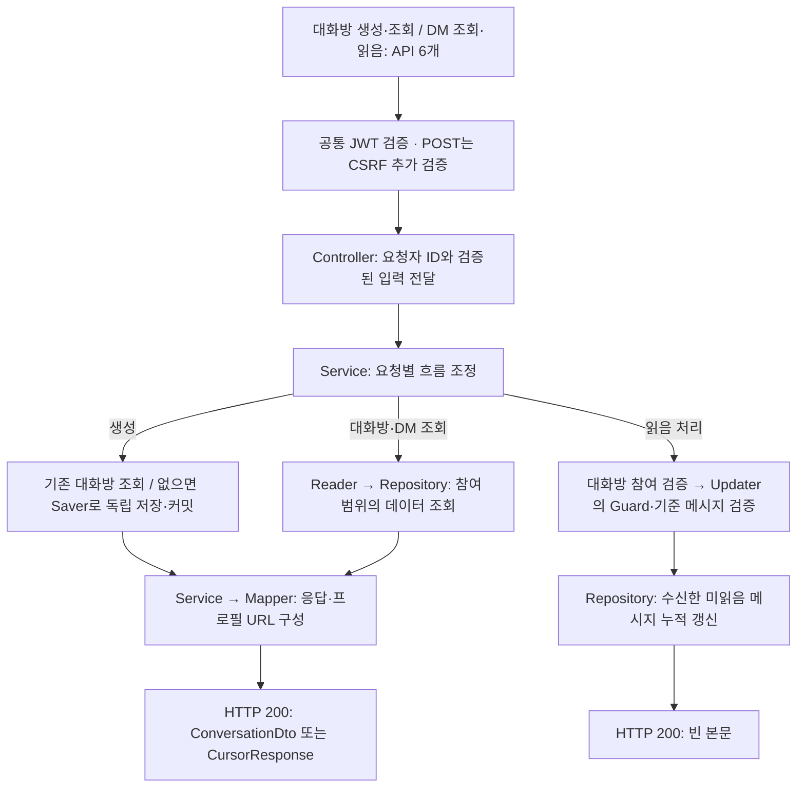

# 대화방·DM 구현 가이드

인증된 사용자 사이의 1:1 대화방 생성·조회, DM 조회·누적 읽음과 WebSocket 송수신·보안·검증을 설명합니다.
팀원이 코드를 수정하거나 서버별 메시지 전달 환경을 구성할 때 참고하는 문서입니다.

처음 읽는다면 [DM 전체 흐름](00-overall-flow.md)에서 연결·구독과 서버 A·B의 메시지 전달 그림을 먼저 확인합니다.

**구현 기준:** 2026-11-17, [#58 대화방 생성](https://github.com/codeit-backend13-part4-team1/playlist_for_everyone/issues/58), [#59 대화방 조회](https://github.com/codeit-backend13-part4-team1/playlist_for_everyone/issues/59), [#60 DM 도메인·조회·읽음 처리](https://github.com/codeit-backend13-part4-team1/playlist_for_everyone/issues/60), [#61 WebSocket 메시지 송수신](https://github.com/codeit-backend13-part4-team1/playlist_for_everyone/issues/61)입니다.
코드 주석은 각 클래스의 역할과 구현 이유를, 이 문서는 컴포넌트 사이의 흐름과 테스트 범위를 설명합니다.

## 먼저 알아둘 계약

- A가 B에게 요청하거나 B가 A에게 요청해도 같은 대화방을 사용합니다.
- 요청자 ID는 인증 정보에서 가져옵니다. REST API는 JWT가 필요하고, 생성·읽음 POST에는 CSRF 토큰도 필요합니다. WebSocket은 STOMP CONNECT에서 JWT를 검증합니다.
- REST API 성공은 HTTP 200입니다. 목록은 커서 응답, 생성·대화방 단건 조회는 대화방 응답, 읽음 처리는 빈 본문을 반환합니다.
- 조회는 본인 대화방을 대상으로 하며, 대화방을 생성하거나 메시지를 읽음 처리하지 않습니다.
- 메시지가 없으면 `lastestMessage`는 null, `hasUnread`는 false입니다.
- 대화방 목록은 상대방 이름·전체 메시지를 검색하되 응답에는 실제 최신 메시지를 담습니다.
- DM 목록은 메시지 생성 시각·ID로 커서를 구성합니다. 읽음 요청은 기준 메시지까지 받은 미읽음 메시지를 갱신합니다.
- 저장 커밋 이후 응답 변환에 실패하면 오류를 반환하지만 저장된 대화방은 유지됩니다.
- DM SEND·SUBSCRIBE는 대화방 참여자만 허용합니다. 메시지 수신만으로 읽음 처리하지 않으며, 기존 REST 읽음 API를 사용합니다.

## REST 처리 흐름

생성·조회 서비스는 Reader 또는 Saver의 결과를 받은 뒤 Mapper를 호출합니다. 조회 API에서는 Saver를 호출하지 않습니다.
상위 트랜잭션이 없는 일반 HTTP 호출에서는 DB 트랜잭션이 끝난 뒤 프로필 이미지 URL을 만듭니다.
DM 조회·읽음은 먼저 대화방 참여 여부를 확인합니다. 읽음 처리는 Updater의 쓰기 트랜잭션에서 기준 메시지를 검증하고 갱신합니다.
생성 충돌 복구, 커서 페이지 처리, 누적 읽음의 상세 흐름은 아래 문서로 나눴습니다.

## WebSocket 전송 흐름

DM은 `/ws` 연결 후 `/pub/conversations/{conversationId}/direct-messages`로 전송합니다.
참여자 검증과 DB 저장·커밋 후 `MessageDto`를 Redis로 발행하고, 각 서버는 수신한 메시지를 `/sub/conversations/{conversationId}/direct-messages`의 로컬 구독자에게 전달합니다.
컴포넌트 역할·트랜잭션·실패 결과는 [송수신 흐름](11-websocket-flow.md), 전송·구독·채널은 [환경 설정](10-websocket-settings.md)을 참고합니다.

## 추천 읽기 순서

| 순서 | 문서 | 확인할 내용 |
| --- | --- | --- |
| 먼저 | [DM 전체 흐름](00-overall-flow.md) | 연결·구독 → 저장·커밋 → Redis → 서버별 대화방 전달, REST 읽음·재조회 |
| 1 | [API와 보안](01-api-security.md) | API 6개와 공통 응답, JWT·CSRF, 오류 코드 |
| 2 | [생성과 트랜잭션](02-creation-transactions.md) | 정렬과 UNIQUE, 동시 요청 복구, 저장 커밋 |
| 3 | [대화방 조회와 공통 응답 변환](03-query-mapping.md) | Projection, 최신 메시지·미읽음, 공통 Mapper와 프로필 URL |
| 4 | [검색과 커서 페이지 처리](05-search-pagination.md) | 대화방 검색·정렬, 커서 입력과 반환, 전체 개수 조회 |
| 5 | [테스트 읽기와 실행](04-testing.md) | 공통 환경·생성 테스트·전체 실행과 기존 검증 기록 |
| 6 | [대화방 조회 테스트와 Swagger 검증](06-query-testing.md) | 대화방 조회의 보안·SQL·문서 검증 |
| 7 | [DM 메시지 조회](07-direct-message-query.md) | 도메인 규칙, 메시지 커서·전체 개수, 연관관계 조회와 변환 |
| 8 | [DM 누적 읽음 처리](08-direct-message-read.md) | 참여·기준 메시지 검증, 갱신 범위, 트랜잭션·수정 시각 |
| 9 | [DM 테스트와 Swagger 검증](09-direct-message-testing.md) | DM 조회·읽음의 7개 테스트 클래스 역할, 실행 명령, API 통합 표시 |
| 10 | [DM WebSocket 환경 설정](10-websocket-settings.md) | 전송·구독·채널, 공통 이벤트 설정, 테스트 프로필과 Compose 재사용 |
| 11 | [DM WebSocket 송수신 흐름](11-websocket-flow.md) | 독립 저장·응답 변환·Redis 전달, 실패별 DB 상태 |
| 12 | [WebSocket 보안과 오류 처리](12-websocket-security-errors.md) | 인증·DM 인가 범위, 출처 제한, 공통 오류 처리와 콘텐츠 확장 위치 |
| 13 | [WebSocket 테스트 읽기와 실행](13-websocket-testing.md) | Mock·실제 인프라 경계, 관련 41개 클래스 실행 명령과 검증 한계 |
| 14 | [다중 서버 DM 수동 검증](14-websocket-multi-node.md) | Compose·분리된 브라우저 준비, 양방향 전달·REST 재조회·종료 |

## 현재 구현과 후속 범위

| 구분 | 범위 |
| --- | --- |
| 생성 | 기존 대화방 반환, 역방향·동시 요청의 중복 처리 |
| 대화방 조회 | 본인 목록·단건·상대방 기준 조회, 검색·커서 페이지 처리 |
| DM 도메인·조회 | 생성 입력 검증, 메시지 영속성, 참여한 대화방의 메시지 커서 조회 |
| DM 읽음 | 기준 메시지까지 수신한 미읽음 메시지의 상태·수정 시각 갱신 |
| DM WebSocket | 참여자 SEND·SUBSCRIBE, 저장·커밋 후 Redis 발행, 서버별 로컬 구독자 전달 |
| 공통 응답 | 상대방 정보, 실제 최신 메시지, 요청자 기준 미읽음 여부 |
| 보안·문서 | JWT·참여자 제한, 생성·읽음의 CSRF, 두 API 인터페이스를 하나의 Swagger 그룹으로 표시 |
| 후속 연동 | DM 생성 이벤트·알림·SSE 연동(#62), Kafka 전송(#63), 연결 유지 중 인증 자연 만료 처리(#208) |

REST API 테스트 구성과 날짜별 실행 결과는 [공통 테스트](04-testing.md)·[DM 테스트](09-direct-message-testing.md)에서 구분합니다.
WebSocket의 [자동 테스트](13-websocket-testing.md)와 [Compose 수동 검증](14-websocket-multi-node.md)은 환경과 수행 결과를 구분합니다. 문서에 절차가 있다는 것만으로 실제 수행 완료를 의미하지 않습니다.

---

[프로젝트 README](../../README.md) · [팀원 개발 가이드](../DEVELOPMENT.md) · [다음: API와 보안 →](01-api-security.md)
