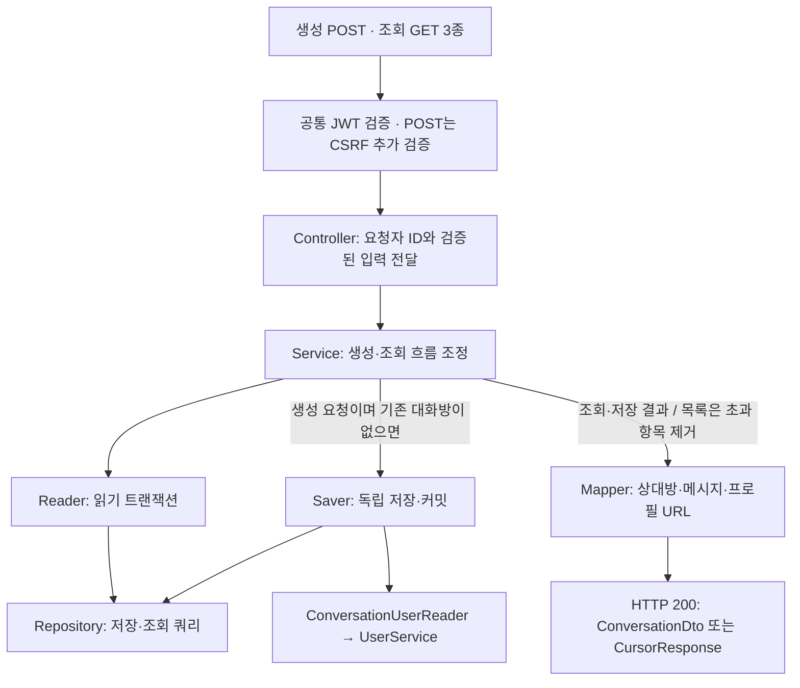

# 대화방 생성·조회 구현 가이드

인증된 사용자와 상대방 사이의 1:1 대화방을 생성하고, 목록·단건·상대방 기준으로 조회하는 흐름을 설명합니다.
팀원이 코드를 수정하거나 후속 DM 기능을 연결할 때 참고하는 문서입니다.

**기준:** 2026-11-13, [#58 생성 API](https://github.com/codeit-backend13-part4-team1/playlist_for_everyone/issues/58)와 [#59 조회 API](https://github.com/codeit-backend13-part4-team1/playlist_for_everyone/issues/59)의 현재 구현과 검증 기록입니다.
코드 주석은 각 클래스의 역할과 구현 이유를, 이 문서는 컴포넌트 사이의 흐름과 테스트 범위를 설명합니다.

## 먼저 알아둘 계약

- A가 B에게 요청하거나 B가 A에게 요청해도 같은 대화방을 사용합니다.
- 요청자 ID는 인증 정보에서 가져옵니다. 모든 API는 JWT가 필요하고, 생성 POST에는 CSRF 토큰도 필요합니다.
- 생성·조회 성공은 HTTP 200입니다. 목록은 커서 응답, 나머지는 대화방 응답으로 반환합니다.
- 조회는 본인 대화방을 대상으로 하며, 대화방을 생성하거나 메시지를 읽음 처리하지 않습니다.
- 메시지가 없으면 `lastestMessage`는 null, `hasUnread`는 false입니다.
- 목록은 상대방 이름·전체 메시지를 검색하되 응답에는 실제 최신 메시지를 담습니다.
- 저장 커밋 이후 응답 변환에 실패하면 오류를 반환하지만 저장된 대화방은 유지됩니다.

## 전체 흐름

서비스가 Reader 또는 Saver의 결과를 받은 뒤 Mapper를 호출합니다. 조회 API에서는 Saver를 호출하지 않습니다.
상위 트랜잭션이 없는 일반 HTTP 호출에서는 DB 트랜잭션이 끝난 뒤 프로필 이미지 URL을 만듭니다.
생성 시 UNIQUE 충돌 복구는 [생성과 트랜잭션](02-creation-transactions.md), 목록 조립은 [검색과 커서 페이지 처리](05-search-pagination.md)에서 설명합니다.

## 추천 읽기 순서

| 순서 | 문서 | 확인할 내용 |
| --- | --- | --- |
| 1 | [API와 보안](01-api-security.md) | 생성·조회 요청과 공통 응답, JWT·CSRF, 오류 코드 |
| 2 | [생성과 트랜잭션](02-creation-transactions.md) | 정렬과 UNIQUE, 동시 요청 복구, 저장 커밋 |
| 3 | [조회와 응답 변환](03-query-mapping.md) | 조회 조건·Projection, 최신 메시지·미읽음, 프로필 URL |
| 4 | [검색과 커서 페이지 처리](05-search-pagination.md) | 검색·정렬, 커서 입력과 반환, 전체 개수 조회 |
| 5 | [테스트 읽기와 실행](04-testing.md) | 공통 환경·생성 테스트·전체 실행과 기존 검증 기록 |
| 6 | [조회 테스트와 Swagger 검증](06-query-testing.md) | 조회 테스트별 책임, 보안·SQL·문서 검증 |

## 현재 구현과 후속 범위

| 구분 | 범위 |
| --- | --- |
| 생성 | 기존 대화방 반환, 역방향·동시 요청의 중복 처리 |
| 조회 | 본인 목록·단건·상대방 기준 조회, 검색·커서 페이지 처리 |
| 공통 응답 | 상대방 정보, 실제 최신 메시지, 요청자 기준 미읽음 여부 |
| 보안·문서 | 생성의 JWT·CSRF, 조회의 JWT·참여자 제한, Swagger 계약·UI 확인 |
| 후속 연동 | 메시지 송신·읽음 변경, WebSocket, 알림 이벤트, SSE 연동 |

현재 메시지 엔티티와 Mapper는 생성·조회 응답과 검색에 사용합니다.
이 가이드의 구현 범위는 메시지 송수신이나 읽음 변경 API까지 포함하지 않습니다.
기존 검증 결과와 프로젝트 전체 회귀 검증은 [테스트 가이드](04-testing.md)에서 구분합니다.

---

[프로젝트 README](../../README.md) · [팀원 개발 가이드](../DEVELOPMENT.md) · [다음: API와 보안 →](01-api-security.md)
