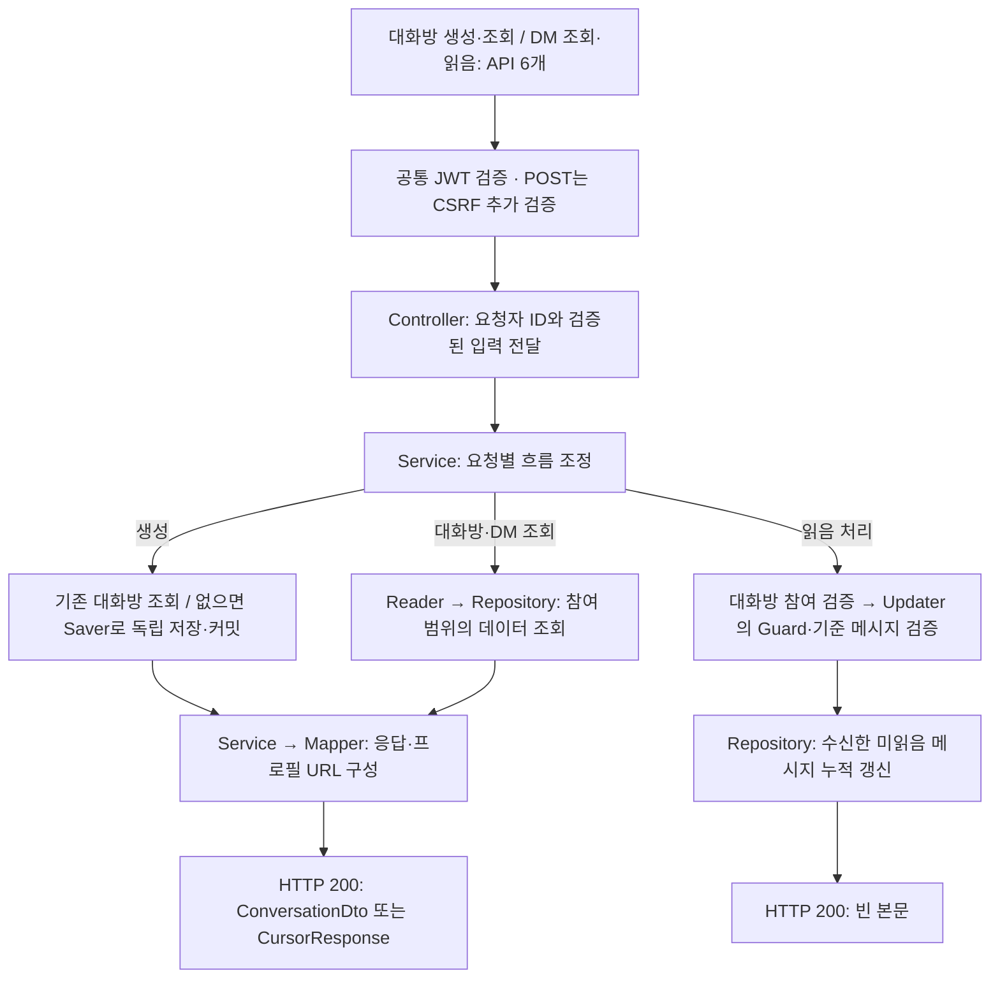

# 대화방·DM 구현 가이드

인증된 사용자 사이의 1:1 대화방 생성·조회와 DM 메시지 조회·누적 읽음 처리를 설명합니다.
팀원이 코드를 수정하거나 메시지 송수신 기능을 연결할 때 참고하는 문서입니다.

**구현 기준:** 2026-11-15, [#58 대화방 생성](https://github.com/codeit-backend13-part4-team1/playlist_for_everyone/issues/58), [#59 대화방 조회](https://github.com/codeit-backend13-part4-team1/playlist_for_everyone/issues/59), [#60 DM 도메인·조회·읽음 처리](https://github.com/codeit-backend13-part4-team1/playlist_for_everyone/issues/60)입니다.
코드 주석은 각 클래스의 역할과 구현 이유를, 이 문서는 컴포넌트 사이의 흐름과 테스트 범위를 설명합니다.

## 먼저 알아둘 계약

- A가 B에게 요청하거나 B가 A에게 요청해도 같은 대화방을 사용합니다.
- 요청자 ID는 인증 정보에서 가져옵니다. 모든 API는 JWT가 필요하고, 생성·읽음 POST에는 CSRF 토큰도 필요합니다.
- 성공은 HTTP 200입니다. 목록은 커서 응답, 생성·대화방 단건 조회는 대화방 응답, 읽음 처리는 빈 본문을 반환합니다.
- 조회는 본인 대화방을 대상으로 하며, 대화방을 생성하거나 메시지를 읽음 처리하지 않습니다.
- 메시지가 없으면 `lastestMessage`는 null, `hasUnread`는 false입니다.
- 대화방 목록은 상대방 이름·전체 메시지를 검색하되 응답에는 실제 최신 메시지를 담습니다.
- DM 목록은 메시지 생성 시각·ID로 커서를 구성합니다. 읽음 요청은 기준 메시지까지 받은 미읽음 메시지를 갱신합니다.
- 저장 커밋 이후 응답 변환에 실패하면 오류를 반환하지만 저장된 대화방은 유지됩니다.

## 전체 흐름

생성·조회 서비스는 Reader 또는 Saver의 결과를 받은 뒤 Mapper를 호출합니다. 조회 API에서는 Saver를 호출하지 않습니다.
상위 트랜잭션이 없는 일반 HTTP 호출에서는 DB 트랜잭션이 끝난 뒤 프로필 이미지 URL을 만듭니다.
DM 조회·읽음은 먼저 대화방 참여 여부를 확인합니다. 읽음 처리는 Updater의 쓰기 트랜잭션에서 기준 메시지를 검증하고 갱신합니다.
생성 충돌 복구, 커서 페이지 처리, 누적 읽음의 상세 흐름은 아래 문서로 나눴습니다.

## 추천 읽기 순서

| 순서 | 문서 | 확인할 내용 |
| --- | --- | --- |
| 1 | [API와 보안](01-api-security.md) | API 6개와 공통 응답, JWT·CSRF, 오류 코드 |
| 2 | [생성과 트랜잭션](02-creation-transactions.md) | 정렬과 UNIQUE, 동시 요청 복구, 저장 커밋 |
| 3 | [대화방 조회와 공통 응답 변환](03-query-mapping.md) | Projection, 최신 메시지·미읽음, 공통 Mapper와 프로필 URL |
| 4 | [검색과 커서 페이지 처리](05-search-pagination.md) | 대화방 검색·정렬, 커서 입력과 반환, 전체 개수 조회 |
| 5 | [테스트 읽기와 실행](04-testing.md) | 공통 환경·생성 테스트·전체 실행과 기존 검증 기록 |
| 6 | [대화방 조회 테스트와 Swagger 검증](06-query-testing.md) | 대화방 조회의 보안·SQL·문서 검증 |
| 7 | [DM 메시지 조회](07-direct-message-query.md) | 도메인 규칙, 메시지 커서·전체 개수, 연관관계 조회와 변환 |
| 8 | [DM 누적 읽음 처리](08-direct-message-read.md) | 참여·기준 메시지 검증, 갱신 범위, 트랜잭션·수정 시각 |
| 9 | [DM 테스트와 Swagger 검증](09-direct-message-testing.md) | DM 7개 테스트 클래스의 역할, 실행 명령, API 통합 표시 |

## 현재 구현과 후속 범위

| 구분 | 범위 |
| --- | --- |
| 생성 | 기존 대화방 반환, 역방향·동시 요청의 중복 처리 |
| 대화방 조회 | 본인 목록·단건·상대방 기준 조회, 검색·커서 페이지 처리 |
| DM 도메인·조회 | 생성 입력 검증, 메시지 영속성, 참여한 대화방의 메시지 커서 조회 |
| DM 읽음 | 기준 메시지까지 수신한 미읽음 메시지의 상태·수정 시각 갱신 |
| 공통 응답 | 상대방 정보, 실제 최신 메시지, 요청자 기준 미읽음 여부 |
| 보안·문서 | JWT·참여자 제한, 생성·읽음의 CSRF, 두 API 인터페이스를 하나의 Swagger 그룹으로 표시 |
| 후속 연동 | 메시지 송신, WebSocket, 알림 이벤트, SSE 연동 |

현재 가이드는 메시지 송수신 연동까지 구현되었다는 의미는 아닙니다.
현재 테스트 구성과 날짜별 실행 결과는 [공통 테스트](04-testing.md)·[DM 테스트](09-direct-message-testing.md)에서 구분합니다.

---

[프로젝트 README](../../README.md) · [팀원 개발 가이드](../DEVELOPMENT.md) · [다음: API와 보안 →](01-api-security.md)
