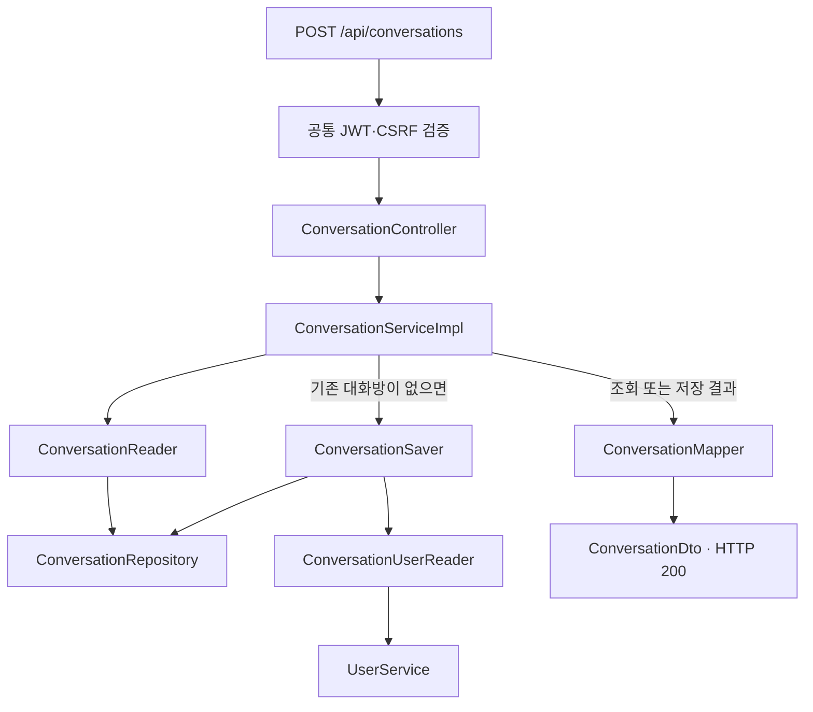

# 대화방 생성 구현 가이드

인증된 사용자와 상대방 사이의 1:1 대화방을 생성하는 흐름을 설명합니다.
팀원이 코드를 수정하거나 후속 DM 기능을 연결할 때 참고하는 문서입니다.

**기준:** 2026-11-12, [#58 대화방 도메인 및 생성 API](https://github.com/codeit-backend13-part4-team1/playlist_for_everyone/issues/58)의 현재 구현과 검증 기록입니다.
코드 주석은 각 클래스의 역할과 구현 이유를, 이 문서는 컴포넌트 사이의 흐름과 테스트 범위를 설명합니다.

## 먼저 알아둘 계약

- A가 B에게 요청하거나 B가 A에게 요청해도 같은 대화방을 사용합니다.
- 요청자 ID는 인증 정보에서 가져오며, 요청 본문에는 상대방 ID만 전달합니다.
- 신규 생성과 기존 대화방 반환 모두 HTTP 200입니다.
- 메시지가 없으면 `lastestMessage`는 null, `hasUnread`는 false입니다.
- 저장 커밋 이후 응답 변환에 실패하면 오류를 반환하지만 저장된 대화방은 유지됩니다.

## 전체 흐름

서비스가 Reader 또는 Saver의 결과를 받은 뒤 Mapper를 호출합니다.
저장 시 사용자 쌍 UNIQUE가 충돌하면 Reader로 기존 대화방을 재조회합니다.
저장 커밋과 재조회 시점은 [생성과 트랜잭션](02-creation-transactions.md)에서 설명합니다.

## 추천 읽기 순서

| 순서 | 문서 | 확인할 내용 |
| --- | --- | --- |
| 1 | [API와 보안](01-api-security.md) | 요청·응답, JWT·CSRF, 오류 코드와 Swagger |
| 2 | [생성과 트랜잭션](02-creation-transactions.md) | 정렬과 UNIQUE, 동시 요청 복구, 저장 커밋 |
| 3 | [조회와 응답 변환](03-query-mapping.md) | 최신 메시지·미읽음, 사용자 조회와 프로필 URL |
| 4 | [테스트 읽기와 실행](04-testing.md) | Mock·실제 DB·보안 검증의 차이와 실행 방법 |

## 현재 구현과 후속 범위

| 구분 | 범위 |
| --- | --- |
| 현재 구현 | 대화방 생성, 기존 대화방 반환, 역방향·동시 요청의 중복 처리 |
| 생성 응답 조회 | 상대방 정보, 기존 최신 메시지, 요청자 기준 미읽음 여부 |
| 보안·문서 | 실제 JWT·CSRF 통합 테스트와 Swagger 계약·UI 확인 |
| 후속 기능 | 대화방 목록·단건·특정 사용자와의 대화 조회 API |
| 후속 연동 | 메시지 송신·읽음 변경, WebSocket, 알림 이벤트, SSE 연동 |

현재 메시지 엔티티와 Mapper는 생성 응답을 구성하는 데 사용합니다.
메시지 송수신이나 읽음 변경 기능까지 완료되었다는 의미는 아닙니다.
기존 검증 결과와 프로젝트 전체 회귀 검증은 [테스트 가이드](04-testing.md)에서 구분합니다.

---

[프로젝트 README](../../README.md) · [팀원 개발 가이드](../DEVELOPMENT.md) · [다음: API와 보안 →](01-api-security.md)
