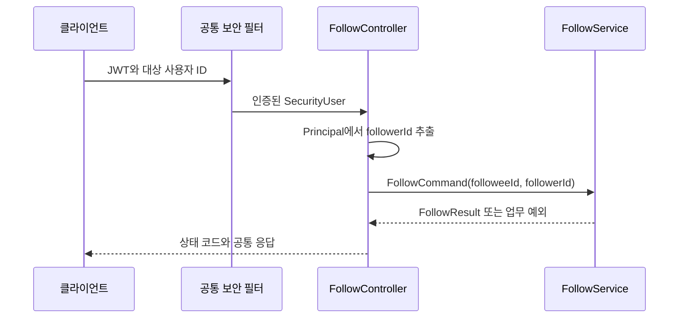

# 1. API와 인증·인가

팔로우 HTTP 요청은 공통 보안 필터를 거칩니다.
컨트롤러는 인증된 요청자 ID와 클라이언트 입력을 합쳐 서비스 Command를 만듭니다.

## API 계약

공통 인증 입력은 `Authorization: Bearer <accessToken>`입니다.
아래는 현재 코드의 응답 정책이며, 실제 JWT를 거친 통합 검증은 #76에서 진행합니다.

| API | 클라이언트 입력 | 정상 응답 |
| --- | --- | --- |
| `POST /api/follows` | JSON 본문의 `followeeId` | 신규 201, 기존 관계 200 |
| `DELETE /api/follows/{followId}` | 관계 ID | 204, 빈 본문 |
| `GET /api/follows/followed-by-me` | 쿼리 `followeeId` | 본인의 관계 200, 없으면 404 |
| `GET /api/follows/count` | 쿼리 `followeeId` | 200, 숫자 |

등록·관계 조회의 응답은 `FollowDto(id, followeeId, followerId)`입니다.
서비스의 `FollowResult.created`는 201/200 선택에만 사용하며 응답 JSON에 포함하지 않습니다.
엔티티의 생성 시각도 현재 DTO에는 포함하지 않습니다.

## 인증과 인가의 역할

| 구성 요소 | 담당하는 일 |
| --- | --- |
| `JwtAuthenticationFilter` | JWT와 사용자 상태를 확인하고 `SecurityUser`를 인증정보에 저장 |
| `SecurityFilterChain` | 팔로우 4개 API에 인증 요구 |
| `FollowController` | Principal의 `getUserId()`로 요청자 ID 결정 |
| `FollowRequest` | 대상 ID 필수 여부 등 입력 검증과 Command 변환 |
| `FollowServiceImpl` | 자기 팔로우 금지 등 업무 정책 처리 |
| `@PreAuthorize`와 `FollowGuard` | 취소하려는 관계의 소유자 확인 |

서비스의 취소 메서드는 `isAuthenticated()`를 별도로 검사하지 않습니다.
따라서 내부에서 서비스를 호출할 때도 신뢰할 수 있는 요청자 ID를 전달해야 합니다.
Guard는 Command의 ID를 비교하며 SecurityContext에서 요청자를 다시 찾지 않습니다.

팔로워 수 조회도 인증이 필요하지만 요청자 ID를 집계 조건으로 사용하지 않습니다.
인증된 일반 사용자도 다른 사용자의 팔로워 수를 조회할 수 있습니다.

## 요청자가 전달되는 흐름

클라이언트 입력에 `followerId` 필드를 추가해 요청자를 결정하지 않습니다.
Swagger의 `@Parameter(hidden = true)`는 Principal을 문서 입력에서 숨기는 역할이며,
실제 주입은 컨트롤러의 `@AuthenticationPrincipal`이 담당합니다.

## 오류 응답과 문서 상태

| 조건 | 현재 응답 정책 |
| --- | --- |
| 필수 대상 ID 누락·UUID 형식 오류 | 400 |
| 자기 팔로우·등록 대상 사용자 미존재 | 400 |
| 인증정보 없음·만료·변조 JWT | 공통 보안 설정에서 401 |
| 존재하는 타인 관계 취소 | 메서드 인가 거부로 403 |
| 본인과 대상 사이의 관계 없음 | 404 |
| 복구할 수 없는 저장 무결성 오류 | 500 |

오류 응답의 공통 필드는 `exceptionName`, `message`, `details`입니다.
필터 단계 오류는 보안 핸들러가 작성하고, 서비스·MVC 오류는 글로벌 예외 핸들러가 처리합니다.
메서드 인가의 `AccessDeniedException` 계열에는 별도의 403 처리가 있습니다.

현재 `FollowApi`의 적용 예정 설명과 일부 CSRF 이슈 표기는 아직 정리 전입니다.
JWT·소유자 인가 설명은 실제 통합 검증 후 정리하며, CSRF 안내는 #114 완료 전까지 후속 상태로 유지합니다.
Bearer 인증 스키마와 인증 요구사항의 OpenAPI 연결도 #76에서 확인해야 합니다.

## 관련 코드

[컨트롤러](../../src/main/java/com/codeit/sb13/playlist_for_everyone/domain/follow/controller/FollowController.java) ·
[Swagger 계약](../../src/main/java/com/codeit/sb13/playlist_for_everyone/domain/follow/controller/swagger/FollowApi.java) ·
[공통 보안 설정](../../src/main/java/com/codeit/sb13/playlist_for_everyone/global/config/SecurityConfig.java) ·
[글로벌 예외 핸들러](../../src/main/java/com/codeit/sb13/playlist_for_everyone/global/controller/GlobalExceptionHandler.java)

---

[← 목차](README.md) · [다음: 등록과 트랜잭션 →](02-registration-transactions.md)
