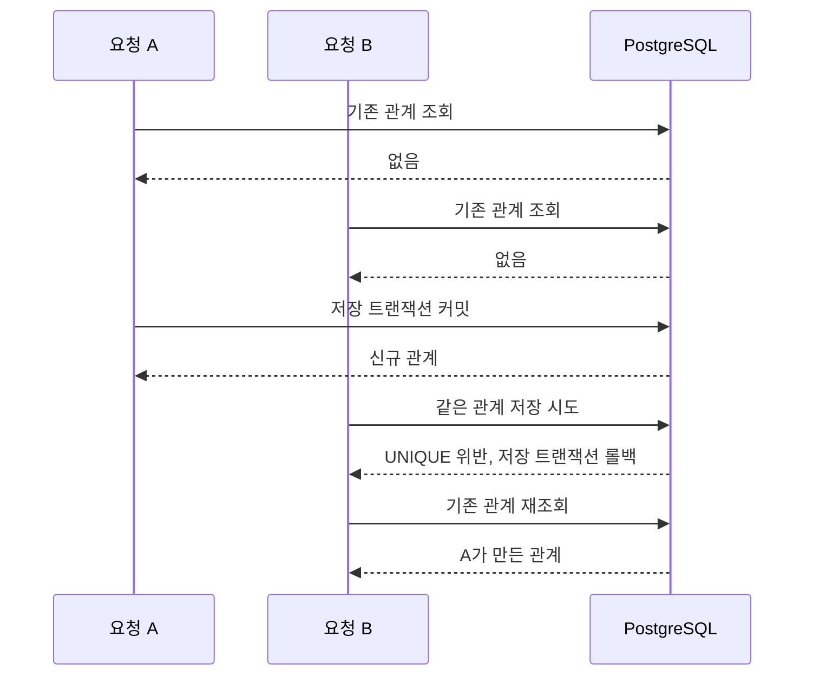

# 2. 등록과 트랜잭션

중복 요청에는 기존 관계를 반환합니다.
두 요청이 동시에 같은 관계를 만들려고 할 때도 DB 제약조건과 재조회를 이용해 이 정책을 유지합니다.

## 관계를 저장하는 규칙

`Follow`는 두 사용자를 필수 LAZY 연관관계로 참조합니다.
자기 팔로우는 서비스에서 거부하고, 같은 방향의 중복은 DB에서 막습니다.

| 항목 | 현재 설정 |
| --- | --- |
| 테이블 | `follows` |
| 중복 기준 | `(follower_id, followee_id)` |
| 제약조건 이름 | `uq_follows_follower_followee` |
| 방향 | A → B와 B → A는 각각 저장 가능 |

엔티티 선언과 실제 DB 제약조건은 이름·컬럼을 맞춥니다.
DB 적용은 [팔로우 UNIQUE 마이그레이션](../../src/main/resources/db/migration/V202610241802__add_follows_follwer_followee_unique.sql)이 담당합니다.

## 일반 등록 흐름

1. 서비스가 요청자와 대상 ID를 비교해 자기 팔로우를 거부합니다.
2. `FollowReader`가 기존 관계를 조회합니다. 있으면 추가 저장 없이 `created=false`를 반환합니다.
3. 없으면 `FollowSaver`가 사용자를 조회하고 새 관계를 저장합니다.
4. 같은 저장 트랜잭션 안에서 생성 이벤트를 발행합니다.
5. 저장 트랜잭션이 커밋되어 호출이 정상 반환되면 `created=true`로 응답합니다.

`save()` 호출이나 DTO 생성만으로 커밋이 끝난 것은 아닙니다.
SQL 실행·제약조건 확인이 flush 또는 커밋 과정에서 일어날 수 있으며, 현재 코드는 명시적 flush를 강제하지 않습니다.

## 왜 조회와 저장을 별도 빈으로 두나요?

`follow()` 전체에는 트랜잭션을 선언하지 않았습니다.
`FollowReader`는 읽기 전용 트랜잭션, `FollowSaver`는 `REQUIRES_NEW` 트랜잭션을 사용합니다.
서비스가 다른 빈을 호출하므로 Spring 프록시를 통해 저장의 커밋·롤백 경계가 적용됩니다.

저장 실패를 잡는 서비스 코드로 돌아왔을 때는 실패한 저장 트랜잭션이 종료된 상태입니다.
일반 HTTP 호출에서는 그 뒤의 재조회를 별도 읽기 트랜잭션에서 수행할 수 있습니다.

외부 트랜잭션에서 호출하더라도 저장은 독립적으로 커밋됩니다.
호출자 트랜잭션을 나중에 롤백한다고 이미 커밋된 팔로우가 함께 취소되지는 않습니다.
외부 트랜잭션의 격리 수준과 조회 가시성까지 모든 호출 경로에서 검증한 것은 아닙니다.
독립 트랜잭션의 의미는 [Spring 전파 설정 문서](https://docs.spring.io/spring-framework/reference/data-access/transaction/declarative/tx-propagation.html)를 참고합니다.

## 같은 요청이 동시에 들어오면

두 요청의 사전 조회가 모두 빈 결과일 수 있으므로, 사전 조회만으로 중복을 막을 수는 없습니다.

서비스는 `DataIntegrityViolationException`의 원인 체인을 따라 Hibernate 예외를 찾습니다.
**SQLState가 `23505`이고 제약조건 이름도 일치할 때만** 팔로우 중복으로 처리합니다.
이름이 다른 UNIQUE, FK, NOT NULL 위반은 `FollowCreationFailedException`으로 전달합니다.
팔로우 UNIQUE 위반이어도 재조회 결과가 없으면 같은 생성 실패 예외를 전달합니다.

DB 동시 등록과 복구는 서비스 통합 테스트에서 다룹니다.
실제 JWT를 거친 동시 HTTP 요청의 201/200 검증은 #76의 남은 작업입니다.

## 관련 코드

[등록 정책과 원인 예외 확인](../../src/main/java/com/codeit/sb13/playlist_for_everyone/domain/follow/service/impl/FollowServiceImpl.java) ·
[저장 트랜잭션](../../src/main/java/com/codeit/sb13/playlist_for_everyone/domain/follow/service/impl/FollowSaver.java) ·
[읽기 전용 조회](../../src/main/java/com/codeit/sb13/playlist_for_everyone/domain/follow/service/impl/FollowReader.java) ·
[엔티티](../../src/main/java/com/codeit/sb13/playlist_for_everyone/domain/follow/entity/Follow.java)

---

[← API와 인증·인가](01-api-security.md) · [목차](README.md) · [다음: 조회와 취소 →](03-query-unfollow.md)
