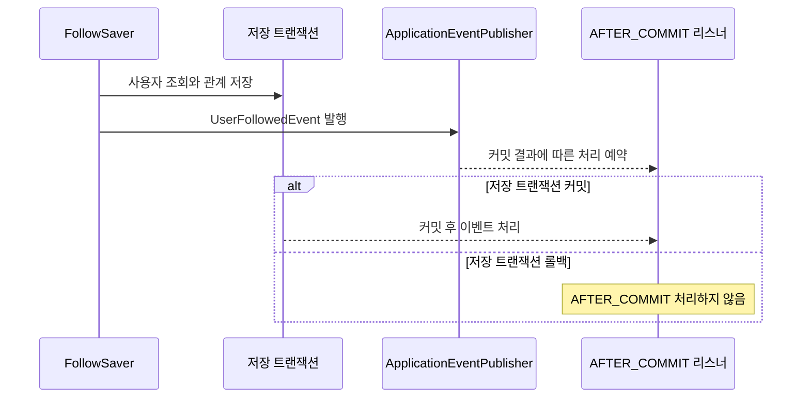

# 4. 사용자 조회와 생성 이벤트

팔로우 도메인은 새 관계가 만들어졌다는 사실을 이벤트로 전달합니다.
이벤트의 이름·ID를 준비하는 책임과 알림을 생성하는 책임을 나누어 설명합니다.

## 사용자 조회를 모은 컴포넌트

```text
FollowSaver → FollowUserReader → UserService.getById → UserRepository
```

`FollowUserReader`는 사용자 조회를 위임하는 컴포넌트이며, 사용자 도메인 앞의 간단한 파사드 역할을 합니다.
파사드는 내부 기능을 사용하는 쪽에 단순한 진입점을 제공합니다.
현재 코드는 `UserService.getById()`를 그대로 위임하면서, 팔로우에서 사용자 도메인을 호출하는 지점을 한곳에 모읍니다.

반환 타입으로 `User` 엔티티를 사용하므로 사용자 엔티티에 대한 의존성은 남아 있습니다.
기존 서비스 계층 안의 역할 분리이며, 별도 포트 인터페이스나 저장소 구현체 교체 구조는 도입하지 않았습니다.
`FollowSaver`는 Command의 ID로 두 사용자를 저장 트랜잭션 안에서 조회합니다.

| 조회 실패 대상 | 예외 처리 |
| --- | --- |
| 요청자 `followerId` | 사용자 도메인의 `UserNotFoundException`을 그대로 전달 |
| 팔로우 대상 `followeeId` | `FollowTargetNotFoundException`으로 변환하고 대상 ID를 포함 |

이 표는 저장 컴포넌트의 예외 계약입니다.
일반 HTTP 요청에서는 먼저 JWT 필터가 요청자 사용자 상태를 확인합니다.

## 이벤트에 담는 정보

| 필드 | 출처 |
| --- | --- |
| `followerId` | 저장한 관계의 팔로워 ID |
| `followerName` | 저장 트랜잭션에서 조회한 팔로워 이름 |
| `followeeId` | 저장한 관계의 대상 ID |

이벤트는 `UserFollowedEvent` record이며 사용자·팔로우 엔티티를 직접 담지 않습니다.
이름은 Principal이나 JWT의 이름으로 대체하지 않고, 현재 사용자 조회 결과를 문자열로 담습니다.
발행 후 이름이 바뀌어도 이미 만들어진 이벤트에는 발행 당시 값이 남습니다.
현재 계약은 이름의 null·공백을 보정하지 않고 원본 그대로 전달합니다.

## 발행과 커밋 후 처리는 다른 시점입니다



그림의 리스너는 커밋 후 소비 방식을 설명합니다.
현재 팔로우 서비스 통합 테스트에서는 테스트 전용 리스너가 이 동작을 기록합니다.
운영 알림 리스너가 이미 연결됐다는 뜻은 아닙니다.

일반 `@EventListener`는 커밋 성공까지 기다린다는 계약이 없습니다.
커밋된 관계에만 후속 작업을 수행하려면 수신 측에서 `@TransactionalEventListener(AFTER_COMMIT)`을 사용해야 합니다.
트랜잭션에 결합된 처리 시점은 [Spring 공식 문서](https://docs.spring.io/spring-framework/reference/data-access/transaction/event.html)를 참고합니다.

## 중복과 실패를 읽는 방법

| 상황 | 이벤트 관찰 |
| --- | --- |
| 사전 조회에서 기존 관계 발견 | 저장 컴포넌트를 호출하지 않아 신규 이벤트 없음 |
| 신규 저장 트랜잭션 커밋 | 생성 이벤트 발행 후 AFTER_COMMIT 소비 가능 |
| 저장 호출에서 즉시 예외 | 발행 코드까지 도달하지 않음 |
| 발행 후 flush·커밋 과정에서 실패 | 발행 기록은 있을 수 있지만 롤백된 트랜잭션의 AFTER_COMMIT 소비는 없음 |
| 팔로우 취소 | 생성 이벤트 없음 |

따라서 발행 횟수와 커밋 후 처리 횟수를 같은 의미로 해석하지 않습니다.
현재 이벤트 발행은 프로세스 내부 Spring 이벤트이며, 영속 메시지 저장·재시도·전달 보장을 추가한 구조는 아닙니다.

## 검증 범위와 후속 연동

`FollowSecurityIntegrationTest`에서 실제 JWT 등록 요청의 이벤트를 관찰해 두 사용자 ID와 DB에서 조회한 이름을 확인했습니다.
JWT 누락·만료·변조로 등록이 거부되면 관계 저장과 이벤트 발행이 없다는 점도 검증했습니다.
중복·롤백에 따른 커밋 후 수신 여부는 서비스 통합 테스트의 별도 관찰자로 확인합니다.

업무 이벤트를 알림 생성 요청으로 연결하는 작업은 [#45](https://github.com/codeit-backend13-part4-team1/playlist_for_everyone/issues/45)에서 다룹니다.
현재 테스트의 커밋 후 관찰을 실제 알림 저장이나 SSE 전달 성공으로 해석하지 않습니다.
테스트별 역할과 실행 방법은 [테스트 가이드](05-testing.md)를 참고합니다.

## 관련 코드

[사용자 조회 컴포넌트](../../src/main/java/com/codeit/sb13/playlist_for_everyone/domain/follow/service/impl/FollowUserReader.java) ·
[저장과 발행](../../src/main/java/com/codeit/sb13/playlist_for_everyone/domain/follow/service/impl/FollowSaver.java) ·
[이벤트](../../src/main/java/com/codeit/sb13/playlist_for_everyone/domain/follow/event/UserFollowedEvent.java) ·
[테스트 전용 커밋 관찰자](../../src/test/java/com/codeit/sb13/playlist_for_everyone/domain/follow/service/FollowServiceIntegrationTest.java)

---

[← 조회와 취소](03-query-unfollow.md) · [목차](README.md) · [다음: 테스트 읽기와 실행 →](05-testing.md)
