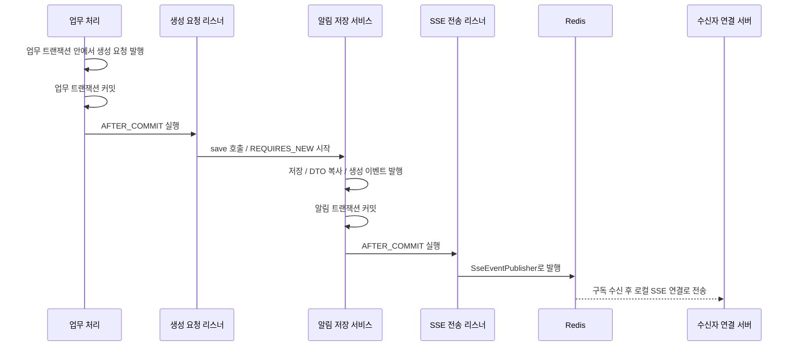

# 1. 알림 생성·저장과 SSE 전송

[#51](https://github.com/codeit-backend13-part4-team1/playlist_for_everyone/issues/51)은 **저장이 커밋된 알림을 수신자에게 실시간으로 전달**하는 연결 작업입니다.
알림 생성 요청부터 읽고, 트랜잭션 경계와 실패 처리를 확인하면 코드를 따라가기 쉽습니다.
연결 관리와 Redis 설정은 [공통 SSE 전송 가이드](../sse/06-redis-transport.md)를 참고합니다.

## 역할부터 구분하기

| 역할 | 코드 | 맡은 일 |
| --- | --- | --- |
| 생성 요청 | `NotificationCreateRequestedEvent` | 수신자·제목·내용·수준으로 알림 저장을 요청 |
| 업무 커밋 후 처리 | `NotificationEventListener` | 요청을 command로 변환하고 저장 서비스 호출 |
| 독립 저장 | `NotificationService.save` | 새 트랜잭션으로 저장하고 DTO를 담은 생성 이벤트 발행 |
| 저장 결과 전달 | `NotificationCreatedEvent` | 별도 이벤트 ID와 저장된 알림의 DTO 스냅샷 보관 |
| 알림 커밋 후 처리 | `NotificationSseEventListener` | `notifications` 이벤트로 변환하여 공통 발행 계약 호출 |
| 서버 간 전송 | `SseEventPublisher` | 현재 Redis 구현체를 통해 수신자가 연결된 서버까지 전달 |

알림 목록 조회와 SSE는 같은 `NotificationDto`를 사용합니다.
전송 리스너는 엔티티를 받거나 DB를 다시 조회하지 않고 저장 당시의 DTO를 사용합니다.

## 커밋은 두 번 구분한다

두 리스너의 `@TransactionalEventListener`는 기본값인 `AFTER_COMMIT`, `fallbackExecution=false`를 사용합니다.
업무가 롤백되면 첫 리스너가, 알림 저장이 롤백되면 두 번째 리스너가 실행되지 않습니다.
각 이벤트를 트랜잭션 밖에서 발행해도 해당 리스너는 처리하지 않습니다.

`NotificationCreatedEvent`는 **저장 트랜잭션 안에서** 발행됩니다. 이름만 보고 커밋까지 완료된 것으로 해석하지 않습니다.
현재 UUID 생성 전략과 JPA Auditing은 신규 엔티티를 저장할 때 ID·생성시각을 채워 주므로 DTO를 즉시 구성합니다.
`save` 반환이나 SQL을 실행하는 `flush` 자체는 커밋 완료를 뜻하지 않으며, 이 경로는 명시적 `flush`를 강제하지 않습니다.

저장은 별도 Spring 빈을 통해 호출하여 `REQUIRES_NEW`를 적용합니다.
업무 커밋 전에 저장 서비스를 직접 호출하면 알림만 먼저 커밋될 수 있으므로, 공통 생성 흐름은 업무 트랜잭션 안에서 생성 요청 이벤트를 발행합니다.
두 리스너에 `@Async`는 없습니다. 커밋 처리 스레드에서 Redis 발행 요청까지 진행하며, 브라우저 수신 완료를 기다리지는 않습니다.

## 이벤트 ID와 클라이언트 데이터

| 값 | 의미와 사용처 |
| --- | --- |
| `NotificationCreatedEvent.eventId` | 저장 서비스에서 한 번 만든 UUID. SSE 프레임의 `id`까지 유지 |
| `NotificationDto.id` | DB에 저장한 알림의 ID. 이벤트 ID와 별도로 관리 |
| `NotificationDto.receiverId` | 각 서버에서 실제 수신자의 연결을 찾는 기준 |
| `eventName` | `notifications`로 고정 |
| `data` | `NotificationDto` 객체를 JSON으로 전달 |

DTO에는 `id`, `createdAt`, `receiverId`, `title`, `content`, `level`이 들어갑니다.
브라우저의 `data`에는 이 DTO만 전달하고, 내부 `SseEvent` 전체를 넣거나 DTO를 미리 JSON 문자열로 바꾸지 않습니다.
`SseEvent.createNotificationEvent`는 이벤트 이름을 지정하며, 새 이벤트 ID를 만들지 않습니다.

알림 코드는 로컬 연결 유무를 확인하지 않습니다. 발행 서버 A에 연결이 없어도 수신자가 서버 B에 연결되어 있을 수 있기 때문입니다.
Redis에서 받은 이벤트는 각 서버의 로컬 전송 서비스가 해당 수신자의 연결에 전달합니다.

## 실패했을 때 남는 것

| 상황 | 알림 저장·전송 결과 |
| --- | --- |
| 업무 트랜잭션 롤백 | 알림 생성 요청 리스너 미실행, 알림·SSE 발행 없음 |
| 알림 검증·저장 실패 | 원래 업무의 커밋 유지, 알림 저장 실패 기록, SSE 발행 없음 |
| 알림 저장 트랜잭션 롤백 | 생성 이벤트를 이미 발행했어도 SSE 전송 리스너 미실행 |
| JSON 직렬화·Redis 발행 실패 | 저장된 알림과 업무 데이터 유지, 전송 실패 기록, 이후 알림 처리 계속 |
| 수신자가 미접속 | 알림 저장과 Redis 발행 요청 수행, 연결이 없는 서버의 로컬 전송은 종료 |

전송 리스너는 발행 구현체가 전달하는 `SsePublishException`만 처리합니다.
현재 Redis 구현체는 `JacksonException`과 `DataAccessException`을 이 예외로 감쌉니다. 필수 값 누락 같은 이벤트 구성 오류까지 처리하는 계약은 아닙니다.

전송 실패 로그에는 알림 ID·이벤트 ID·수신자 ID·원인 예외 타입만 남기고, 제목·내용·예외 메시지·스택은 넣지 않습니다.
Redis 발행자 로그와 알림 리스너 로그가 각각 남을 수 있으며, 동일 이벤트 ID로 연결해 확인합니다.
생성 요청 리스너의 **알림 저장 실패** 로그는 수신자 ID와 예외 스택을 남기는 별도 경로입니다.

## 현재 보장하는 범위

정상 커밋된 알림 한 건에 대해 발행 요청을 한 번 수행합니다. 이는 모든 장애 상황에서 브라우저에 정확히 한 번 도착한다는 보장이 아닙니다.
알림 저장과 Redis 발행은 원자적으로 묶이지 않으므로, 커밋 후 프로세스가 종료되거나 발행이 실패하면 실시간 알림이 누락될 수 있습니다.
DB의 알림은 조회할 수 있지만, 자동 재시도·공유 이벤트 이력·누락 재전송·Outbox는 현재 제공하지 않습니다.

업무별 이벤트를 공통 생성 요청으로 바꾸는 [#45](https://github.com/codeit-backend13-part4-team1/playlist_for_everyone/issues/45), DM 본문의 `direct-messages` 연동, Kafka 구현체는 별도 범위입니다.
공유 이력과 재연결 복구는 [#53](https://github.com/codeit-backend13-part4-team1/playlist_for_everyone/issues/53)에서 다룹니다.
이번 기능을 위한 외부 알림 생성 API는 추가하지 않았으며, 실제 저장부터 수신까지의 확인 방법은 다음 문서에 정리합니다.

---

[알림 목차](README.md) · [공통 SSE 가이드](../sse/README.md) · [다음: 알림 전송 테스트 →](02-testing.md)
