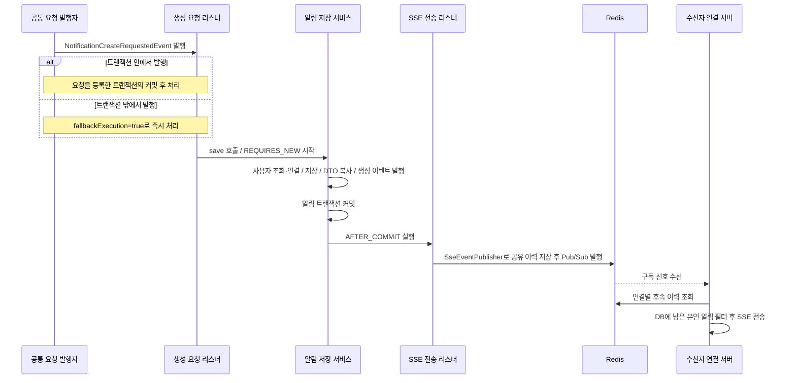

# 1. 알림 생성·저장과 SSE 전송

[#51](https://github.com/codeit-backend13-part4-team1/playlist_for_everyone/issues/51)은 **저장이 커밋된 알림을 수신자에게 실시간으로 전달**하는 연결 작업입니다.
알림 생성 요청부터 읽고, 트랜잭션 경계와 실패 처리를 확인하면 코드를 따라가기 쉽습니다.
업무 이벤트부터 확인하려면 [팔로우 연동](07-domain-event-integration.md) 또는 [권한 변경·구독 연동](08-role-subscription-integration.md)을 먼저 읽습니다.
연결부터 전달까지는 [SSE 전체 흐름](../sse/00-overall-flow.md), 이력과 복구 정책은 [공유 이력 계약](../sse/09-shared-history.md)을 참고합니다.

## 역할부터 구분하기

| 역할 | 코드 | 맡은 일 |
| --- | --- | --- |
| 생성 요청 | `NotificationCreateRequestedEvent` | 수신자·제목·내용·수준으로 알림 저장을 요청 |
| 공통 요청 수신 | `NotificationEventListener` | 트랜잭션 안의 요청은 커밋 후, 밖의 요청은 즉시 받아 command로 변환하고 저장 서비스 호출 |
| 독립 저장 | `NotificationService.save` | 새 트랜잭션에서 수신자를 조회·연결하고 알림 저장·생성 이벤트 발행 |
| 사용자 조회 | `NotificationUserReader` | `UserService.getById`에 조회를 위임하고 User 반환 |
| 저장 결과 전달 | `NotificationCreatedEvent` | 별도 이벤트 ID와 저장된 알림의 DTO 스냅샷 보관 |
| 알림 커밋 후 처리 | `NotificationSseEventListener` | `notifications` 이벤트로 변환하여 공통 발행 계약 호출 |
| 이력 저장·전송 진입점 | `SseEventPublisher` | 기본 발행기가 공유 이력을 저장한 뒤 Redis 전송 구현체에 위임 |

알림 목록 조회와 SSE는 같은 `NotificationDto`를 사용합니다.
전송 리스너는 엔티티를 받거나 DB를 다시 조회하지 않고 저장 당시의 DTO를 사용합니다.

코드는 [NotificationEventListener](../../src/main/java/com/codeit/sb13/playlist_for_everyone/domain/notification/event/listener/NotificationEventListener.java)
→ [NotificationService](../../src/main/java/com/codeit/sb13/playlist_for_everyone/domain/notification/service/NotificationService.java)
→ [NotificationSseEventListener](../../src/main/java/com/codeit/sb13/playlist_for_everyone/domain/notification/event/listener/NotificationSseEventListener.java) 순서로 읽습니다.

## 저장 입력과 제목 말줄임

[NotificationCommand](../../src/main/java/com/codeit/sb13/playlist_for_everyone/domain/notification/dto/command/NotificationCommand.java)는 수신자 ID·제목·내용·수준을 전달합니다.
서비스의 `@Validated`와 `save`의 `@Valid`를 통해 수신자·수준의 null, 제목·내용의 null·공백을 검증합니다.
Command를 직접 생성하는 것만으로 Bean Validation이 실행되지는 않습니다.

제목은 생성자에서 **255 코드 포인트** 이하면 유지하고, 초과하면 앞 252개와 `...`를 남깁니다.
UTF-16 길이 대신 코드 포인트를 기준으로 잘라 이모지의 서로게이트 쌍을 보존합니다. 본문은 말줄임하지 않습니다.
null·공백 제목은 검증 오류를 낼 수 있도록 원래 값으로 두며, 잘라 낸 제목의 원문을 별도로 저장하지 않습니다.

서비스는 수신자 UUID로 사용자를 조회한 뒤 엔티티의 `User` 연관관계에 연결합니다.
DB의 `receiver_id` 외래 키와 요청·응답의 UUID 형식은 유지합니다. 매핑과 조회 컴포넌트는 [수신자 연관관계 문서](06-receiver-association.md)에서 설명합니다.

## 요청 수신 조건과 알림 커밋

아래는 요청을 등록한 트랜잭션이 커밋되거나, 트랜잭션 밖에서 요청을 발행한 경우의 정상 처리 흐름입니다.

업무 이벤트·공통 생성 요청·생성 결과의 세 처리 단계는 모두 `AFTER_COMMIT`을 사용하며, 트랜잭션 밖 발행 시 동작이 다릅니다.

| 수신 이벤트 | 리스너 | `fallbackExecution` | 트랜잭션 밖 발행 |
| --- | --- | --- | --- |
| `UserFollowedEvent` | `NotificationDomainEventListener` | `false` | 무시 |
| `UserRoleChangedEvent` | `NotificationDomainEventListener` | `false` | 무시 |
| `PlaylistSubscribedEvent` | `NotificationDomainEventListener` | `false` | 무시 |
| `NotificationCreateRequestedEvent` | `NotificationEventListener` | `true` | 즉시 처리 |
| `NotificationCreatedEvent` | `NotificationSseEventListener` | `false` | 무시 |

트랜잭션에 등록된 이벤트는 커밋 후 처리하고, 롤백되면 처리하지 않습니다.
팔로우·권한 변경·구독 경로는 업무 커밋 후 공통 요청을 재발행하므로 별도 변환 트랜잭션 없이 위 즉시 처리 경로로 연결됩니다.

`NotificationCreatedEvent`는 **저장 트랜잭션 안에서** 발행됩니다. 이름만 보고 커밋까지 완료된 것으로 해석하지 않습니다.
현재 UUID 생성 전략과 JPA Auditing은 신규 엔티티를 저장할 때 ID·생성시각을 채워 주므로 DTO를 즉시 구성합니다.
`save` 반환이나 SQL을 실행하는 `flush` 자체는 커밋 완료를 뜻하지 않으며, 이 경로는 명시적 `flush`를 강제하지 않습니다.

저장은 별도 Spring 빈을 통해 호출하여 `REQUIRES_NEW`를 적용합니다.
업무 커밋 전에 저장 서비스를 직접 호출하면 알림만 먼저 커밋될 수 있습니다. 업무 이벤트는 저장 트랜잭션 안에서 발행하고 커밋 후 변환합니다.
세 리스너에 `@Async`는 없습니다. 트랜잭션에 등록된 요청은 커밋 처리 스레드에서, 밖의 요청은 발행 스레드에서 실행하며 브라우저 수신 완료를 기다리지는 않습니다.

## 이벤트 ID와 클라이언트 데이터

| 값 | 의미와 사용처 |
| --- | --- |
| `NotificationCreatedEvent.eventId` | 저장 서비스에서 한 번 만든 UUID. SSE 프레임의 `id`까지 유지 |
| `NotificationDto.id` | DB에 저장한 알림의 ID. 이벤트 ID와 별도로 관리 |
| `NotificationDto.receiverId` | 각 서버에서 실제 수신자의 연결을 찾는 기준 |
| `eventName` | `notifications`로 고정 |
| `data` | `NotificationDto` 객체를 JSON으로 전달 |

DTO에는 `id`, `createdAt`, `receiverId`, `title`, `content`, `level`이 들어갑니다.
브라우저의 `data`에는 이 DTO만 전달하고, 내부 `SseEvent` 전체를 넣거나 DTO를 미리 JSON 문자열로 바꾸지 않습니다.
`SseEvent.createNotificationEvent`는 이벤트 이름을 지정하며, 새 이벤트 ID를 만들지 않습니다.

알림 코드는 로컬 연결 유무를 확인하지 않습니다. 발행 서버 A에 연결이 없어도 수신자가 서버 B에 연결되어 있을 수 있기 때문입니다.
Redis 신호를 받은 서버는 연결별 위치에서 이력을 읽습니다. `NotificationReplayFilter`가
DTO의 DB 알림 ID를 수신자 조건으로 일괄 조회하여 현재 남아 있는 알림만 원래 순서로 전달합니다.
`data.id`를 UUID로 읽을 수 없는 항목은 제외하고, 유효한 ID가 하나도 없으면 DB를 조회하지 않습니다.
읽음 처리로 DB 알림을 삭제해도 Redis 커서 매핑은 보관 정책에 따라 남아 복구 기준으로 사용됩니다.
필터가 모든 항목을 제외해도 원본 이력의 마지막 위치까지 진행합니다. 상세 계약은 [복구와 필터](../sse/10-recovery-and-retry.md#필터와-보관-범위-밖의-이력)를 참고합니다.

## 실패했을 때 남는 것

| 상황 | 알림 저장·전송 결과 |
| --- | --- |
| 업무 이벤트나 공통 요청을 등록한 트랜잭션의 롤백 | 해당 AFTER_COMMIT 소비 미실행, 알림·SSE 발행 없음 |
| 알림 입력 검증 실패 | 원래 업무 커밋 유지, 검증 실패 기록, 알림 저장·SSE 발행 없음 |
| 수신자 미존재 | 사용자 조회에서 UserNotFoundException 발생, 알림 저장·생성 이벤트 발행 전 종료 |
| 실제 DB 저장 실패 | 알림 트랜잭션 롤백, 원래 업무 커밋 유지, 실패 기록, SSE 발행 없음 |
| 알림 저장 트랜잭션 롤백 | 생성 이벤트를 이미 발행했어도 SSE 전송 리스너 미실행 |
| JSON 변환·이력 저장 실패 | 저장된 DB 알림과 업무 데이터 유지, 브로커 호출 없음, 실패 기록 |
| 이력 저장 후 Redis 발행 실패 | DB 알림과 공유 이력 유지, 실패 기록, 자동 재발행 없음 |
| 수신자가 미접속 | 알림·이력 저장과 Redis 발행 요청 수행, 연결이 없는 서버의 로컬 전송은 종료 |

전송 리스너는 발행 구현체가 전달하는 `SsePublishException`만 처리합니다.
공통 이력 발행기는 JSON 변환·저장소 접근·이력 충돌·저장 결과 해석 실패를 이 예외로 감쌉니다.
전송 구현체의 직렬화·Redis 실패도 같은 계약으로 전달됩니다. 필수 값 누락 같은 이벤트 구성 오류까지 처리하는 계약은 아닙니다.

전송 실패 로그에는 알림 ID·이벤트 ID·수신자 ID·원인 예외 타입만 남기고, 제목·내용·예외 메시지·스택은 넣지 않습니다.
Redis 발행자 로그와 알림 리스너 로그가 각각 남을 수 있으며, 동일 이벤트 ID로 연결해 확인합니다.
생성 요청 리스너의 **알림 저장 실패** 로그는 수신자 ID와 예외 스택을 남기는 별도 경로입니다.
입력 검증·사용자 조회·DB 저장 실패는 이 리스너가 처리하며, 이미 커밋된 업무와 후속 알림 처리를 유지합니다.

## 현재 보장하는 범위

정상 커밋된 알림 한 건에 대해 발행 요청을 한 번 수행합니다. 이는 모든 장애 상황에서 브라우저에 정확히 한 번 도착한다는 보장이 아닙니다.
알림 저장과 Redis 발행은 원자적으로 묶이지 않으므로, 커밋 후 프로세스가 종료되거나 발행이 실패하면 실시간 알림이 누락될 수 있습니다.
DB 알림은 조회할 수 있습니다. 공유 이력 저장에 성공한 항목은 보관 범위 내에서 복구할 수 있으며,
연결 이후의 일시적 조회 실패는 제한된 재시도를 수행합니다. 이것은 브로커 자동 재발행이나 Outbox가 아닙니다.
발행 실패 후 보관된 이력이 즉시 전송된다고 보장하지 않으며, 이후 조회 신호나 유효한 커서를 가진 재연결이 필요합니다.

공통 생성 요청으로 변환하는 구현과 검증 범위는 [#155 팔로우](07-domain-event-integration.md)와 [#156 권한 변경·구독](08-role-subscription-integration.md)에 정리했습니다.
이 세 종류 외의 업무 이벤트는 [#45](https://github.com/codeit-backend13-part4-team1/playlist_for_everyone/issues/45)의 후속 연동이며, DM 본문의 `direct-messages` 연동과 Kafka 구현체도 별도 범위입니다.
공유 이력과 재연결 복구의 현재 동작은 [SSE 복구 문서](../sse/10-recovery-and-retry.md)에 정리했습니다.
이번 기능을 위한 외부 알림 생성 API는 추가하지 않았으며, 실제 저장부터 수신까지의 확인 방법은 다음 문서에 정리합니다.

---

[알림 목차](README.md) · [공통 SSE 가이드](../sse/README.md) · [다음: 알림 생성·전송 테스트 →](02-testing.md)
