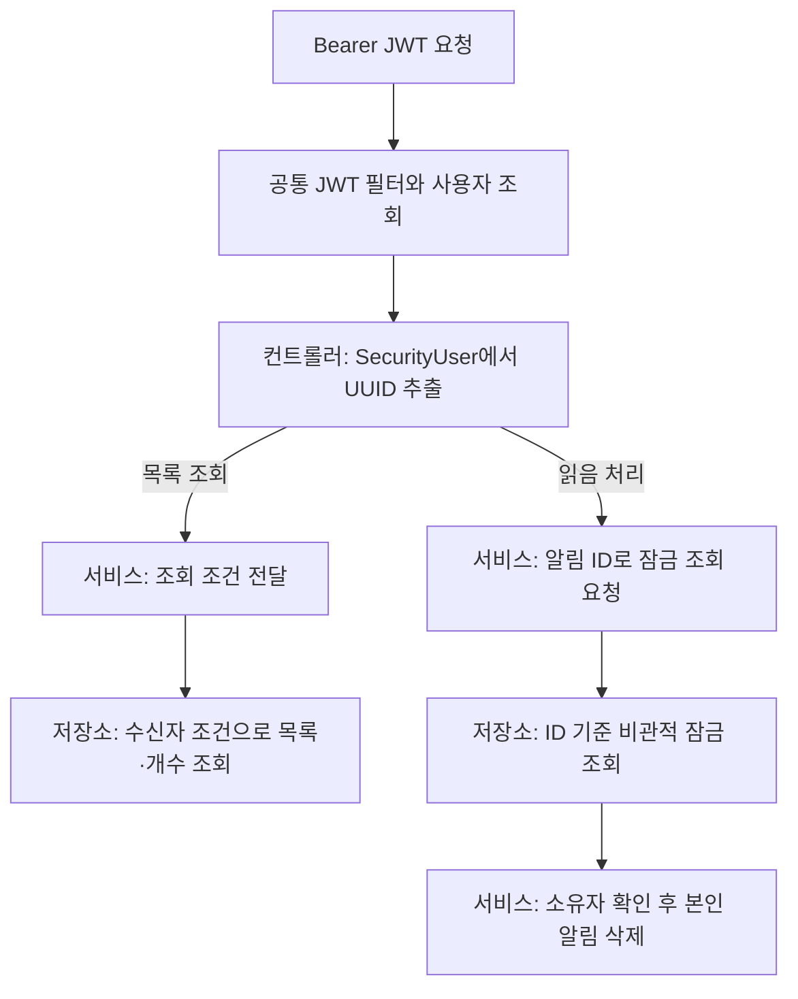

# 3. 목록 조회·읽음 처리와 JWT 인증

알림 API는 **JWT로 확인한 사용자가 수신한 알림**을 조회하고 읽음 처리합니다.
수신자 ID를 요청값으로 받지 않으며, 읽음 처리는 알림 행을 삭제하는 방식입니다.

## 요청자와 수신자 범위가 정해지는 곳



[NotificationController](../../src/main/java/com/codeit/sb13/playlist_for_everyone/domain/notification/controller/NotificationController.java)는
조회 시 `request.toCondition(user.getUserId())`, 삭제 시 `confirm(notificationId, user.getUserId())`를 호출합니다.
서비스는 인증 컨텍스트를 다시 읽지 않습니다. 내부 호출자도 의도한 수신자 ID를 전달해야 합니다.

목록과 전체 개수는 저장소의 수신자 조건으로 제한합니다.
읽음 처리는 알림 ID로 조회한 뒤 서비스가 `notification.isOwner(receiverId)`로 수신자를 확인합니다.

## 목록 조회 요청

`GET /api/notifications`는 다음 쿼리 파라미터를 사용합니다.

| 파라미터 | 필수 | 현재 규칙 |
| --- | --- | --- |
| `limit` | 예 | 양의 정수. 생략 시 기본값을 넣지 않고 검증 오류 반환 |
| `sortDirection` | 예 | `ASCENDING` 또는 `DESCENDING` |
| `sortBy` | 예 | `createdAt` |
| `cursor` | 아니요 | 이전 응답의 `nextCursor`. 전달하면 `LocalDateTime` 형식 검증 |
| `idAfter` | 아니요 | 이전 응답의 `nextIdAfter`. UUID 형식 |

첫 페이지에서는 커서 두 값을 생략합니다. 아래 토큰 표기는 실제 토큰으로 교체할 자리입니다.

```http
GET /api/notifications?limit=20&sortDirection=DESCENDING&sortBy=createdAt
Authorization: Bearer <access-token>
```

`hasNext=true`이면 **응답의 `nextCursor`와 `nextIdAfter`를 함께** 다음 요청에 넣고 정렬 조건을 유지합니다.
예를 들어 두 값이 각각 아래 시각·ID였다면 다음처럼 요청합니다.

```http
GET /api/notifications?limit=20&sortDirection=DESCENDING&sortBy=createdAt&cursor=2026-11-04T12:00:00&idAfter=11111111-1111-1111-1111-111111111111
Authorization: Bearer <access-token>
```

현재 구현은 둘 중 하나만 전달한 요청을 쌍 검증으로 거부하지 않습니다.
두 값이 모두 있어야 페이지 경계를 적용하므로 하나가 없으면 첫 페이지 조건으로 조회합니다.
다만 날짜 형식이 잘못된 `cursor`는 `idAfter`가 없어도 400이며, 빈 문자열도 올바른 날짜가 아닙니다.

## 커서와 응답을 읽는 방법

[NotificationCustomRepositoryImpl](../../src/main/java/com/codeit/sb13/playlist_for_everyone/domain/notification/repository/impl/NotificationCustomRepositoryImpl.java)은
생성시각과 ID를 같은 방향으로 정렬합니다. 생성시각이 같아도 ID가 순서를 결정합니다.
내림차순은 커서보다 작은 시각 또는 같은 시각의 작은 ID를 선택하고, 오름차순은 반대로 선택합니다.
커서의 알림 행을 다시 찾지 않으므로 그 알림이 읽음 처리로 삭제되어도 전달된 값으로 탐색할 수 있습니다.

저장소가 최대 `limit + 1`건을 가져오면 [NotificationService](../../src/main/java/com/codeit/sb13/playlist_for_everyone/domain/notification/service/NotificationService.java)가
추가 한 건으로 다음 페이지 유무를 판단하고, 반환 목록에서 그 한 건을 제외합니다.

| 응답 필드 | 의미 |
| --- | --- |
| `data` | 최대 `limit`건의 `NotificationDto`. SSE의 `notifications` 데이터와 같은 DTO |
| `hasNext` | 추가로 조회된 한 건이 있으면 `true` |
| `nextCursor`, `nextIdAfter` | 다음 페이지가 있을 때 반환 목록의 마지막 알림의 생성시각·ID. 마지막 페이지와 빈 목록에서는 모두 `null` |
| `totalCount` | 커서 위치와 무관한 **본인의 전체 알림 수**. 다른 사용자의 알림은 제외 |
| `sortBy`, `sortDirection` | 이번 조회에 사용한 정렬 기준과 방향 |

`nextIdAfter`는 DB 알림 ID입니다. SSE 프레임의 별도 이벤트 ID를 넣지 않습니다.
이 ID 구분은 [생성·전송 문서](01-creation-and-delivery.md)에서도 확인할 수 있습니다.

## 읽음 처리와 반복 요청

`DELETE /api/notifications/{notificationId}`는 Bearer JWT와 함께 CSRF 검증을 통과해야 합니다.
현재 공통 설정은 `XSRF-TOKEN` 쿠키와 `X-XSRF-TOKEN` 헤더를 사용합니다.

`NotificationService.confirm()`의 처리 순서는 다음과 같습니다.

1. 저장소의 `findWithPessimisticLockById(notificationId)`로 알림을 조회하고 비관적 쓰기 잠금을 획득합니다. 대상이 없으면 정상 종료합니다.
2. 조회한 알림의 `isOwner(receiverId)`를 확인합니다. 타인의 알림이면 삭제하지 않고 정상 종료합니다.
3. 본인 알림이면 `delete(notification)`를 호출합니다. 잠금 조회·소유자 확인·삭제 요청은 같은 트랜잭션에서 수행합니다.
4. 해당 트랜잭션이 커밋되면 삭제가 확정되고 잠금이 해제됩니다. 롤백되면 삭제는 반영되지 않습니다.

잠금 조회 조건에는 알림 ID만 사용하므로, 삭제 가능 여부는 서비스의 소유자 확인으로 결정됩니다.
외부 트랜잭션에 참여한 경우에는 `confirm()` 반환 후에도 그 트랜잭션이 끝날 때까지 잠금이 유지됩니다.
두 요청이 같은 알림을 삭제할 때의 대기·커밋 과정은 [동시 삭제 검증](05-concurrent-deletion-testing.md)에서 설명합니다.

| JWT·CSRF 조건을 충족한 요청 | 응답 | DB 결과 |
| --- | --- | --- |
| 본인 알림 | 204, 빈 본문 | 삭제 후 목록과 전체 개수에 반영 |
| 이미 삭제한 알림·존재하지 않는 ID | 204, 빈 본문 | 추가 변경 없음 |
| 타인의 알림 | 204, 빈 본문 | 타인의 알림 보존 |

204만으로 알림이 존재했거나 실제 삭제되었다고 판단할 수 없습니다.
이 정책은 반복 요청을 허용하며, 타인의 알림 요청에 별도 403·404를 반환하지 않습니다.
잠금 획득이나 DB 처리 중 발생한 예외는 기존 예외 처리로 전달하며, 정상 응답인 204로 바꾸지 않습니다.

## 오류와 Swagger 인증 표시

| 상황 | 응답 |
| --- | --- |
| 필수 조회값 누락, 잘못된 값·UUID·날짜 형식 | 필요한 보안 검사를 통과한 요청에서 400과 공통 오류 응답 |
| JWT 없음·만료·서명 변조 | JWT 인증 실패 시 401과 공통 인증 오류 응답. DELETE는 CSRF 검증 통과를 전제로 설명 |
| 처리 중 서버 내부 오류 | 500과 공통 오류 응답 |

401 응답 예시는 다음과 같습니다. 오류 형태는 `ApiErrorResponse`를 따릅니다.

```json
{"exceptionName":"UnauthorizedException","message":"인증이 필요합니다.","details":{}}
```

[NotificationApi](../../src/main/java/com/codeit/sb13/playlist_for_everyone/domain/notification/controller/swagger/NotificationApi.java)의
`@SecurityRequirement(name = "bearerAuth")`는 공통 OpenAPI 보안 스키마를 참조합니다.
`@Parameter(hidden = true)`는 서버가 주입하는 Principal을 입력란에서 숨기며, 실제 인증은 공통 보안 필터가 수행합니다.

현재 공통 보안 설정은 CSRF를 활성화한 상태입니다. CSRF 실패로 요청이 거부될 수 있으므로,
토큰 없는 실제 DELETE 요청이 항상 JWT 오류인 401로 끝난다는 의미는 아닙니다.
현재 알림 JWT 통합 테스트는 해당 클래스의 MockMvc 요청에서 CSRF 검사만 임시 제외합니다.
실제 CSRF 토큰을 사용하는 알림 API 연동·실패 응답·회귀 검증과 임시 설정 제거는
[#124](https://github.com/codeit-backend13-part4-team1/playlist_for_everyone/issues/124)에서 진행합니다. Swagger의 최종 CSRF 계약 정리도 이 후속 범위에 포함합니다.

---

[← 이전: 알림 생성·전송 테스트](02-testing.md) · [알림 목차](README.md) · [다음: 조회·인증 테스트와 Swagger 확인 →](04-query-and-security-testing.md)
