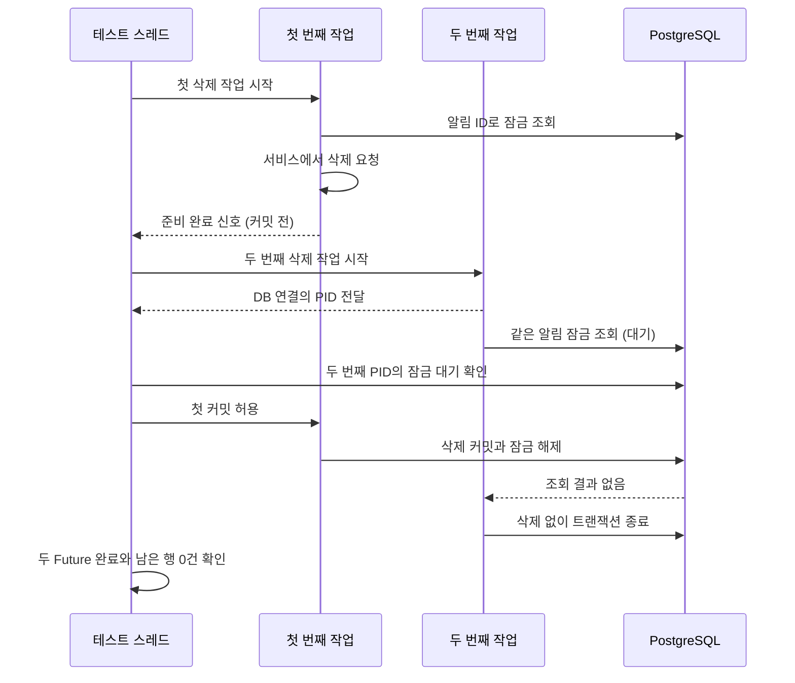

# 5. 동시 읽음 처리와 잠금 검증

같은 알림의 읽음 요청이 겹치면, 먼저 잠금을 획득한 트랜잭션이 끝날 때까지 다음 요청이 기다립니다.
[NotificationServiceIntegrationTest](../../src/test/java/com/codeit/sb13/playlist_for_everyone/domain/notification/service/NotificationServiceIntegrationTest.java)는
**실제 DB 잠금 대기 → 첫 삭제 커밋 → 두 작업의 정상 완료 → 알림 삭제**를 검증합니다.

API의 응답 정책은 [조회·읽음 처리 흐름](03-query-and-security.md), 테스트별 역할은 [검증 범위](04-query-and-security-testing.md)를 참고합니다.

## 두 트랜잭션의 진행 순서



첫 작업의 `confirm()`이 반환되어도 바깥 `TransactionTemplate`의 콜백은 커밋 허용 신호를 기다립니다.
서비스가 이 트랜잭션에 참여하므로 잠금이 유지됩니다. **삭제 준비 완료 신호는 커밋 완료를 뜻하지 않습니다.**

이 테스트는 PostgreSQL 16의 기본 `READ COMMITTED` 격리 수준을 사용합니다.
첫 트랜잭션이 행을 삭제하고 커밋하면, 대기하던 잠금 조회는 해당 행을 반환하지 않아 두 번째 작업도 정상 종료합니다.
다른 격리 수준에서의 동작은 [PostgreSQL 트랜잭션 격리 문서](https://www.postgresql.org/docs/16/transaction-iso.html#XACT-READ-COMMITTED)를 기준으로 별도 확인해야 합니다.

## 신호와 결과 객체의 역할

| 객체 | 전달하는 정보 |
| --- | --- |
| `firstDeletionPrepared` | 첫 작업이 잠금 조회와 삭제 요청까지 진행했음 |
| `allowFirstCommit` | 첫 작업이 대기를 끝내고 트랜잭션 콜백에서 반환해도 됨 |
| `secondBackendPid` | 두 번째 작업의 DB 연결을 담당하는 PostgreSQL 프로세스 ID |
| `firstDeletion`, `secondDeletion` | 각 작업 전체의 완료 또는 예외. `Future.get()`으로 확인 |

`secondBackendPid.complete()`는 PID 전달 완료입니다. 삭제 작업은 그다음에 시작합니다.
`pg_backend_pid()`로 구한 값은 Java 스레드 ID가 아니라 DB 연결의 프로세스 ID입니다.
같은 트랜잭션에서 JDBC로 PID를 구한 뒤 서비스의 잠금 조회를 호출하여 어느 DB 연결이 기다리는지 식별합니다.

## 실제 잠금 대기와 최종 결과 확인

테스트 스레드는 별도 DB 연결에서 `cardinality(pg_blocking_pids(?)) > 0`을 조회합니다.
이 값이 참이면 해당 PID의 잠금 획득을 막는 세션이 있다는 뜻입니다.
[PostgreSQL 잠금 조회 함수](https://www.postgresql.org/docs/16/functions-info.html)의 결과를 Awaitility로 반복 확인한 뒤 첫 커밋을 허용합니다.

두 `Future.get()`이 정상 반환해야 각 트랜잭션까지 예외 없이 종료된 것입니다.
이어 JDBC로 알림 행이 남아 있지 않은지 확인합니다. HTTP의 204 응답은 JWT 통합 테스트에서 별도로 검증합니다.

## 데이터 준비와 종료 정리

테스트 전체에 `@Transactional`을 붙이지 않습니다. 준비한 사용자·알림을 먼저 커밋해야 두 작업 스레드에서 조회할 수 있습니다.
각 스레드의 `TransactionTemplate`이 별도 트랜잭션을 만들고, 첫 작업은 신호 대기를 통해 커밋 시점을 조절합니다.

`finally`는 검증 실패 시에도 첫 작업의 대기를 풀고 실행기를 종료합니다.
종료 대기에 시간이 초과되면 작업 중단을 요청하고 종료 여부를 다시 확인합니다.
작업이 끝난 뒤 `@AfterEach`가 이 테스트의 알림 → 사용자 순서로 커밋된 데이터를 정리합니다.
코드의 대기 시간은 테스트가 끝없이 기다리는 것을 방지하는 제한이며, 운영 DB의 잠금 제한 시간 설정은 아닙니다.

## 실행

Docker를 실행한 뒤 프로젝트 루트에서 확인합니다. 기본 `test` 프로필과 PostgreSQL 컨테이너를 사용합니다.

```bash
./gradlew test --tests '*NotificationServiceIntegrationTest' --no-daemon --console=plain
```

결과는 `build/reports/tests/test/index.html`에서 확인합니다.
실제 서비스·DB 트랜잭션을 검증하며, HTTP·JWT·CSRF·SSE 전송과 운영 부하 검증은 이 테스트의 범위에 포함하지 않습니다.

---

[← 이전: 조회·인증 테스트와 Swagger 확인](04-query-and-security-testing.md) · [알림 목차](README.md) · [다음: 수신자 연관관계와 사용자 조회 →](06-receiver-association.md)
