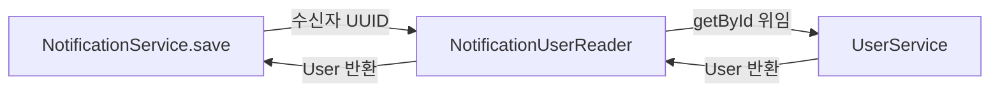

# 6. 수신자 연관관계와 사용자 조회

[#129](https://github.com/codeit-backend13-part4-team1/playlist_for_everyone/issues/129)은 알림의 수신자를 `User` 연관관계로 연결하고,
사용자 조회 호출을 컴포넌트로 모으는 작업입니다. **저장할 때 사용자를 확인하고, 응답에는 수신자 UUID를 전달**합니다.

## 수신자를 표현하는 위치

| 위치 | 표현 | 의미 |
| --- | --- | --- |
| `Notification.receiver` | `User` | 알림을 받는 사용자와의 연관관계 |
| DB `notifications.receiver_id` | UUID 외래 키 | 기존 `users.id` 참조 유지 |
| 생성 요청 이벤트·`NotificationCommand` | `receiverId` UUID | 저장할 수신자 지정 |
| `NotificationDto`·SSE 데이터 | `receiverId` UUID | 클라이언트와 전송 계층에 전달할 수신자 식별자 |

DB 컬럼과 외래 키, 조회·읽음 API 및 SSE 데이터 형식은 그대로입니다. 이 변경을 위한 마이그레이션은 추가하지 않았습니다.

[Notification](../../src/main/java/com/codeit/sb13/playlist_for_everyone/domain/notification/entity/Notification.java)의 매핑은 다음 원칙을 따릅니다.

- `@ManyToOne(fetch = LAZY, optional = false)`와 `@JoinColumn(nullable = false)`로 필수 수신자를 지정합니다.
- cascade를 설정하지 않아 알림 저장·삭제가 사용자 저장·삭제로 전파되지 않습니다.
- `User`에는 알림 역방향 컬렉션을 추가하지 않습니다.
- `getReceiverId()`로 UUID를 꺼내 DTO를 구성하고, `isOwner()`로 전달받은 UUID와 비교합니다.

## 사용자 조회 컴포넌트의 역할

[NotificationUserReader](../../src/main/java/com/codeit/sb13/playlist_for_everyone/domain/notification/service/NotificationUserReader.java)는
알림에서 사용자 도메인을 호출하는 지점을 모으는 위임 컴포넌트입니다.
호출 창구를 제공하는 **작은 파사드 역할**로 이해하면 됩니다. 기존 서비스 계층 안에서 역할을 나눈 구조이며,
포트 인터페이스나 교체 가능한 어댑터를 추가한 구조는 아닙니다. 반환형도 현재는 `User` 엔티티입니다.

사용자 존재 여부와 `UserNotFoundException` 생성은 `UserService.getById()`가 담당합니다.
Reader는 예외를 변환하거나 별도 트랜잭션을 시작하지 않고 그대로 전달합니다.

## 저장 트랜잭션 안에서의 순서

[NotificationService.save()](../../src/main/java/com/codeit/sb13/playlist_for_everyone/domain/notification/service/NotificationService.java)는
다른 Spring 빈에서 호출하면 `REQUIRES_NEW`로 알림 전용 트랜잭션을 시작합니다.

1. Reader를 통해 수신자를 조회합니다. `UserService.getById()`의 기본 전파 설정인 `REQUIRED`가 이 트랜잭션에 참여합니다.
2. 조회한 사용자를 `new Notification(command, receiver)`로 연결하고 저장합니다.
3. 저장된 값으로 DTO를 구성하고 같은 트랜잭션 안에서 `NotificationCreatedEvent`를 발행합니다.
4. 알림 트랜잭션이 커밋된 뒤 SSE 전송 리스너가 발행을 요청합니다.

사용자가 없으면 1번에서 예외가 발생하므로 알림 저장과 생성 이벤트 발행을 시도하지 않습니다.
공통 생성 경로의 `NotificationEventListener`는 이 예외를 기록하여 이미 커밋된 업무와 후속 알림 처리를 유지합니다.
서비스를 직접 호출한 경우에는 호출자가 예외를 받습니다.

사용자 조회 이후의 DB 실패 가능성은 남아 있으며, 사용자 조회가 외래 키 제약을 대신하지는 않습니다.
업무·알림의 두 커밋 경계와 실패 처리는 [생성·전송 흐름](01-creation-and-delivery.md),
검증·사용자 조회·실제 DB 실패의 테스트 구분은 [생성·전송 테스트](02-testing.md)를 참고합니다.

## 검증을 나눈 기준

| 테스트 | 이번 변경에서 확인하는 것 |
| --- | --- |
| `NotificationServiceTest` | 조회한 User를 그대로 연결, 수신자 미존재 예외 전달, 저장소·생성 이벤트 발행자 미호출 |
| `NotificationIntegrationTest` | 실제 사용자 조회, 실패 시 업무 커밋 유지와 SSE 미발행, 이후 정상 알림 처리 |
| `NotificationRepositoryTest` | 연관관계 ID로 수신자별 조회, 알림 삭제 후 사용자 보존, DTO 변환 중 추가 SQL 여부 |

사용자 보존 검증은 기존 삭제 후 목록·개수 테스트에 포함합니다. 별도의 삭제 사례를 중복해서 만들지 않습니다.
저장소 테스트는 JDBC로 사용자를 준비하고, 직접 엔티티를 저장하는 사례에서만 `EntityManager`로 User를 조회합니다.
서비스 주입 없이 매핑과 저장소의 동작을 확인하며, 실제 삭제 권한·잠금 경계는 기존 서비스 테스트가 담당합니다.

## DTO 변환 중 추가 SQL을 확인하는 방법

[NotificationRepositoryTest](../../src/test/java/com/codeit/sb13/playlist_for_everyone/domain/notification/repository/NotificationRepositoryTest.java)의
`convertsNotificationsToDtosWithoutAdditionalUserQueries()`는 다음 순서로 검증합니다.

1. 사용자와 알림 두 건을 JDBC로 준비합니다. User를 영속성 컨텍스트에 미리 올리지 않습니다.
2. 저장소로 알림을 조회하고, 각 수신자가 `Hibernate.isInitialized()` 기준으로 미초기화 상태인지 확인합니다.
3. Hibernate 통계 활성화를 확인하고 `getPrepareStatementCount()`의 현재 누적값을 기록합니다.
4. 목록을 `NotificationDto.from()`으로 변환하여 SQL 수가 늘지 않고 수신자 UUID가 유지되는지 확인합니다.

현재 매핑에서는 수신자의 ID만 읽어 DTO를 구성합니다. 이름·이메일 같은 다른 사용자 필드까지 읽는 동작은 이 검증에 포함하지 않습니다.
사용자를 미리 로딩하면 추가 조회가 가려질 수 있어 데이터 준비 방식과 프록시 상태를 함께 확인합니다.

통계는 이 테스트 클래스에서만 활성화합니다. 카운터는 **SessionFactory 전체의 누적값**이므로 초기화하지 않고 변환 전후 차이를 비교합니다.
측정 중 같은 팩토리에서 다른 SQL이 실행되지 않는 것을 전제로 합니다. 병렬 실행을 도입할 때는 이 측정 범위를 다시 확인해야 합니다.
이 테스트의 통과는 DTO 변환 구간의 추가 SQL이 없다는 의미이며, 목록 조회 전체의 SQL 수나 다른 경로의 N+1까지 보장하지 않습니다.

테스트 실행 명령과 결과 확인 위치는 [조회·인증 테스트 가이드](04-query-and-security-testing.md)의 실행 절차를 사용합니다.

---

[← 이전: 동시 읽음 처리와 잠금 검증](05-concurrent-deletion-testing.md) · [알림 목차](README.md) · [팀원 개발 가이드](../DEVELOPMENT.md)
