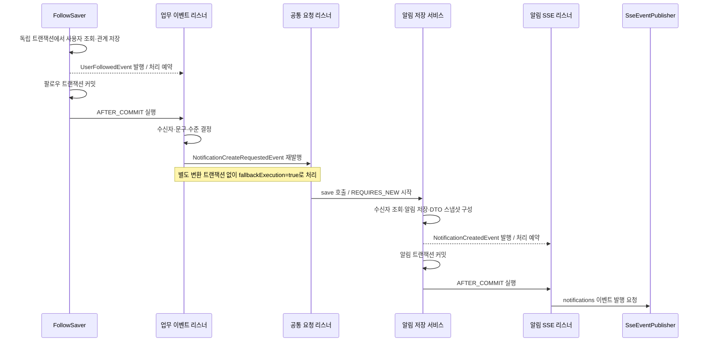

# 7. 업무 이벤트와 팔로우 알림 연동

팔로우 등록이 커밋되면 팔로우받은 사용자에게 알림을 생성합니다.
[#155](https://github.com/codeit-backend13-part4-team1/playlist_for_everyone/issues/155)에서 연결한 흐름이며,
권한 변경·플레이리스트 구독의 구현은 [#156 연동 가이드](08-role-subscription-integration.md)에서 설명합니다.
팔로워·구독자 목록을 조회해 여러 수신자에게 전달하는 흐름은 [#157 플레이리스트 알림](09-playlist-event-integration.md)에서 설명합니다.
전체 업무 이벤트의 계약과 후속 연동은 상위 [#45](https://github.com/codeit-backend13-part4-team1/playlist_for_everyone/issues/45)에서 관리합니다.

이 페이지 → [공통 저장·전송](01-creation-and-delivery.md) → [테스트 읽기](02-testing.md) 순서로 읽으면 됩니다.

## 누가 무엇을 결정하나요?

| 담당 | 책임 |
| --- | --- |
| 팔로우 도메인 | 사용자 조회, 관계 저장, 업무 사실을 담은 `UserFollowedEvent` 발행 |
| `NotificationDomainEventListener` | 커밋된 업무 이벤트를 받아 수신자·문구·수준을 결정하고 공통 생성 요청 재발행 |
| `NotificationEventListener`·`NotificationService` | 공통 요청을 받아 수신자를 조회하고 독립 트랜잭션으로 알림 저장 |
| `NotificationSseEventListener` | 알림 저장 커밋 후 공통 SSE 발행 계약 호출 |

생산자는 사용자·팔로우 엔티티나 완성된 알림 문구를 이벤트에 담지 않습니다.
알림 생성 요청은 저장 결과를 반환하지 않으며, 팔로우 응답은 팔로우 처리 결과를 사용합니다.

## 팔로우 한 건의 전체 흐름



업무 이벤트 리스너는 `AFTER_COMMIT`, `fallbackExecution=false`입니다.
팔로우 저장이 롤백되거나 트랜잭션 없이 `UserFollowedEvent`를 발행하면 알림 요청을 만들지 않습니다.
공통 요청 리스너는 커밋 후 재발행된 요청을 처리하도록 `fallbackExecution=true`를 사용합니다.
**변환을 위한 별도 트랜잭션은 없으며**, 실제 알림 저장에서 `REQUIRES_NEW`를 사용합니다.

현재 Spring 이벤트 처리는 동기 방식입니다. 커밋 처리 스레드에서 알림 저장과 SSE 발행 요청까지 이어집니다.
이후 공유 이력·Redis·연결별 전송은 [공통 저장·전송 흐름](01-creation-and-delivery.md)에서 설명합니다.

## 팔로우 알림에 사용하는 값

`UserFollowedEvent(followerId, followerName, followeeId)`를 다음과 같이 변환합니다.

| 공통 생성 요청의 값 | 결정 규칙 |
| --- | --- |
| `receiverId` | 팔로우받은 사용자 `followeeId` |
| `title` | `새로운 팔로워` |
| `content` | `{followerName}님이 회원님을 팔로우했습니다.` |
| 이름 대체 | null·빈 문자열·공백 이름은 `사용자`로 표시 |
| `level` | `NotificationLevel.INFO` |

이름은 이벤트 발생 당시의 스냅샷을 사용합니다. 문구를 만들기 위해 팔로워를 다시 조회하지 않습니다.
저장 서비스가 알림 수신자를 조회하는 것은 `User` 연관관계에 연결하기 위한 별도 작업입니다.

## 생산 도메인에서 발행하는 위치

아래는 [FollowSaver.save](../../src/main/java/com/codeit/sb13/playlist_for_everyone/domain/follow/service/impl/FollowSaver.java)의 핵심 부분입니다.
Spring 빈의 `REQUIRES_NEW` 저장 트랜잭션 안에서 실행되며, 호출자가 반환값을 받기 전에 트랜잭션 프록시가 커밋합니다.

```java
Follow saved = followRepository.save(createFollow(command));
eventPublisher.publishEvent(new UserFollowedEvent(
        saved.getFollowerId(),
        saved.getFollowerName(),
        saved.getFolloweeId()
));
```

저장과 업무 이벤트 발행을 같은 트랜잭션에 둡니다. `save`나 이벤트 발행 자체가 커밋 완료를 의미하지 않습니다.
이후 커밋이 실패하면 발행 기록은 남을 수 있지만 알림의 `AFTER_COMMIT` 소비는 실행되지 않습니다.
사전 조회에서 기존 팔로우를 찾은 요청과 언팔로우에서는 새 생성 이벤트를 발행하지 않습니다.
중복 경쟁·실제 UNIQUE 충돌 처리와 발행 조건은 [팔로우 이벤트 가이드](../follow/04-follow-event.md)를 참고합니다.

## 실패 처리와 보장 범위

| 실패 지점 | 처리와 남는 데이터 |
| --- | --- |
| 팔로우 저장·커밋 | 업무 롤백 시 알림 요청으로 변환하지 않음 |
| 문구 변환·공통 요청 재발행 | 업무 이벤트 리스너가 실패를 기록하고 이미 커밋된 팔로우 유지 |
| 알림 입력·수신자 조회·DB 저장 | 공통 요청 리스너가 실패를 기록하고 원래 팔로우 유지 |
| SSE 발행 요청 | 기존 전송 실패 처리 적용. 커밋된 팔로우와 DB 알림 유지 |

변환·재발행 실패 로그에는 `followerId`, `followeeId`, 예외 타입을 남깁니다.
이 로그에는 이름·본문·원본 예외 메시지를 넣지 않습니다. 저장·전송 실패 로그는 각 리스너가 담당합니다.

업무 커밋과 알림 저장은 하나의 원자적 작업이 아닙니다. 그 사이 프로세스가 종료되면 알림이 누락될 수 있습니다.
자동 재발행·Outbox·모든 장애 상황의 전달 보장은 제공하지 않습니다.
권한 변경·구독도 같은 공통 생성 경로를 사용하며, 수신자·문구와 생산 서비스의 차이는 [8번 페이지](08-role-subscription-integration.md)에서 설명합니다.
비동기화·Kafka 전환은 현재 알림 연동의 구현 범위에 포함하지 않습니다.

## 코드를 확인하는 순서

1. [FollowSaver](../../src/main/java/com/codeit/sb13/playlist_for_everyone/domain/follow/service/impl/FollowSaver.java)에서 업무 이벤트 발행 위치를 확인합니다.
2. [NotificationDomainEventListener](../../src/main/java/com/codeit/sb13/playlist_for_everyone/domain/notification/event/listener/NotificationDomainEventListener.java)에서 매핑과 재발행 실패 처리를 확인합니다.
3. [공통 저장·전송 가이드](01-creation-and-delivery.md)에서 요청 수신 조건과 알림 커밋 이후를 확인합니다.

단위 테스트는 매핑·실패 처리를, `NotificationIntegrationTest`는 실제 팔로우 등록부터 알림 저장·SSE 발행 요청을 검증합니다.
Redis·HTTP 수신은 별도의 `NotificationSseIntegrationTest`에서 확인합니다.
팔로우 등록부터 브라우저 수신까지를 하나의 테스트로 검증한 것은 아닙니다. 실행 방법은 [테스트 가이드](02-testing.md)에 있습니다.

---

[알림 목차](README.md) · [팔로우 이벤트](../follow/04-follow-event.md) · [권한 변경·구독 알림](08-role-subscription-integration.md) · [플레이리스트 알림](09-playlist-event-integration.md) · [다음: 공통 저장·전송 →](01-creation-and-delivery.md)
