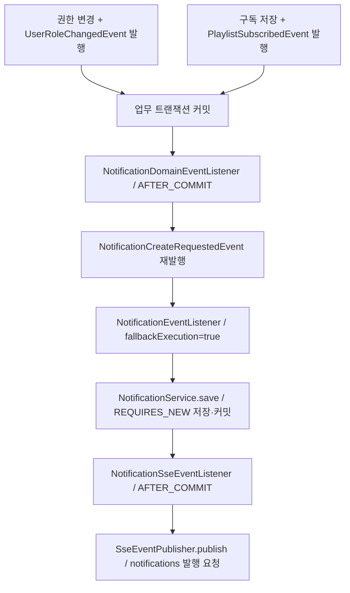

# 8. 권한 변경·플레이리스트 구독 알림 연동

권한 변경이 커밋되면 변경 대상 사용자에게, 구독이 커밋되면 플레이리스트 소유자에게 알림을 생성합니다.
[#156](https://github.com/codeit-backend13-part4-team1/playlist_for_everyone/issues/156)은 기존 업무 이벤트를 공통 알림 생성 경로에 연결합니다.
팔로우 예시는 [7번 페이지](07-domain-event-integration.md), 전체 업무 이벤트 연동 범위는 [#45](https://github.com/codeit-backend13-part4-team1/playlist_for_everyone/issues/45)에서 확인합니다.

## 누가 이벤트를 발행하나요?

| 생산 서비스 | 업무 이벤트와 전달 값 |
| --- | --- |
| [UserAdministrationService.updateRole](../../src/main/java/com/codeit/sb13/playlist_for_everyone/domain/user/service/UserAdministrationService.java) | `UserRoleChangedEvent(userId, previousRole, newRole)` |
| [PlaylistServiceImpl.subscribe](../../src/main/java/com/codeit/sb13/playlist_for_everyone/domain/playlist/service/impl/PlaylistServiceImpl.java) | `PlaylistSubscribedEvent(playlistId, playlistTitle, ownerId, subscriberId, subscriberName)` |

권한 변경은 사용자의 기존 권한과 요청한 권한이 다를 때만 이벤트를 발행합니다.
같은 권한을 다시 요청하면 변경과 이벤트 발행 없이 종료합니다.

구독은 자기 구독·중복 구독을 거부한 뒤 구독을 저장하고 구독자 수를 증가시킵니다.
이후 구독자의 이름을 조회해 소유자 ID·플레이리스트 제목과 함께 이벤트를 발행합니다. 구독 취소에서는 이 생성 이벤트를 발행하지 않습니다.
이 과정은 같은 업무 트랜잭션에서 실행되며, 구독 저장의 `saveAndFlush`나 이벤트 발행 자체가 커밋 완료를 의미하지 않습니다.

생산자는 업무 사실과 당시 값을 전달합니다. 알림의 수신자·문구·수준은
[NotificationDomainEventListener](../../src/main/java/com/codeit/sb13/playlist_for_everyone/domain/notification/event/listener/NotificationDomainEventListener.java)가 결정합니다.

## 누구에게 어떤 알림을 만드나요?

| 공통 생성 요청 | 권한 변경 | 플레이리스트 구독 |
| --- | --- | --- |
| `receiverId` | 변경 대상 `userId` | 소유자 `ownerId` |
| `title` | `권한 변경` | `새로운 구독자` |
| `content` | `회원님의 권한이 {previousRole}에서 {newRole}{조사} 변경되었습니다.` | `{subscriberName}님이 "{playlistTitle}" 플레이리스트를 구독했습니다.` |
| `level` | `NotificationLevel.INFO` | `NotificationLevel.INFO` |

권한 변경 문구는 `USER에서 ADMIN으로`, `ADMIN에서 USER로` 표시합니다.
권한 변경 알림에는 자기 알림 제외 규칙을 적용하지 않습니다.
구독 알림은 `ownerId`와 `subscriberId`가 같으면 생성 요청을 만들지 않습니다. 생산 서비스의 자기 구독 거부와 별도로 소비자도 이 규칙을 적용합니다.

권한·구독자 이름·플레이리스트 제목은 **이벤트 발생 당시의 스냅샷**을 사용합니다.
구독자 이름이 null·빈 문자열·공백뿐이면 `사용자`로 대체하고, 그 외에는 앞뒤 공백도 그대로 사용합니다.
문구를 만들기 위한 재조회는 하지 않습니다. 이후 저장 서비스가 수신자를 조회하는 것은 `User` 연관관계에 연결하기 위한 작업입니다.

## 커밋 이후의 전체 흐름

- 업무 이벤트는 `AFTER_COMMIT`, `fallbackExecution=false`로 수신합니다. 업무가 롤백되거나 트랜잭션 없이 발행되면 알림 요청으로 변환하지 않습니다.
- 변환용 트랜잭션은 열지 않습니다. 커밋 후 재발행한 공통 요청을 즉시 받아 실제 알림 저장에서 `REQUIRES_NEW`를 사용합니다.
- 현재 리스너에는 `@Async`가 없습니다. 커밋 처리 스레드에서 알림 저장과 SSE 발행 요청까지 실행합니다.

두 생산 서비스는 기존 트랜잭션이 있으면 참여합니다. 호출을 감싼 트랜잭션이 있다면 서비스 메서드 반환 시점이 아니라 그 트랜잭션의 커밋 후에 알림을 처리합니다.
알림 저장 이후의 DTO·공유 이력·Redis·HTTP 전달은 [공통 저장·전송](01-creation-and-delivery.md), 재연결은 [SSE 복구](../sse/10-recovery-and-retry.md)에서 이어서 설명합니다.

## 실패하면 어떻게 되나요?

변환·재발행 중 `RuntimeException`은 업무 이벤트 리스너가 기록하고 전파하지 않습니다.
이미 커밋된 권한 변경·구독은 유지하며, 다음 이벤트를 처리할 수 있습니다. 실패한 요청을 자동 재발행하지는 않습니다.

| 변환·재발행 실패 로그 | 남기는 값 |
| --- | --- |
| 권한 변경 | `userId`, `exceptionType` |
| 구독 | `playlistId`, `ownerId`, `subscriberId`, `exceptionType` |

이 로그에는 이름·제목·본문·원본 예외 메시지를 넣지 않습니다.
알림 저장 실패와 SSE 발행 실패는 각각 공통 요청 리스너와 SSE 리스너가 담당하며, 로그와 보존 데이터는 [공통 실패 처리](01-creation-and-delivery.md#실패했을-때-남는-것)를 참고합니다.

업무 커밋과 알림 저장은 별개입니다. 그 사이 프로세스가 종료되면 알림이 누락될 수 있으며, Outbox나 모든 장애 상황의 전달 보장은 구현하지 않았습니다.

## 테스트와 함께 읽기

1. [NotificationDomainEventListenerTest](../../src/test/java/com/codeit/sb13/playlist_for_everyone/domain/notification/event/listener/NotificationDomainEventListenerTest.java)에서 수신자·문구·이름 대체·자기 구독 제외·재발행 실패 후 처리를 확인합니다.
2. [NotificationIntegrationTest](../../src/test/java/com/codeit/sb13/playlist_for_everyone/domain/notification/NotificationIntegrationTest.java)에서 실제 권한 변경·구독의 커밋과 롤백, 알림 저장·SSE 발행 요청을 확인합니다.
3. [테스트 가이드](02-testing.md)에서 생산 도메인 테스트와의 역할 분담 및 실행 명령을 확인합니다.

두 번째 테스트의 SSE 발행자는 Mock입니다. 공통 생성 요청부터 Redis·HTTP 수신까지는 별도 통합 테스트가 검증하므로,
권한 변경·구독부터 브라우저 수신까지를 하나의 테스트로 확인한 것으로 해석하지 않습니다.

---

[알림 목차](README.md) · [팔로우 알림 연동](07-domain-event-integration.md) · [다음: 공통 저장·전송 →](01-creation-and-delivery.md)
