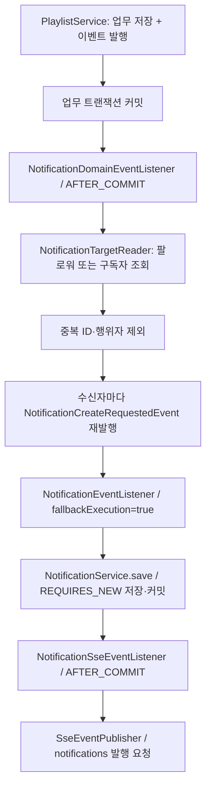

# 9. 플레이리스트 생성·콘텐츠 추가 알림 연동

플레이리스트를 만들면 소유자의 팔로워에게, 콘텐츠를 추가하면 해당 플레이리스트의 구독자에게 알림을 생성합니다.
[#157](https://github.com/codeit-backend13-part4-team1/playlist_for_everyone/issues/157)은 두 업무 이벤트를 기존 공통 알림 생성 경로에 연결합니다.
이 페이지에서 처리 흐름을 읽고, [10번 테스트 가이드](10-playlist-event-testing.md)에서 검증 범위를 확인합니다.

## 이벤트와 알림에 사용하는 값

생산자는 [PlaylistServiceImpl](../../src/main/java/com/codeit/sb13/playlist_for_everyone/domain/playlist/service/impl/PlaylistServiceImpl.java)입니다.
저장과 이벤트 발행은 같은 업무 트랜잭션에서 실행하며, 알림의 수신자·문구는 소비 리스너가 결정합니다.

| 항목 | 플레이리스트 생성 | 콘텐츠 추가 |
| --- | --- | --- |
| 생산 메서드 | `create` | `addContent` |
| 업무 이벤트 | `PlaylistCreatedEvent` | `PlaylistContentAddedEvent` |
| 전달 값 | `playlistId`, `playlistTitle`, `ownerId`, `ownerName` | `playlistId`, `playlistTitle`, `contentId`, `contentTitle`, `actorId` |
| 수신자 | 소유자 `ownerId`의 팔로워 | `playlistId`의 구독자 |
| 제외 대상 | 소유자 `ownerId` | 콘텐츠를 추가한 `actorId` |
| 제목 | `팔로우한 사용자의 새 플레이리스트` | `구독한 플레이리스트에 새 콘텐츠` |
| 내용 | `{ownerName}님이 "{playlistTitle}" 플레이리스트를 만들었습니다.` | `"{playlistTitle}" 플레이리스트에 "{contentTitle}" 콘텐츠가 추가되었습니다.` |

두 알림의 수준은 `NotificationLevel.INFO`입니다. 이름·제목은 **이벤트 발생 당시의 값**을 사용합니다.
소유자 이름이 null·빈 문자열·공백뿐이면 `사용자`로 대체하며, 그 외에는 앞뒤 공백도 그대로 사용합니다.
콘텐츠 추가 문구에는 행위자 이름을 사용하지 않습니다.

## 수신자 조회와 알림 정책의 경계

[NotificationTargetReader](../../src/main/java/com/codeit/sb13/playlist_for_everyone/domain/notification/service/NotificationTargetReader.java)는
기존 서비스 계층 안에서 두 조회를 모으는 **단순 파사드 역할의 컴포넌트**입니다.

- `findFollowerIds(ownerId)`는 `FollowService.findFollowerIds`에 위임합니다.
- `findSubscriberIds(playlistId)`는 `PlaylistService.findSubscriberIds`에 위임합니다.

조회 결과와 예외는 그대로 전달합니다. 관계가 없으면 빈 목록이며, 반환 순서는 보장하지 않습니다.
이벤트에 수신자 목록을 고정하지 않고, **커밋 후 리스너가 처리하는 시점의 관계**를 조회합니다.

리스너 내부의 `getFollowerIdsOrEmpty()`·`getSubscriberIdsOrEmpty()`가 조회 예외 처리를 담당합니다.
정상 결과는 그대로 반환하고, `RuntimeException` 발생 시 로그를 남긴 뒤 빈 목록을 반환합니다.
관계가 없는 경우와 조회 실패 모두 알림을 발행하지 않지만, 실패 여부는 로그로 구분합니다.

[NotificationDomainEventListener](../../src/main/java/com/codeit/sb13/playlist_for_everyone/domain/notification/event/listener/NotificationDomainEventListener.java)가
중복 ID와 행위자를 제외한 뒤 수신자별로 요청을 발행합니다. 남은 수신자가 없으면 발행하지 않습니다.
중복 제거는 이번 조회 목록에만 적용하며, 같은 업무 이벤트의 재발행까지 막는 멱등성 처리는 아닙니다.
저장 단계의 `NotificationUserReader`는 수신자 한 명을 `User` 연관관계로 연결하는 별도 역할입니다.

## 정상 처리의 전체 흐름

업무 이벤트는 `AFTER_COMMIT`, `fallbackExecution=false`로 수신합니다. 롤백되거나 트랜잭션 없이 발행되면 처리하지 않습니다.
서비스 호출을 감싼 트랜잭션이 있다면 그 트랜잭션의 커밋 후에 처리하며, 서비스 본문 종료나 `save` 반환은 커밋 완료가 아닙니다.

변환용 트랜잭션은 열지 않습니다. 커밋 후 재발행한 공통 요청을 받아 **수신자별 독립 트랜잭션**으로 알림을 저장합니다.
현재 `@Async` 없이 커밋 처리 스레드에서 순차 실행하며, 완료가 브라우저 수신 확인을 의미하지는 않습니다.
DTO·공유 이력·Redis·연결별 전송은 [공통 저장·전송 흐름](01-creation-and-delivery.md)에서 이어집니다.

## 실패 지점별 담당과 결과

| 실패 지점 | 담당 | 결과 |
| --- | --- | --- |
| 업무 저장·커밋 | 생산 서비스의 트랜잭션 | 롤백 시 커밋 후 소비가 실행되지 않아 알림 요청 없음 |
| 팔로워·구독자 조회 | 리스너의 조회 헬퍼 | `RuntimeException` 기록 후 빈 목록 반환으로 미발행, 업무 커밋 유지 |
| 한 수신자의 변환·재발행 | 리스너의 수신자별 발행 헬퍼 | `RuntimeException` 기록 후 나머지 수신자 처리 계속 |
| 한 수신자의 알림 저장 | 공통 요청 리스너·저장 서비스 | 해당 알림 트랜잭션 롤백, 업무 커밋 유지, 후속 수신자 처리 계속 |
| SSE 발행 요청 | 알림 SSE 리스너 | `SsePublishException` 기록, 이미 커밋된 업무와 DB 알림 유지 |

| 업무 이벤트 | 조회 실패 로그의 식별자 |
| --- | --- |
| 플레이리스트 생성 | `playlistId`, `ownerId` |
| 콘텐츠 추가 | `playlistId`, `contentId`, `actorId` |

두 조회 로그에 `exceptionType`을 남기며, 개별 변환·재발행 실패 로그에는 `receiverId`도 추가합니다.
이 로그에는 이름·제목·원본 예외 메시지를 넣지 않습니다. 저장·SSE 실패 로그는 [공통 실패 처리](01-creation-and-delivery.md#실패했을-때-남는-것)를 따릅니다.

업무 커밋과 알림 저장은 하나의 원자적 작업이 아닙니다. 그 사이 프로세스가 종료되면 알림이 누락될 수 있습니다.
업무 이벤트의 자동 재발행·Outbox·비동기화·Kafka 전환은 현재 연동에 포함하지 않습니다.

---

[← 이전: 권한 변경·구독 알림](08-role-subscription-integration.md) · [알림 목차](README.md) · [다음: 플레이리스트 알림 테스트 →](10-playlist-event-testing.md)
