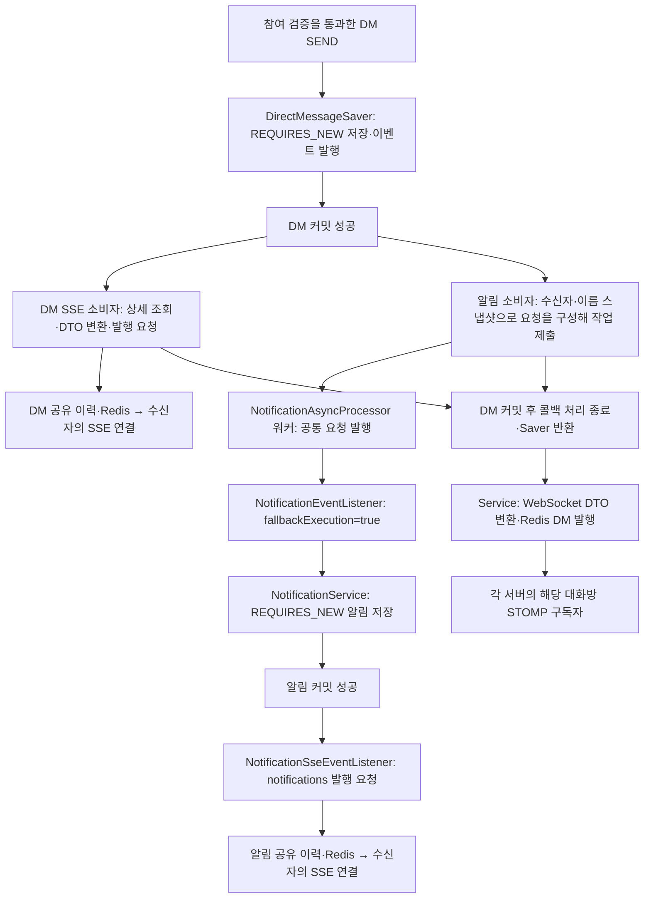

# 11. DM 생성 이벤트와 알림 연동

[#159](https://github.com/codeit-backend13-part4-team1/playlist_for_everyone/issues/159)는 **DM 커밋 → 알림 요청 → 독립 저장 → `notifications` SSE**를 연결합니다.
DM 이벤트 생산·`direct-messages` SSE·WebSocket은 [#62의 DM 가이드](../conversation/15-direct-message-event-sse.md), 검증 방법은 [DM 알림 테스트](12-direct-message-testing.md)에서 이어서 확인합니다.

## 알림 계약

| 항목 | 처리 규칙 |
| --- | --- |
| 업무 이벤트 | `DirectMessageCreatedEvent(directMessageId, conversationId, senderId, senderName, receiverId)` |
| 수신자·수준 | `receiverId`, `INFO` |
| 제목·내용 | `새로운 메시지`, `{senderName}님이 메시지를 보냈습니다.` |
| 이름 | 이벤트 생성 당시 스냅샷 사용. null·빈 문자열·공백뿐이면 `사용자`로 대체 |
| 자기 알림 | `senderId == receiverId`이면 생성 요청 제외 |
| 접속·구독 여부 | SSE 미접속 또는 대화방 WebSocket 구독 중이어도 알림 생성 |
| 본문 | 업무 이벤트와 알림 문구에 DM 본문을 포함하지 않음 |

문구를 만들기 위해 메시지나 발신자를 다시 조회하지 않습니다. 수신자 조회는 공통 알림 저장 서비스가 담당합니다.
DM SSE의 `MessageDto`는 커밋 후 상세 조회 결과로 만들므로, 알림의 이름 스냅샷과 조회 시점이 다를 수 있습니다.

## 전체 처리 흐름

DM SSE 소비자는 커밋 처리 스레드에서 조회·변환·발행 요청을 수행하고, 알림 소비자는 같은 스레드에서 알림 작업을 제출합니다. 두 콜백은 서로의 실행 순서와 독립적으로 처리합니다.
두 콜백이 끝나면 송신 서비스가 WebSocket 발행을 진행합니다. 알림 워커의 저장과 SSE 발행은 별도로 이어집니다. 세 전송 경로의 브라우저 도착 순서는 보장하지 않습니다.
그림은 정상 흐름이며, 아래 경계에서 처리한 실패가 있어도 나머지 소비자와 후속 WebSocket 단계는 계속 진행합니다.

## 커밋과 소비자의 책임

| 단계 | 구현과 책임 |
| --- | --- |
| DM 업무 사실 생산 | `DirectMessageSaver.save`: 저장 트랜잭션 안에서 생성 이벤트 발행 |
| 알림 요청 구성·제출 | `NotificationDomainEventListener.handleDirectMessageCreated`: `AFTER_COMMIT`, `fallbackExecution=false` |
| 공통 요청 발행 | `NotificationAsyncProcessor`: 알림 전용 워커에서 공통 요청 발행 |
| 공통 요청 수신 | `NotificationEventListener.handleNotification`: `fallbackExecution=true`로 워커가 트랜잭션 밖에서 발행한 요청 처리 |
| 알림 저장 | `NotificationService.save`: 별도 빈의 `REQUIRES_NEW`로 저장하고 `NotificationCreatedEvent` 발행 |
| 알림 SSE 요청 | `NotificationSseEventListener`: 알림 커밋 후 공통 `SseEventPublisher` 호출 |

변환을 위한 별도 트랜잭션은 열지 않습니다. DM이 롤백되거나 트랜잭션 없이 업무 이벤트를 발행하면 두 업무 소비자는 실행하지 않습니다.
독립적으로 커밋된 DM과 알림은 이후 외부 트랜잭션이 롤백되어도 유지됩니다.
공통 알림 요청을 트랜잭션 없이 직접 발행하면 처리되는 계약과, 업무 이벤트의 커밋 조건을 구분합니다.

## 두 SSE 이벤트의 차이

| 구분 | `direct-messages` | `notifications` |
| --- | --- | --- |
| SSE 이벤트 ID | DM ID | 알림 저장 시 만든 `NotificationCreatedEvent.eventId` |
| data | `MessageDto` | `NotificationDto` |
| data.id | DM ID | DB 알림 ID |
| 저장·전송 책임 | DM 소비자와 공통 SSE | 알림 도메인과 공통 SSE |

두 이벤트 모두 수신자 사용자의 SSE 연결로 전달합니다. 미접속이면 즉시 수신할 연결은 없지만 알림 DB 저장과 공통 이력 저장·발행 요청은 수행합니다.
Redis WebSocket 수신자는 로컬 대화방에 전달만 하며, DM 저장·업무 이벤트 발행·알림 생성을 반복하지 않습니다.

## 실패하면 무엇이 유지되는가

| 실패 지점 | 유지되는 결과와 처리 |
| --- | --- |
| DM 저장·커밋 | DM·알림 미저장, 두 SSE 소비자와 후속 WebSocket 발행 미실행 |
| 알림 요청 생성·작업 제출 거부 | 업무 이벤트 리스너가 실패 기록. DM 저장·DM SSE·WebSocket 경로 유지 |
| 알림 요청 발행 | 비동기 프로세서가 실패 기록. DM 저장·DM SSE·WebSocket 경로 유지 |
| 알림 저장 | 공통 요청 리스너가 저장 실패 기록. 해당 알림·알림 SSE 없음, DM과 다른 전송 경로 유지 |
| 알림 SSE 발행 | 알림 SSE 리스너가 `SsePublishException` 처리. DM·알림 DB 유지, DM SSE·WebSocket 경로 유지 |
| DM SSE 조회·URL 변환·발행 | DM SSE 리스너가 실패 기록. DM·알림 저장, 알림 SSE·WebSocket 경로 유지 |
| WebSocket용 URL 변환·발행 | 기존 `DirectMessagePublishException` 계약 유지. DM·알림 저장과 앞선 SSE 처리를 취소하거나 반복하지 않음 |

요청 생성·제출·발행 실패 로그는 메시지·대화방·수신자 ID와 예외 타입을 남깁니다. 알림 SSE 실패 로그는 알림·이벤트·수신자 ID와 원인 타입을 남깁니다. 이 로그에는 업무 식별과 실패 분류에 필요한 값만 담습니다.
공통 알림 **저장 실패** 로그는 수신자 ID와 예외 스택을 남기는 별도 경로입니다.

## 보장 범위와 코드 읽기

한 번의 정상 DM 처리에서 알림 한 건과 SSE 발행 요청 한 번을 검증합니다. 같은 업무 이벤트를 다시 발행하는 상황까지 중복을 제거하는 구조는 아닙니다.
DM 저장·알림 저장·Redis 발행은 각각 완료되므로, 커밋 후 장애 시 실시간 전달이 누락될 수 있습니다. 자동 재시도·Outbox·Kafka는 후속 범위입니다.
DB 데이터는 목록 API로 조회할 수 있고, 저장된 SSE 이력은 [공통 보관·복구 정책](../sse/10-recovery-and-retry.md)을 따릅니다.

[업무 이벤트](../../src/main/java/com/codeit/sb13/playlist_for_everyone/domain/conversation/event/DirectMessageCreatedEvent.java) →
[알림 변환 소비자](../../src/main/java/com/codeit/sb13/playlist_for_everyone/domain/notification/event/listener/NotificationDomainEventListener.java) →
[알림 비동기 프로세서](../../src/main/java/com/codeit/sb13/playlist_for_everyone/domain/notification/event/NotificationAsyncProcessor.java) →
[공통 요청 리스너](../../src/main/java/com/codeit/sb13/playlist_for_everyone/domain/notification/event/listener/NotificationEventListener.java) →
[저장 서비스](../../src/main/java/com/codeit/sb13/playlist_for_everyone/domain/notification/service/NotificationService.java) →
[알림 SSE 리스너](../../src/main/java/com/codeit/sb13/playlist_for_everyone/domain/notification/event/listener/NotificationSseEventListener.java) 순서로 읽습니다.

---

[알림 목차](README.md) · [공통 저장·전송](01-creation-and-delivery.md) · [다음: DM 알림 테스트 →](12-direct-message-testing.md)
