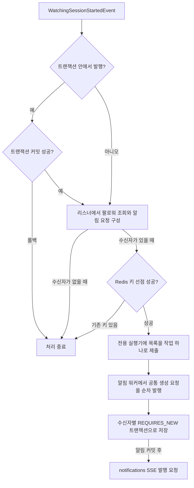

# 13. 시청 시작 이벤트와 알림 연동

같이 보기에 참여한 사용자를 팔로우하는 사람에게 알림을 보냅니다. 아래 흐름은 알림 도메인이 `WatchingSessionStartedEvent`를 받는 시점부터 설명합니다.

## 어떤 알림을 만드나요?

| 항목 | 처리 규칙 |
| --- | --- |
| 이벤트 | `WatchingSessionStartedEvent(watcherId, watcherName, contentId, contentTitle)` |
| 수신자 | 처리 시점에 `watcherId`의 팔로워를 조회합니다. 같은 이벤트 안에서 중복 ID와 시청자 본인을 제외합니다. |
| 제목 | `팔로우한 사용자의 같이 보기 참여` |
| 본문 | `{watcherName}님이 "{contentTitle}" 같이 보기에 참여했습니다.` |
| 이름 | 이벤트에 담긴 이름을 사용하며, null·빈 문자열·공백뿐인 이름은 `사용자`로 표시합니다. |
| 수준·출처 | `INFO`, `WATCHING_SESSION_STARTED` (`watching_session_started`) |

수신자가 있으면 시청자 ID와 콘텐츠 ID로 Redis 키를 선점합니다. 성공하면 요청 목록을 작업 하나로 제출하고, 같은 키가 이미 있으면 작업 제출을 생략합니다. [반복 알림 발송 제한](14-deduplication.md)

팔로워 조회에 실패하면 `contentId`, `watcherId`, 예외 타입과 실패 지표를 기록하고 요청 목록을 제출하지 않습니다.

## 이벤트 수신부터 SSE 발행 요청까지



트랜잭션 밖에서 발행되면 `fallbackExecution=true`에 따라 발행 스레드에서 즉시 팔로워를 조회하고 요청을 구성합니다. 요청 재발행부터는 알림 워커에서 진행합니다. 저장 이후의 이력과 전송 경로는 [공통 생성·전송 흐름](01-creation-and-delivery.md#요청-수신-조건과-알림-커밋)에서 확인합니다.

## 테스트가 확인하는 범위

| 구분 | 검증 내용 |
| --- | --- |
| `NotificationDomainEventListenerTest` 5건 | 중복 ID·본인 제외와 문구·수준·출처 확인, 본인만 남으면 미제출, 공백 이름 대체, 팔로워 조회 실패 시 로그·지표 기록과 미제출, 제한 시간 안에 같은 시청 이벤트를 다시 받으면 작업을 한 번만 제출 |
| `NotificationIntegrationTest` 2건 | 트랜잭션 밖에서 직접 발행하면 PostgreSQL에 팔로워 알림을 저장하고 SSE 발행을 요청합니다. 발행 트랜잭션을 롤백하면 작업을 제출하지 않으며 알림 저장과 SSE 호출도 발생하지 않습니다. |

통합 테스트의 시작점은 이벤트 직접 발행이고, 마지막 확인 지점은 `SseEventPublisher` Mock 호출입니다. WebSocket 구독에서 이벤트를 발행하는 조건, 다중 탭에서의 이벤트 중복 발행, 실제 브라우저 SSE 수신은 별도 검증 범위입니다.

Docker를 실행한 뒤 프로젝트 루트에서 관련 테스트를 실행합니다.

```bash
./gradlew test --tests '*NotificationDomainEventListenerTest' \
  --tests '*NotificationIntegrationTest'
```

[알림 목차](README.md) · [공통 테스트 가이드](02-testing.md) · [#158 이슈](https://github.com/codeit-backend13-part4-team1/playlist_for_everyone/issues/158)
