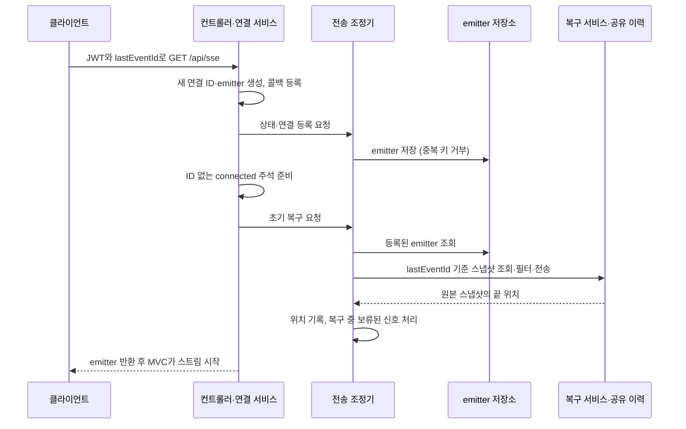
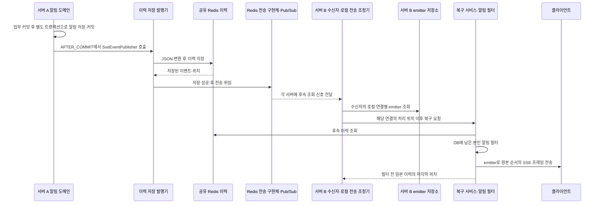

# SSE 전체 흐름

이 페이지는 **연결 준비 → 알림 발행 → 서버별 전달 → 실패·종료 처리**를 먼저 살펴보는 안내입니다.
메서드별 계약과 테스트는 각 절의 상세 문서로 이어집니다.

## 어디에 무엇을 보관하나요?

| 위치 | 보관하는 것 | 담당 |
| --- | --- | --- |
| 연결을 받은 서버 메모리 | HTTP 응답을 가진 emitter | `SseEmitterRepository` |
| 같은 서버 메모리 | 연결별 복구 여부·처리 위치·전송 상태·재시도 예약 | `SseDeliveryCoordinator` |
| 공유 Redis | 사용자별 이벤트 이력·이벤트 UUID와 저장 위치의 매핑 | `SseHistoryStore` |
| DB | 저장된 알림과 수신자 | 알림 도메인 |

emitter의 보관처는 저장소 한 곳입니다. 조정기는 상태에 emitter를 넣지 않고 사용할 때 저장소에서 조회합니다.
사용자의 두 탭이 서로 다른 서버에 연결되어도 각 서버는 자기 연결만 관리하고 같은 Redis 이력을 읽습니다.
사용자·연결·이벤트 UUID와 내부 저장 위치는 [식별자 표](09-shared-history.md#발행-역할과-식별자)에서 구분합니다.

## 1. 연결과 재연결 준비

커서가 없거나 보관 이력에서 찾을 수 없으면 과거 전체를 보내지 않고 현재 끝 위치에서 시작합니다.
유효한 커서가 있으면 그 이후의 보관 이력을 보냅니다. 재연결에는 항상 새 연결 ID를 사용합니다.
초기 전송은 MVC 초기화 전 버퍼에 쌓일 수 있으며 브라우저 수신 완료를 뜻하지 않습니다.
등록 과정은 [연결 생성](01-connection-lifecycle.md), 중복 키와 잠금은 [저장소](03-repository-concurrency.md)를 참고합니다.

## 2. 알림 저장에서 다른 서버의 연결까지

다음은 발행 서버 A와 연결 서버 B가 다른 경우입니다. 같은 서버에 연결되어 있어도 구독 경로를 거칩니다.

발행 서버 A도 같은 신호를 받지만 로컬 연결이 없으면 전송할 대상이 없습니다.
브로커 메시지는 조회 신호로 사용하며, 실제 보낼 데이터와 순서는 공유 이력에서 가져옵니다.
DB에서 삭제된 알림이나 `data.id`가 유효하지 않은 항목은 제외해도 처리 위치는 진행합니다.

저장·전송은 [공유 이력 계약](09-shared-history.md), 서버 간 신호는 [Redis 전송](06-redis-transport.md),
두 커밋의 경계는 [알림 생성·전송](../notification/01-creation-and-delivery.md)에 설명되어 있습니다.

## 3. 실패하거나 연결이 끝나면

| 상황 | 현재 처리 | 상세 |
| --- | --- | --- |
| 초기 복구에서 지정된 일시적 조회 예외 | 등록 자원 정리 후 SSE 시작 전 503 JSON 응답 | [초기 실패](01-connection-lifecycle.md#초기-실패와-서버-종료) |
| 후속 조회에서 같은 두 예외 | 연결·위치 유지, 제한된 지연 재시도 | [재시도](10-recovery-and-retry.md#실패재시도종료) |
| 재시도 소진 또는 그 외 후속 전송 RuntimeException | 상태·예약 제거, HTTP 종료 요청과 저장소 정리 | [종료와 정리](01-connection-lifecycle.md#종료-요청과-참조-정리) |
| 하트비트의 I/O·상태 오류 | 상태·예약·저장소 참조 정리. 여기서 complete를 요청하지 않음 | [하트비트](02-delivery-heartbeat.md#하트비트-동작) |
| 완료·오류·타임아웃 콜백 | 해당 연결만 정리. 타임아웃은 complete도 요청 | [콜백](01-connection-lifecycle.md#콜백과-여러-탭의-관계) |
| 서버 종료 | 각 emitter 종료 요청 후 finally에서 정리 | [서버 종료](01-connection-lifecycle.md#초기-실패와-서버-종료) |

저장소에서 emitter를 찾지 못하면 조정기에 남은 상태·예약도 정리합니다.
연결을 정리해도 Redis 공유 이력은 지우지 않으며, 이력은 사용자별 보관기간·건수·TTL로 관리합니다.
브로커 발행 성공은 브라우저 수신 확인이 아닙니다. [전달 보장 범위](11-history-operations.md#전달-보장의-경계)와
[테스트별 검증 범위](12-history-testing.md)를 함께 확인합니다.

---

[목차](README.md) · [다음: 연결 생성과 종료 →](01-connection-lifecycle.md)
