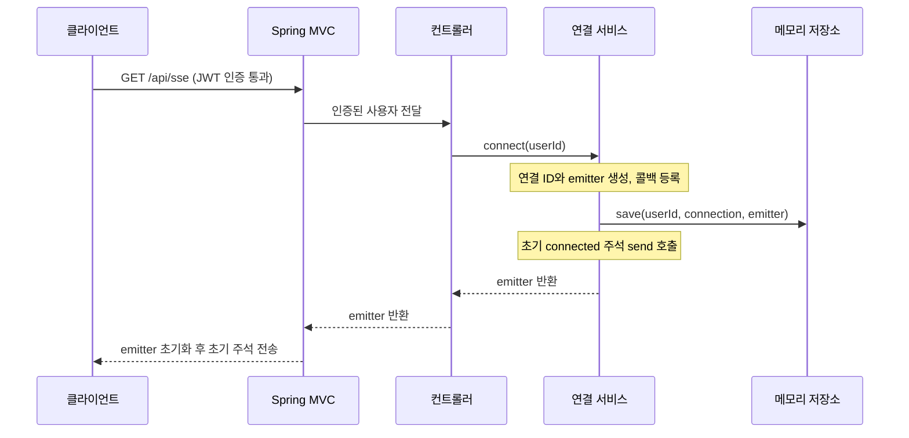

# 1. 연결 생성과 종료

연결 서비스는 emitter를 만들고, 저장하고, 종료 시 저장소에서 제거하는 과정을 관리합니다.
핵심은 **사용자 ID와 연결 ID를 함께 사용하여 종료된 연결만 정리하는 것**입니다.

## 연결 요청 계약

| 항목 | 현재 동작 |
| --- | --- |
| 경로 | `GET /api/sse` |
| 인증 | `Authorization: Bearer <accessToken>`으로 인증한 사용자의 ID를 사용합니다. |
| 응답 | `200`, `Content-Type: text/event-stream` |
| 선택 입력 | `lastEventId` 쿼리. UUID로 변환할 수 없는 값은 연결 시작 전 `400` JSON 응답입니다. |
| 재연결 | 새 연결 ID와 emitter를 만듭니다. 기존 연결은 자신의 종료 절차로 정리합니다. |

컨트롤러는 `SecurityUser`에서 사용자 ID를 꺼냅니다. 요청 파라미터로 다른 사용자의 ID를 받지 않습니다.
`lastEventId`는 현재 형식만 검증하며 서비스로 전달하지 않습니다. 누락 이벤트 복구는 후속 작업입니다.

## 연결이 만들어지는 순서



콜백은 먼저 등록하지만, 이 시점에는 실행하지 않습니다.
MVC가 완료·타임아웃·오류를 통지할 때 등록해 둔 작업이 실행됩니다.

초기 주석 전송보다 저장을 먼저 수행하여, 실패 시 동일한 연결을 저장소에서 제거할 수 있게 합니다.
컨트롤러가 반환되기 전 `send()`는 전송 handler가 준비되지 않아 데이터를 버퍼에 보관할 수 있습니다.
따라서 이 호출이 끝났다는 것만으로 브라우저가 이미 데이터를 받았다고 판단하지 않습니다.

최초 프레임은 다음과 같습니다. 주석 뒤의 빈 줄이 프레임의 끝입니다.

```text
:connected

```

업무 이벤트가 아닌 주석에는 `id`를 붙이지 않아 마지막 이벤트 ID를 변경하지 않습니다.

## 콜백과 여러 탭의 관계

예를 들어 같은 사용자의 탭 A와 탭 B는 서로 다른 연결 ID를 가집니다.
탭 A가 종료되면 A를 등록할 때 캡처한 사용자 ID·연결 ID로 삭제하므로 B는 유지됩니다.

| 콜백 | 서비스가 등록한 작업 |
| --- | --- |
| `onCompletion` | 해당 연결을 저장소에서 삭제합니다. |
| `onTimeout` | 해당 연결을 삭제하고 `complete()`로 종료를 요청합니다. |
| `onError` | 해당 연결을 삭제하고 오류를 기록합니다. 오류에 따른 비동기 응답 종료는 MVC가 관리합니다. |

타임아웃 처리 뒤 완료 콜백이 실행되어 같은 연결을 다시 삭제할 수 있습니다.
저장소는 없는 연결의 삭제도 허용하므로, 중복 삭제가 다른 연결에 영향을 주지 않습니다.
이전 연결의 콜백이 늦게 실행되어도 새 연결 ID를 삭제하지 않습니다.

## 초기 실패와 서버 종료

초기 `send()`에서 `IOException`이 발생하면 연결을 삭제하고 원인을 보존한 `UncheckedIOException`을 던집니다.
`IllegalStateException`이면 연결을 삭제한 뒤 같은 예외를 다시 던집니다.
이미 연결된 상태에서의 전송 실패는 [전송 서비스](02-delivery-heartbeat.md)가 처리합니다.

서버의 `ContextClosedEvent`를 받으면 현재 서버의 연결들을 순회합니다.

1. 각 emitter에 `complete()`를 호출하여 MVC에 응답 종료를 요청합니다.
2. 하나의 종료가 `RuntimeException`으로 실패해도 다음 연결을 계속 처리합니다.
3. `finally`에서 해당 연결을 저장소에서 삭제합니다.

`complete()` 호출과 완료 콜백의 실행은 동일한 순간이라고 가정하지 않습니다.
따라서 종료 정리는 콜백 실행 여부에만 의존하지 않습니다.
종료 이벤트 수신 시 실행 중인 하트비트가 이미 모두 끝났다고도 가정하지 않습니다. 스케줄러 종료는 Spring이 관리합니다.

## 관련 코드와 테스트

- [SseController](../../src/main/java/com/codeit/sb13/playlist_for_everyone/global/sse/controller/SseController.java): 인증 사용자와 쿼리 입력을 받습니다.
- [SseConnectionService](../../src/main/java/com/codeit/sb13/playlist_for_everyone/global/sse/service/SseConnectionService.java): 생성·콜백 등록·초기 전송·종료 정리를 담당합니다.
- [SseConnectionServiceTest](../../src/test/java/com/codeit/sb13/playlist_for_everyone/global/sse/service/SseConnectionServiceTest.java), [SseConnectionLifecycleTest](../../src/test/java/com/codeit/sb13/playlist_for_everyone/global/sse/service/SseConnectionLifecycleTest.java): 콜백별 정리와 컨텍스트 종료를 검증합니다.

---

[← 이전: 안내](README.md) · [목차](README.md) · [다음: 이벤트 전송과 하트비트 →](02-delivery-heartbeat.md)
