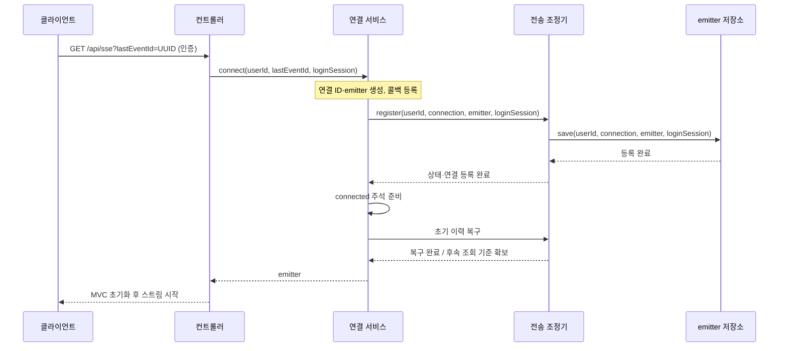

# 1. 연결 생성과 종료

연결 서비스는 emitter 생성과 콜백 연결을 담당하고, 상태·저장소 등록과 정리는 조정기에 위임합니다.
사용자 ID와 연결 ID를 함께 사용하여 **해당 연결만 정리**합니다. 큰 흐름은 [전체 흐름](00-overall-flow.md)을 참고합니다.

## 연결 요청 계약

| 항목 | 현재 동작 |
| --- | --- |
| 경로 | GET /api/sse |
| 인증 | Bearer JWT의 사용자 ID와 현재 로그인 세션 ID(`sid`) |
| 성공 응답 | 200, text/event-stream |
| 선택 입력 | lastEventId 쿼리의 이벤트 UUID |
| 형식 오류 | 연결 시작 전 400 JSON 응답 |
| 초기 일시적 조회 실패 | 지정된 두 예외에 한해 503 JSON 응답 |
| 재연결 | 새 연결 ID·emitter·복구 상태 생성 |

JWT 인증 필터는 토큰의 `sid`가 현재 로그인 세션과 일치하는지 확인한 뒤 `SecurityUser`에 저장합니다.
컨트롤러는 인증된 사용자 ID와 `sid`를 `SecurityUser`에서 읽고, `sid`를 `LoginSession`으로 감싸 `lastEventId`와 함께 서비스에 전달합니다.
커서가 없거나 본인 보관 이력에서 찾을 수 없으면 과거 전체를 보내지 않고 현재 끝 위치를 기준으로 시작합니다.

## 연결이 만들어지는 순서



콜백 등록은 실행 예약이며 이 시점에 콜백을 직접 실행하지 않습니다.
초기 주석과 복구 데이터의 `send()`는 MVC 초기화 전에 버퍼에 쌓일 수 있습니다.
호출이 반환되었다고 브라우저 수신까지 끝난 것은 아닙니다.

최초 주석 `:connected`에는 이벤트 ID가 없어 클라이언트의 마지막 수신 이벤트 ID를 바꾸지 않습니다.

상태나 저장소에 같은 사용자·연결 키가 있으면 등록을 거부합니다.
저장소 등록이 실패하면 조정기는 이번에 만든 상태만 취소하고 기존 연결은 보존합니다.
그래서 등록 호출은 연결 서비스의 전송 실패 처리 `try` 밖에 둡니다. 등록 실패까지 일반 정리로 처리하면 기존 연결을 지울 수 있습니다.

초기 복구와 그동안 도착한 신호의 처리 순서는 [복구 문서](10-recovery-and-retry.md)를 참고합니다.

## 콜백과 여러 탭의 관계

같은 로그인에서 연 탭 A와 B는 `sid`를 공유하고 서로 다른 연결 ID를 가집니다. 같은 세션으로 재연결해도 새 연결 ID를 사용합니다.
A의 콜백은 등록할 때 캡처한 사용자 ID와 연결 ID로 A의 상태·예약·emitter·세션 매핑을 정리합니다.

| 콜백 | 처리 |
| --- | --- |
| onCompletion | 상태·재시도 예약·emitter·세션 매핑 제거 |
| onTimeout | 같은 정리 후 complete로 종료 요청 |
| onError | 같은 정리와 오류 로그. 응답 종료는 MVC도 관여 |

타임아웃 이후 이전 완료 콜백이 반복되어도 같은 `sid`의 다른 탭과 새 연결은 유지됩니다.
Redis 공유 이력도 연결 종료로 삭제하지 않습니다.
예약 취소는 실행 중인 I/O의 즉시 중단을 뜻하지 않으며 늦은 예약 작업은 상태를 재확인합니다.

## 초기 실패와 서버 종료

초기 주석 전송 또는 복구에 실패하면 연결 서비스가 상태·예약·로컬 참조를 정리합니다.
IOException은 원인을 보존한 UncheckedIOException으로, RuntimeException은 그대로 전달합니다.

컨트롤러는 초기 `DataAccessResourceFailureException`·`QueryTimeoutException`만
SSE 시작 전 503 공통 JSON 오류로 바꿉니다. 모든 데이터 접근 예외를 503으로 처리하지 않습니다.
연결 이후의 일시적 실패는 [후속 조회 재시도](10-recovery-and-retry.md#실패재시도종료)가 담당합니다.

`ContextClosedEvent`를 받으면 하트비트 전용 실행기를 먼저 종료하고 로컬 연결을 정리합니다.

1. 디스패처가 신규 작업 제출과 보류된 종료 요청의 재제출을 차단합니다. 대기열의 작업과 보류 중인 종료 요청을 폐기하고, 실행 중인 워커에 인터럽트를 요청합니다.
2. 종료 시점에 워커가 사용 중이던 연결은 상태·예약·저장소 참조만 정리합니다. 이 연결에 `complete()`를 호출하면 워커가 잡고 있는 쓰기 잠금을 기다릴 수 있습니다.
3. 나머지 연결에는 `complete()`를 요청합니다. 호출이 실패해도 상태·예약·저장소 참조를 정리하고 다음 연결로 진행합니다.

종료 이벤트는 실행 중인 하트비트 쓰기가 끝나기 전에 반환할 수 있습니다.
소켓 쓰기의 완료 시점은 서블릿 I/O와 연결 상태에 따릅니다.
주기 스케줄러의 종료는 Spring이 관리합니다.

## 종료 요청과 참조 정리

| 조정기 진입점 | 역할 |
| --- | --- |
| `cleanupConnection(userId, connection)` | 상태·예약·저장소 참조 정리. HTTP 종료는 요청하지 않음 |
| `closeConnection(userId, connection)` | 상태·예약 정리 후 HTTP 종료 요청과 저장소 참조 정리 |

실제 HTTP 종료와 저장소 삭제는 `SseConnectionCloser`에 위임합니다.
`close`는 complete가 실패해도 finally에서 `cleanUp`으로 저장소를 삭제합니다.
삭제에는 사용자·연결 키만 사용하며, `close`에 전달하는 emitter는 종료할 HTTP 응답입니다.
정리 호출 시 저장소에 emitter가 이미 없어도 남아 있는 상태·예약은 제거합니다.
일반 전송 실패·예약 실패·재시도 소진은 종료 요청을, 완료·오류 콜백과 하트비트 실패는 참조 정리를 사용합니다.

구현: [SseConnectionService](../../src/main/java/com/codeit/sb13/playlist_for_everyone/global/sse/service/SseConnectionService.java),
[SseController](../../src/main/java/com/codeit/sb13/playlist_for_everyone/global/sse/controller/SseController.java).
종료 위임: [SseConnectionCloser](../../src/main/java/com/codeit/sb13/playlist_for_everyone/global/sse/service/SseConnectionCloser.java).
검증 범위는 [기본 테스트](05-testing.md)와 [이력·종료 테스트](12-history-testing.md)에 정리했습니다.

## 활성 SSE 연결 수 조회

`everyone.sse.connections.active`는 요청을 처리한 서버 인스턴스의 SSE 저장소에 등록된 연결 수를 보여주는 Gauge입니다.
서버 시작 직후 연결이 없으면 `0`이고, 같은 사용자가 같은 서버에 탭 두 개를 열면 `2`입니다.
완료·타임아웃·오류 처리로 연결이 저장소에서 제거되면 값이 줄어듭니다. 여러 서버에서 운영할 때는 각 인스턴스의 값을 조회합니다.

`ACCESS_TOKEN`에 관리자 액세스 토큰을 설정하고 다음과 같이 조회합니다.

```bash
curl -i \
  -H "Authorization: Bearer $ACCESS_TOKEN" \
  http://localhost:8080/actuator/metrics/everyone.sse.connections.active
```

응답의 `measurements` 배열에서 `statistic`이 `VALUE`인 항목의 `value`가 활성 연결 수입니다.

---

[← 전체 흐름](00-overall-flow.md) · [목차](README.md) · [다음: 전송과 하트비트 →](02-delivery-heartbeat.md)
