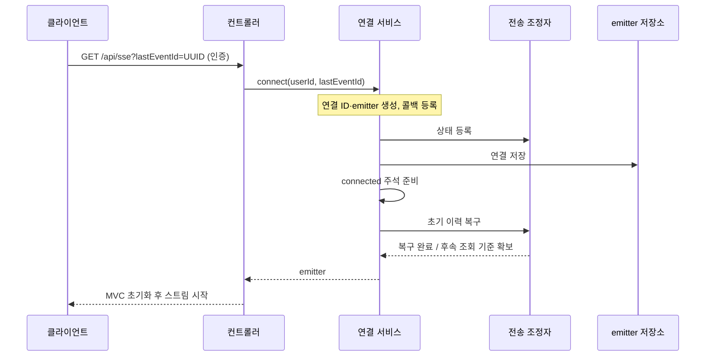

# 1. 연결 생성과 종료

연결 서비스는 emitter 생성부터 종료까지 관리합니다.
사용자 ID와 연결 ID를 함께 사용하여 **종료된 연결만 정리**합니다.

## 연결 요청 계약

| 항목 | 현재 동작 |
| --- | --- |
| 경로 | GET /api/sse |
| 인증 | Bearer JWT로 인증한 사용자의 ID |
| 성공 응답 | 200, text/event-stream |
| 선택 입력 | lastEventId 쿼리의 이벤트 UUID |
| 형식 오류 | 연결 시작 전 400 JSON 응답 |
| 초기 일시적 조회 실패 | 지정된 두 예외에 한해 503 JSON 응답 |
| 재연결 | 새 연결 ID·emitter·복구 상태 생성 |

컨트롤러는 `SecurityUser`의 사용자 ID와 `lastEventId`를 서비스에 전달합니다.
다른 수신자를 요청 파라미터로 지정하지 않습니다.
커서가 없거나 본인 보관 이력에서 찾을 수 없으면 과거 전체를 보내지 않고 현재 끝 위치를 기준으로 시작합니다.

## 연결이 만들어지는 순서



콜백 등록은 실행 예약이며 이 시점에 콜백을 직접 실행하지 않습니다.
초기 주석과 복구 데이터의 `send()`는 MVC 초기화 전에 버퍼에 쌓일 수 있습니다.
호출이 반환되었다고 브라우저 수신까지 끝난 것은 아닙니다.

최초 주석에는 이벤트 ID가 없어 클라이언트의 마지막 수신 이벤트 ID를 바꾸지 않습니다.

```text
:connected

```

초기 복구와 그동안 도착한 신호의 처리 순서는 [복구 문서](10-recovery-and-retry.md)를 참고합니다.

## 콜백과 여러 탭의 관계

탭 A와 B는 같은 사용자라도 다른 연결 ID를 가집니다.
A의 콜백은 등록 당시 캡처한 사용자·연결 ID로 A의 상태·예약·로컬 참조만 정리합니다.

| 콜백 | 처리 |
| --- | --- |
| onCompletion | 상태·재시도 예약·emitter 저장소 참조 제거 |
| onTimeout | 같은 정리 후 complete로 종료 요청 |
| onError | 같은 정리와 오류 로그. 응답 종료는 MVC도 관여 |

타임아웃 이후 완료 콜백이 반복되어도 중복 정리가 다른 연결에 영향을 주지 않습니다.
Redis 공유 이력도 연결 종료로 삭제하지 않습니다.
예약 취소는 실행 중인 I/O의 즉시 중단을 뜻하지 않으며 늦은 예약 작업은 상태를 재확인합니다.

## 초기 실패와 서버 종료

초기 주석 전송 또는 복구에 실패하면 연결 서비스가 상태·예약·로컬 참조를 정리합니다.
IOException은 원인을 보존한 UncheckedIOException으로, RuntimeException은 그대로 전달합니다.

컨트롤러는 초기 `DataAccessResourceFailureException`·`QueryTimeoutException`만
SSE 시작 전 503 공통 JSON 오류로 바꿉니다. 모든 데이터 접근 예외를 503으로 처리하지 않습니다.
연결 이후의 일시적 실패는 [후속 조회 재시도](10-recovery-and-retry.md#실패재시도종료)가 담당합니다.

서버의 ContextClosedEvent에서는 각 emitter에 complete를 요청하고,
실패해도 다음 연결로 진행하며 finally에서 상태·예약·저장소 참조를 정리합니다.
완료 콜백의 즉시 실행에 의존하지 않습니다.
이 시점에 실행 중인 하트비트가 모두 끝났다고 가정하지 않으며 스케줄러 종료는 Spring이 관리합니다.

구현: [SseConnectionService](../../src/main/java/com/codeit/sb13/playlist_for_everyone/global/sse/service/SseConnectionService.java),
[SseController](../../src/main/java/com/codeit/sb13/playlist_for_everyone/global/sse/controller/SseController.java).
검증 범위는 [기본 테스트](05-testing.md)와 [이력·종료 테스트](12-history-testing.md)에 정리했습니다.

---

[← 안내](README.md) · [목차](README.md) · [다음: 전송과 하트비트 →](02-delivery-heartbeat.md)
