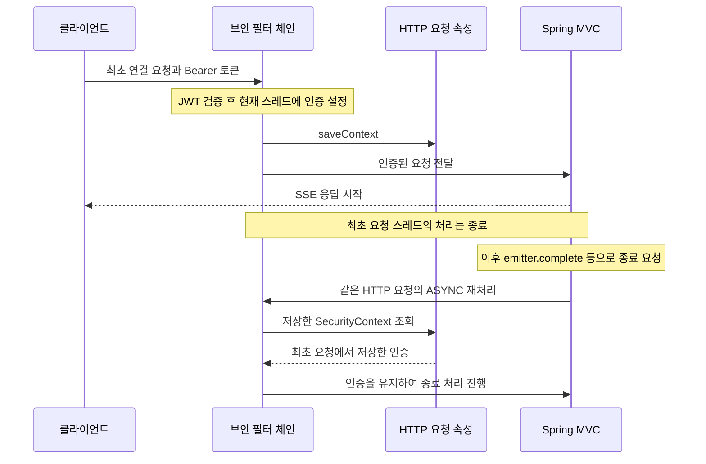

# 4. 비동기 응답과 인증

SSE 응답은 최초 요청 처리가 끝난 뒤에도 열려 있습니다.
응답 종료 시 같은 HTTP 요청이 `ASYNC` 디스패치로 다시 처리될 수 있어, 이때도 인증 정보를 읽을 수 있어야 합니다.

## 인증 정보를 저장하는 두 곳

| 위치 | 역할 | 유지 범위 |
| --- | --- | --- |
| `SecurityContextHolder` | 현재 실행 스레드에서 인증 정보를 읽게 합니다. | 현재 스레드의 보안 처리 범위 |
| `RequestAttributeSecurityContextRepository` | 인증 정보를 요청 속성에 저장하고 읽습니다. | 동일 HTTP 요청의 디스패치 간 |

최초 JWT 인증 성공 시 현재 스레드에 인증을 설정하고, 같은 인증을 요청 속성에도 명시적으로 저장합니다.
요청 스레드의 처리가 끝나 인증 컨텍스트가 정리되어도, 같은 요청의 재처리에서 요청 속성을 통해 다시 읽을 수 있게 합니다.

```java
context.setAuthentication(authentication);
SecurityContextHolder.setContext(context);
securityContextRepository.saveContext(context, request, response);
```

이 저장은 HTTP 세션이나 Redis를 사용하지 않습니다. 현재 보안 설정은 `STATELESS`입니다.

## 최초 연결부터 비동기 종료까지



현재 JWT 필터는 `OncePerRequestFilter`의 기본 동작에 따라 ASYNC에서 토큰을 다시 검사하지 않습니다.
보안 필터 체인은 이 재처리를 허용할지 판단하므로 요청 속성에 저장해 둔 인증을 복원하는 경로가 필요합니다.
현재 설정은 ASYNC 요청 전체를 무조건 허용하는 방식으로 우회하지 않습니다.

## 저장소 객체를 새로 만들어도 읽을 수 있는 이유

`RequestAttributeSecurityContextRepository` 자체가 사용자별 인증을 Map으로 보관하는 것은 아닙니다.
`HttpServletRequest`의 정해진 속성 이름에 인증을 저장하는 역할입니다.
서로 다른 저장소 객체라도 동일 요청과 동일 속성 이름을 사용하면 저장한 인증을 읽을 수 있습니다.

현재 JWT 필터의 저장소와 보안 체인의 요청 속성 저장소는 기본 속성 이름을 사용합니다.
또한 `SecurityConfig`는 필터 체인을 구성할 때 JWT 필터를 생성합니다. 필드의 `new` 선언이 요청마다 필터를 다시 만든다는 뜻은 아닙니다.

## 다른 스레드·다른 서버와의 관계

| 상황 | 현재 처리 범위 |
| --- | --- |
| 같은 HTTP 요청의 ASYNC 재처리 | 요청 속성에 저장한 인증을 다시 읽습니다. 다른 스레드에서 처리될 수 있습니다. |
| 별도 `@Async` 작업 | 이번 설정으로 인증이나 MDC가 자동 전달되지는 않습니다. |
| 연결 종료 후 재연결 | 새 HTTP 요청이므로 JWT 인증을 다시 수행합니다. |
| 다른 인스턴스로 재연결 | 그 서버에서 JWT를 검증하고 새 로컬 emitter를 만듭니다. |

하나의 진행 중인 HTTP 응답이 ASYNC 디스패치 때문에 다른 인스턴스로 이동하는 것은 아닙니다.
요청 속성 저장소도 인스턴스 간에 공유하지 않습니다.
분산 환경에서 각 서버의 사용자 연결로 이벤트를 보내는 문제는 [서버 간 전송 계약](02-delivery-heartbeat.md)에서 별도로 다룹니다.

이 처리는 종료 과정의 인증 복원을 다룹니다. 연결 중 권한 변경·토큰 만료에 따라 기존 스트림을 즉시 끊는 정책까지 제공하는 것은 아닙니다.

## 오류 응답과 검증 범위

인증되지 않은 최초 연결 요청은 `401`이며 연결 서비스를 호출하지 않습니다.
인증은 정상이지만 `lastEventId` 형식이 잘못되면 스트림 시작 전에 `400` JSON 오류를 반환합니다.
이미 전송을 시작한 SSE 응답을 중간에 일반 JSON 오류 응답으로 바꾸는 방식은 사용하지 않습니다.

회귀 테스트에서는 실제 Bearer 요청 경로로 연결한 뒤 `complete()`와 `asyncDispatch()`를 호출합니다.
최초 요청 성공만 확인하지 않고, 후속 ASYNC 처리가 보안 예외 없이 끝나는지도 확인합니다.

- [JwtAuthenticationFilter](../../src/main/java/com/codeit/sb13/playlist_for_everyone/domain/auth/jwt/JwtAuthenticationFilter.java): 인증 성공 후 요청 속성에 저장합니다.
- [SecurityConfig](../../src/main/java/com/codeit/sb13/playlist_for_everyone/global/config/SecurityConfig.java): 필터 체인과 접근 정책을 구성합니다.
- [GlobalExceptionHandler](../../src/main/java/com/codeit/sb13/playlist_for_everyone/global/controller/GlobalExceptionHandler.java): 연결 전 잘못된 입력의 JSON 오류 응답을 처리합니다.
- [SseControllerTest](../../src/test/java/com/codeit/sb13/playlist_for_everyone/global/sse/controller/SseControllerTest.java): 인증·잘못된 쿼리·ASYNC 종료를 검증합니다.

---

[← 이전: 저장소와 동시성](03-repository-concurrency.md) · [목차](README.md) · [다음: 테스트 읽기와 실행 →](05-testing.md)
