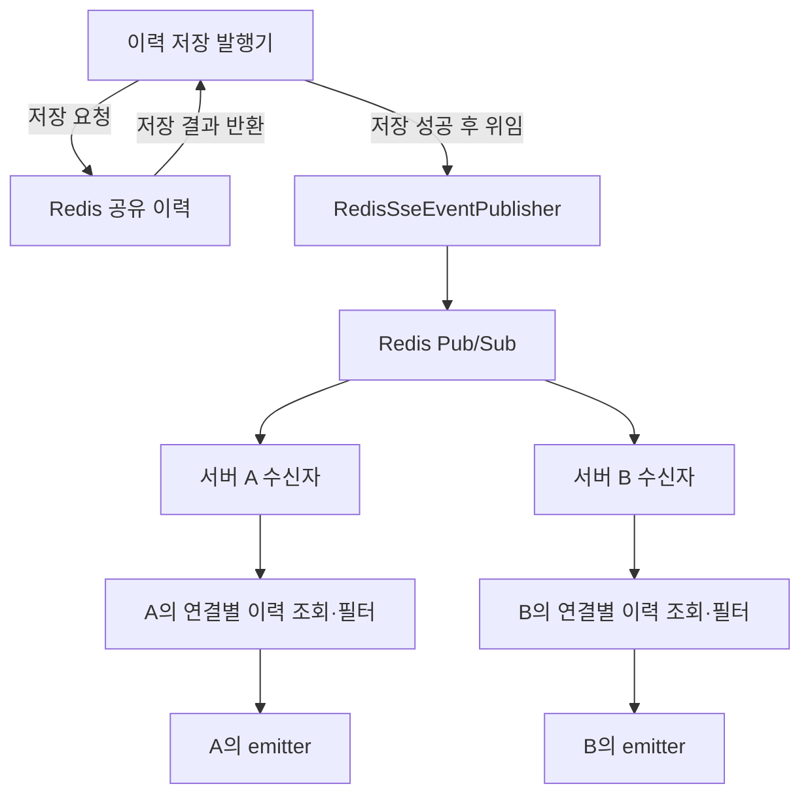

# 6. Redis 전송 구조와 설정

Redis Pub/Sub은 각 서버에 **공유 이력의 후속 조회를 요청하는 신호**를 전달합니다.
HTTP 응답을 가진 emitter는 각 서버 메모리에 남습니다.

## 한 이벤트가 전달되는 흐름

발행 서버도 구독 경로로 전달받습니다. 저장 후 직접 로컬 전송까지 중복 호출하지 않습니다.
수신자는 이력을 다시 저장하거나 브로커에 재발행하지 않습니다.
현재 서버에 수신자 연결이 없으면 로컬 조회 요청은 정상 종료합니다.

| 역할 | 담당 코드 |
| --- | --- |
| 호출부 공통 발행 계약 | SseEventPublisher |
| 기본 주입, JSON 변환·이력 저장 | HistorySavingSseEventPublisher |
| 브로커 전송 구현체 | RedisSseEventPublisher, sseTransportPublisher 한정자 |
| 수신 신호 해석·로컬 요청 | RedisSseEventSubscriber |
| 시작·종료 시 구독 등록·해제 | RedisSseSubscription |
| 공용 컨테이너 등록 창구 | [RedisBrokerRegister](../../src/main/java/com/codeit/sb13/playlist_for_everyone/global/service/redis/RedisBrokerRegister.java) |
| 연결별 상태·순서·재시도 | SseDeliveryCoordinator |

[전체 흐름](00-overall-flow.md)에서 연결까지 함께 살펴보고, [저장 계약](09-shared-history.md)과 [복구 흐름](10-recovery-and-retry.md)으로 이어갑니다.

## Redis 이벤트와 클라이언트 응답

전송 구현체는 StringRedisTemplate으로 이벤트 전체 JSON을 발행합니다.
수신자는 SseEvent<JsonNode>로 읽으며 DTO 타입을 알 필요가 없습니다.
다른 도메인의 RedisTemplate 직렬화 설정은 사용하지 않습니다.

현재 메시지에는 eventId·receiverId·eventName·data가 모두 들어 있지만,
로컬 전송은 receiverId로 연결을 찾고 실제 데이터는 이력에서 읽습니다.
따라서 Redis에 PUBLISH만 한 임의 payload가 브라우저로 직접 전달되지는 않습니다.
클라이언트에는 저장된 이벤트의 id·이름·data를 [SSE 프레임](02-delivery-heartbeat.md#이벤트가-클라이언트에-전달되는-형태)으로 보냅니다.

## 설정과 구독 생명주기

아래 키는 everyone.sse 아래에 있습니다.

| 설정 | 환경변수 | 기본값 |
| --- | --- | --- |
| transport | EVERYONE_SSE_TRANSPORT | redis |
| redis.channel | EVERYONE_SSE_REDIS_CHANNEL | everyone:sse:events |
| subscription-enabled | EVERYONE_SSE_SUBSCRIPTION_ENABLED | true |

전송 방식은 현재 redis만 지원합니다. 누락·지원하지 않는 방식·빈 채널은 설정 검증에서 거부합니다.
같은 환경의 서버는 같은 Redis·채널·[이력 접두사](11-history-operations.md#설정값과-환경-구분)를 사용합니다.
서로 다른 환경은 이력 키뿐 아니라 채널 또는 Redis도 구분합니다.

RedisSseSubscription은 공용 RedisMessageListenerContainer에 SSE 리스너를 등록하고 종료 시 해당 리스너만 해제합니다.
WebSocket도 사용하는 공용 컨테이너 전체를 SSE가 종료시키지는 않습니다.
subscription-enabled=false는 자동 구독만 끄며 발행기나 다른 Redis 사용까지 끄지 않습니다.
일반 test 프로필은 false이고 Redis SSE 통합 테스트에서 명시적으로 true를 지정합니다.

## 실패 처리와 로그

| 위치 | 처리와 로그 |
| --- | --- |
| 이력 저장 발행기의 변환·저장 실패 | SsePublishException 전달, 브로커 호출 없음. 이 단계의 별도 로그는 없음 |
| 전송 구현체의 직렬화·Redis 발행 실패 | SsePublishException, WARN에 이벤트·수신자 ID와 예외 타입 |
| 수신 JSON 변환 실패 | 해당 신호 건너뜀, WARN에 추출 가능한 UUID와 변환 실패 타입 |
| 실제 이력 조회·HTTP 전송 실패 | 복구·로컬 전송 경로에서 처리. [단계별 기준](11-history-operations.md#실패-로그를-읽는-순서) 참고 |

전송·수신 변환 로그에는 payload·원문·예외 메시지·스택을 넣지 않습니다.
알림 호출부는 SsePublishException을 처리하며 DB 알림 ID를 포함한 별도 로그를 남깁니다.
저장 성공 후 브로커 실패가 발생해도 이력은 남으며 자동 재발행은 하지 않습니다.

## 전달 보장과 후속 작업

PUBLISH 반환값은 구독자 수이며 실제 브라우저 수신 확인이 아닙니다.
Pub/Sub 자체는 끊긴 동안의 신호를 보관하지 않습니다.
공유 이력이 있는 현재 구조에서는 이후 조회 신호나 재연결로 보관 범위 안의 이벤트를 처리할 수 있습니다.
재구독 자체가 모든 살아 있는 SSE 연결의 조회를 자동 실행하는 것은 아닙니다.

정확히 한 번 전달이나 DB·Redis·브로커를 묶는 Outbox는 제공하지 않습니다.
생산 이벤트를 알림으로 연결하는 흐름은 [#155 팔로우](../notification/07-domain-event-integration.md)와 [#156 권한 변경·구독](../notification/08-role-subscription-integration.md)에서 다룹니다.
Kafka 전송 구현체, 이 세 종류 외의 업무 이벤트 알림 연동(#45), DM 본문 연동은 후속 작업입니다.

구현: [발행기](../../src/main/java/com/codeit/sb13/playlist_for_everyone/global/sse/event/impl/RedisSseEventPublisher.java),
[수신자](../../src/main/java/com/codeit/sb13/playlist_for_everyone/global/sse/event/impl/RedisSseEventSubscriber.java).

---

[← 기본 테스트](05-testing.md) · [목차](README.md) · [다음: 다중 서버 실행 →](07-redis-multi-node.md)
