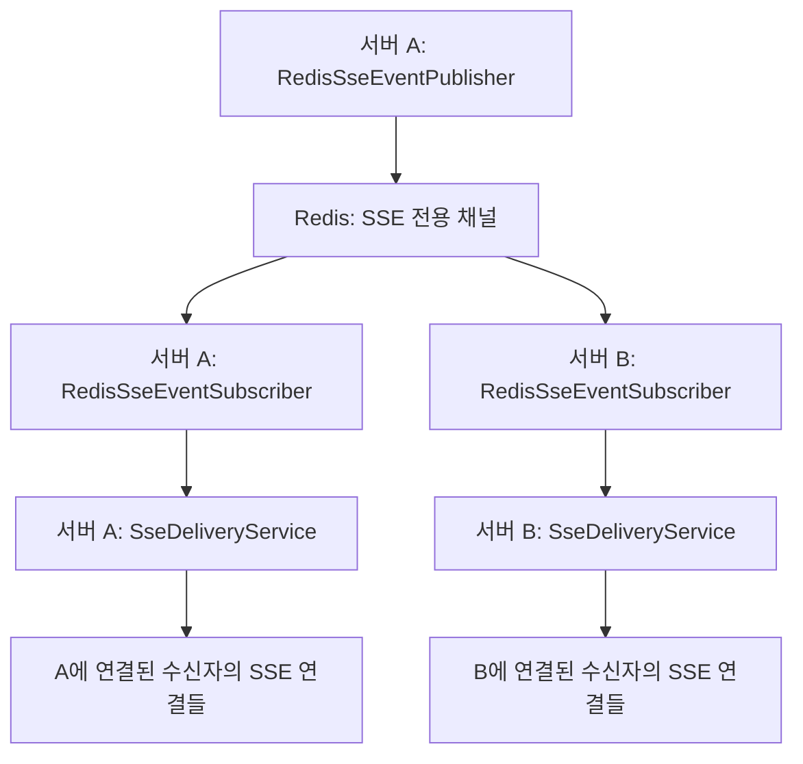

# 6. Redis 전송 구조와 설정

Redis Pub/Sub은 이벤트를 만든 서버와 수신자의 SSE 연결이 있는 서버를 이어 줍니다.
각 서버는 같은 채널에서 이벤트를 받고, **자기 서버에 연결된 수신자**에게 전송합니다.
실제 HTTP 응답을 가진 `SseEmitter`는 계속 각 서버의 메모리에 보관합니다.

## 한 이벤트가 전달되는 흐름

발행 서버 A도 Redis에서 수신한 뒤 전송합니다.
발행 단계에서 로컬 전송까지 직접 호출하면 동일 이벤트가 두 경로로 전달될 수 있으므로, 현재 구현은 Redis 발행만 수행합니다.
구독자는 이벤트를 다시 발행하지 않으며, 해당 서버에 수신자 연결이 없으면 로컬 전송 서비스가 정상 종료합니다.

| 역할 | 담당 코드 |
| --- | --- |
| 브로커에 독립적인 발행 계약 | [SseEventPublisher](../../src/main/java/com/codeit/sb13/playlist_for_everyone/global/sse/event/SseEventPublisher.java) |
| 이벤트를 JSON 문자열로 Redis에 발행 | [RedisSseEventPublisher](../../src/main/java/com/codeit/sb13/playlist_for_everyone/global/sse/event/impl/RedisSseEventPublisher.java) |
| JSON을 읽어 로컬 전송 서비스 호출 | [RedisSseEventSubscriber](../../src/main/java/com/codeit/sb13/playlist_for_everyone/global/sse/event/impl/RedisSseEventSubscriber.java) |
| 시작·종료에 맞춰 리스너 등록·해제 | [RedisSseSubscription](../../src/main/java/com/codeit/sb13/playlist_for_everyone/global/sse/event/impl/RedisSseSubscription.java) |
| 공용 Redis 컨테이너의 리스너 등록 창구 | [RedisBrokerRegister](../../src/main/java/com/codeit/sb13/playlist_for_everyone/global/service/RedisBrokerRegister.java) |
| 수신자의 로컬 연결로 HTTP 데이터 전송 | [SseDeliveryService](../../src/main/java/com/codeit/sb13/playlist_for_everyone/global/sse/service/SseDeliveryService.java) |

## Redis 이벤트와 클라이언트 응답

발행자는 `StringRedisTemplate`과 애플리케이션 JSON 매퍼로 이벤트 전체를 보냅니다.
수신자는 `SseEvent<JsonNode>`로 읽으므로 알림·DM의 구체적인 DTO 클래스를 알 필요가 없습니다.
다른 도메인의 `RedisTemplate<String, Object>` 직렬화 설정은 이 전송에 사용하지 않습니다.

| Redis 이벤트 필드 | 클라이언트 전달 시 사용처 |
| --- | --- |
| `eventId` | SSE 프레임의 `id`. 발행·수신 과정에서 새로 생성하지 않습니다. |
| `receiverId` | 각 서버가 수신자의 연결을 찾을 때 사용합니다. |
| `eventName` | SSE 프레임의 `event`. `notifications` 또는 `direct-messages`입니다. |
| `data` | SSE 프레임의 JSON `data`. 객체를 전달하며 `null`도 허용합니다. |

Redis 내부 이벤트 전체를 클라이언트의 `data`로 보내지 않습니다.
로컬 전송 서비스가 `data`만 JSON으로 변환하며, 자세한 프레임 예시는 [이벤트 전송과 하트비트](02-delivery-heartbeat.md#이벤트가-클라이언트에-전달되는-형태)를 참고합니다.

## 설정과 구독 생명주기

설정 키의 접두사는 `everyone.sse`입니다. 개발은 `.env.dev`, 운영은 외부 환경변수로 공급합니다.

| 설정 키 | 환경변수 | 기본값 |
| --- | --- | --- |
| `transport` | `EVERYONE_SSE_TRANSPORT` | `redis` |
| `redis.channel` | `EVERYONE_SSE_REDIS_CHANNEL` | `everyone:sse:events` |
| `subscription-enabled` | `EVERYONE_SSE_SUBSCRIPTION_ENABLED` | `true` |

전송 방식은 현재 `redis`만 지원합니다. 최종 설정값에 전송 방식이 없거나 지원하지 않는 값이면 시작에 실패합니다.
Redis 설정이 없거나 채널이 빈 문자열·공백인 경우도 거부합니다. YAML 기본값을 사용하는 일반 실행과 설정을 직접 넣는 테스트를 구분합니다.
같은 환경의 서버는 같은 Redis와 채널을 사용하고, 서로 다른 환경은 Redis 또는 채널을 분리합니다.

`RedisSseSubscription`은 시작 시 SSE 리스너를 등록하고 종료 시 해제합니다.
기존 `RedisConnectionFactory`와 `RedisMessageListenerContainer`를 재사용하며, WebSocket 리스너도 공용 컨테이너를 사용합니다.
구독 종료 시에는 SSE 리스너만 해제하고, 컨테이너 전체의 종료는 Spring이 관리합니다.

**`subscription-enabled=false`는 SSE 자동 구독만 끕니다.**
발행자·수신자 빈과 다른 기능의 Redis 사용까지 끄는 설정은 아닙니다.
테스트 프로필은 이를 `false`로 두며 Redis SSE 통합 테스트는 명시적으로 `true`를 지정합니다.
연결 시간·하트비트 설정은 [기존 설정 안내](02-delivery-heartbeat.md#설정값과-허용-범위)를 참고합니다.

## 실패 처리와 로그

| 실패 위치 | 처리 | 해당 코드에서 남기는 로그 |
| --- | --- | --- |
| 발행 전 JSON 직렬화 | 원인을 보존한 `SsePublishException` 전달 | `WARN`: 이벤트 ID, 수신자 ID, 예외 타입 |
| Redis 발행 | 같은 예외로 호출자에게 전달, 자동 재시도 없음 | `WARN`: 이벤트 ID, 수신자 ID, 예외 타입 |
| 수신 이벤트 변환 | 해당 메시지를 건너뛰고 이후 메시지는 계속 수신 | `WARN`: 추출 가능한 UUID와 최초 변환 실패의 예외 타입 |

수신 변환 실패에는 잘못된 JSON, 필수 필드 누락, 잘못된 UUID, 지원하지 않는 이벤트 이름 등이 포함됩니다.
실패한 경우에만 JSON을 다시 읽어 식별자를 추출하며, 읽을 수 없거나 UUID로 변환되지 않는 식별자는 `null`로 기록합니다.
발행자·수신자의 위 로그에는 원문, `data`, 예외 메시지와 스택을 넣지 않습니다.
HTTP 연결 전송 단계의 스택·로그 수준은 [로컬 전송 로그 기준](02-delivery-heartbeat.md#단절과-오류의-로그-기준)에 따릅니다.

## 전달 보장과 후속 작업

Redis `PUBLISH`의 반환값은 구독자 수입니다. 실제 클라이언트 수신 성공 여부는 SSE 응답에서 확인합니다.
구독 연결이 복구되면 재구독하여 **새 이벤트**를 받을 수 있지만, 연결이 끊긴 동안의 이벤트를 보관하거나 재전송하지 않습니다.
발행 성공만으로 브라우저 수신이나 정확히 한 번 전달을 보장하지 않습니다.

Kafka 구현체, 알림·DM 생성 후 발행 연동, [공유 이력·재연결 복구 #53](https://github.com/codeit-backend13-part4-team1/playlist_for_everyone/issues/53)은 후속 작업입니다.
검증 범위는 [테스트 가이드](05-testing.md#redis-테스트의-범위), 직접 실행하는 절차는 다음 문서를 참고합니다.

---

[← 이전: 테스트 읽기와 실행](05-testing.md) · [목차](README.md) · [다음: 다중 서버 실행 →](07-redis-multi-node.md)
