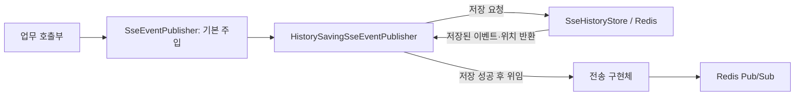

# 9. 공유 이력 저장 계약

공통 발행기는 **접속 여부와 관계없이 이력을 먼저 저장하고 브로커에 발행**합니다.
HTTP 연결은 각 서버 메모리에, 이벤트 이력은 Redis에 둡니다.

## 발행 역할과 식별자



일반 주입에는 `@Primary`인 이력 저장 발행기를 사용합니다.
그 안의 `@Qualifier("sseTransportPublisher")`는 실제 브로커 전송 구현체를 선택합니다.
호출부는 DTO 객체를 넘기고, 이력 저장 발행기가 JSON 트리로 변환합니다.
저장소가 브로커를 호출하는 것은 아닙니다. 발행기가 저장 결과를 받은 뒤 전송을 위임합니다.

| 값 | 역할 |
| --- | --- |
| 사용자 UUID | 이력 소유자와 수신자 |
| 연결 UUID | 사용자의 탭·재연결 구분. 서버별로 관리 |
| 이벤트 UUID | 브라우저 SSE `id`와 재연결 쿼리 `lastEventId` |
| Stream ID | Redis 저장 순서와 서버 내부 처리 위치 |
| 알림 DTO의 `id` | DB 알림 ID. 이벤트 UUID와 별개 |

Kafka 전송 구현체를 추가해도 이력 계약을 재사용할 수 있습니다.
전송 구현체 교체가 Redis 이력 저장소의 자동 교체를 의미하지는 않습니다.

## 저장·조회 계약

| 메서드 | 입력 기준 | 결과 |
| --- | --- | --- |
| `append` | 수신자·이벤트 UUID | 저장 위치와 저장된 이벤트 |
| `snapshot` | 사용자·마지막 이벤트 UUID | 조회 시점의 끝 위치 `upperBound`와 커서 이후 목록 |
| `readAfter` | 사용자·서버 내부 위치 | 그 위치를 제외한 후속 목록과 `gapDetected` |

`snapshot`에서 커서가 없거나, 만료·건수 제한·다른 사용자·알 수 없는 UUID로 찾을 수 없으면
**현재 끝 위치와 빈 목록**을 반환합니다. 전체 이력이 없으면 끝 위치도 `null`입니다.

`readAfter`는 기준 위치가 사라져도 그보다 뒤에 남은 이력을 순서대로 반환합니다.
`gapDetected=true`는 기준 위치를 확인하지 못했다는 표시이며 실제 미수신 유실을 확정하지 않습니다.
기준 위치가 `null`이면 남은 전체 이력과 `false`를 반환합니다.
빈 결과와 저장소 접근 실패는 서로 다릅니다. 실패를 빈 목록으로 바꾸지 않습니다.

## Redis 구조와 중복 처리

사용자마다 두 키를 사용합니다. 접두사 예시는 개발 기본값입니다.

```text
everyone:dev:sse:history:{사용자UUID}:stream
everyone:dev:sse:history:{사용자UUID}:event-ids
```

중괄호의 사용자 UUID는 두 키의 Redis Cluster 해시 슬롯을 맞추는 태그입니다.
Stream에는 이벤트 JSON을, Hash에는 이벤트 UUID → Stream ID 매핑을 저장합니다.

| 같은 사용자·UUID를 다시 저장한 경우 | 처리 |
| --- | --- |
| 내용과 이벤트 이름도 동일 | 기존 위치·이벤트 반환, TTL 연장 없음 |
| 내용 또는 이벤트 이름이 다름 | 충돌 예외, 기존 이벤트 덮어쓰기 없음 |
| 이전 이력이 이미 보관 범위 밖 | 새 이력으로 저장 가능 |
| 수신자가 다름 | 독립 저장 |

JSON 객체 필드는 정렬하여 직렬화하므로 필드 순서 차이를 내용 충돌로 오인하지 않습니다.
중복 이력을 반환해도 브로커 신호는 재발행될 수 있습니다. 연결별 처리 위치가 중복 전송을 줄입니다.

## 보관기간·건수·키 TTL

저장 Lua는 **만료 항목 정리 → 중복 확인 → 신규 저장 → 건수 제한 → TTL 설정**을 한 호출로 처리합니다.
Redis 시간을 사용하며, 제거할 이벤트의 Stream 항목과 UUID 매핑을 함께 정리합니다.
Lua 실행 중 다른 명령이 끼어들지는 않지만, 실행 오류 시 앞선 변경이 롤백된다는 뜻은 아닙니다.

- 신규 저장은 두 키의 TTL을 갱신합니다.
- 키 TTL이 늘어도 기존 이벤트의 저장 시점은 바뀌지 않습니다.
- 계속 활동하는 키의 오래된 항목은 저장·조회 시 정리합니다. 개별 이벤트마다 독립 타이머를 두지는 않습니다.
- 비활성 키는 TTL로 제거합니다. 중복 저장·조회는 TTL을 연장하지 않습니다.
- 조회가 비어 있는 이력 키를 다시 만들지는 않습니다.
- 건수 상한은 사용자별입니다. 전체 메모리는 사용자 수와 데이터 크기에 따라 늘어납니다.

저장 실패 시 브로커를 호출하지 않습니다. 저장 성공 후 브로커 발행이 실패하면 이력은 유지되지만
자동 재발행은 없습니다. 복구 가능 범위는 [복구 흐름](10-recovery-and-retry.md)을 참고합니다.

구현: [저장소 계약](../../src/main/java/com/codeit/sb13/playlist_for_everyone/global/sse/history/SseHistoryStore.java),
[Redis 구현](../../src/main/java/com/codeit/sb13/playlist_for_everyone/global/sse/history/impl/RedisSseHistoryStore.java),
[Lua 스크립트](../../src/main/resources/scripts/sse).

---

[목차](README.md) · [다음: 복구와 재시도 →](10-recovery-and-retry.md)
