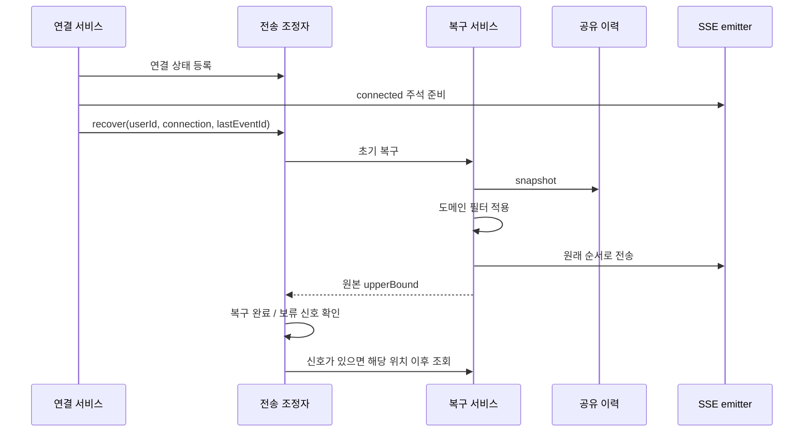

# 10. 연결별 복구와 재시도

브로커에서 받은 이벤트는 **후속 이력을 조회하라는 신호**입니다.
실제 전송 데이터와 순서는 Redis 이력에서 가져옵니다.

## 초기 복구에서 후속 전송으로

초기 복구는 컨트롤러가 emitter를 반환하기 전에 실행됩니다.
MVC 초기화 전의 `send`는 버퍼에 쌓일 수 있으므로 브라우저 수신 완료를 뜻하지 않습니다.

초기 복구 후 Pub/Sub 신호가 들어오면 각 연결의 마지막 위치부터 `readAfter`를 실행합니다.
다른 서버로 재연결해도 같은 공유 이력을 읽지만, 새 연결 ID와 독립 상태를 만듭니다.

## 연결별 상태와 동시성

| 상태 | 쓰는 이유 |
| --- | --- |
| `recovered` | 초기 복구 전에 후속 전송이 먼저 실행되는 것을 방지 |
| `lastPosition` | 다음 조회의 시작 위치 |
| `delivering` | 같은 연결의 후속 전송 중복 실행 방지 |
| `pendingDelivery` | 복구·전송·재시도 중 들어온 신호를 재조회 필요 여부 하나로 합침 |
| `retryFuture`, 횟수·간격 | 예약 중복 방지, 취소, 제한된 재시도 관리 |

`synchronized(state)`는 해당 연결의 상태 전환을 보호합니다.
같은 state를 쓰는 작업은 잠금 구간에서 기다리지만, 다른 연결의 state는 독립적입니다.
Redis·DB 조회와 emitter 전송은 잠금 밖에서 실행합니다.
다만 같은 호출 스레드가 연결들을 순회하므로 이것이 모든 연결을 병렬 전송한다는 뜻은 아닙니다.

조회 목록은 복구 메서드의 지역 변수이며 coordinator에 캐시하지 않습니다.
정리 시 Map의 state 동일성을 확인해 늦은 작업이 제거된 상태를 다시 사용하지 않게 합니다.
이미 실행 중인 I/O의 즉시 중단까지 보장하지는 않습니다.

## 필터와 보관 범위 밖의 이력

알림 필터는 `data.id`의 DB 알림 ID를 수신자 조건으로 일괄 조회합니다.
읽음 처리로 삭제된 알림은 제외하지만 Redis 커서 매핑을 함께 삭제하지는 않습니다.
필터 조회는 전송 전에 모두 끝내고, 허용된 항목은 원본 순서로 전송합니다.

필터가 마지막 항목 또는 모든 항목을 제외해도 원본 끝 위치까지 진행합니다.
그래야 같은 제외 항목을 신호마다 다시 처리하지 않습니다.
존재 여부 확인과 이후 DB 삭제·HTTP 전송이 하나의 원자적 작업인 것은 아닙니다.

| 상황 | 연결의 처리 |
| --- | --- |
| 초기 UUID 커서를 찾을 수 없음 | 과거 재전송 없이 현재 끝 위치를 기준으로 시작 |
| 후속 기준 위치가 사라졌지만 뒤의 이력이 남음 | 남은 후속 이력을 전송하고 위치 진행 |
| 전체 이력 만료로 후속 결과가 비어 있음 | 기존 위치와 연결 유지 |
| 이후 신규 이벤트 저장·신호 수신 | 기존 연결에서 새 이력 처리 |

`gapDetected`만으로 예외·재시도·연결 종료를 만들지 않습니다.
보관 범위 밖 데이터 자체를 되살리거나 프론트 코드를 변경하는 기능은 아닙니다.

## 실패·재시도·종료

| 단계 | 처리 |
| --- | --- |
| 초기 조회의 `DataAccessResourceFailureException`·`QueryTimeoutException` | 상태 정리 후 SSE 시작 전 `503` 공통 JSON 응답 |
| 후속 조회의 같은 두 예외 | 연결 유지, 마지막 처리 위치에서 지연 재시도 |
| 재시도 성공·정상 빈 조회 | 횟수와 간격 초기화 |
| 허용 재시도 모두 실패 | 해당 상태·예약 정리 후 emitter 종료 요청 |
| 전송 I/O·상태 오류 | 조회 재시도로 취급하지 않고 해당 연결 정리 |

후속 조회 재시도에는 Redis 조회뿐 아니라 알림 필터의 DB 조회가 같은 예외로 실패한 경우도 포함됩니다.
기본값은 최초 시도 **외에 3회**, 대기 간격은 `1s → 2s → 4s`입니다.
최대 간격 `30s`는 재시도 횟수를 늘렸을 때도 적용됩니다.
대기 중 새 신호가 와도 예약을 추가하지 않으며, 성공하면 다음 장애는 새 횟수·초기 간격으로 시작합니다.

완료·타임아웃·오류·서버 종료 시 해당 연결의 상태와 예약, emitter 저장소 참조를 정리합니다.
`cancel(false)`는 실행 중인 스레드를 interrupt하지 않으며, 늦은 예약 작업은 상태를 재확인합니다.
다른 연결과 Redis 공유 이력은 유지합니다. 재시도 성공으로 emitter를 새로 만들거나 타임아웃을 갱신하지 않습니다.

구현: [전송 조정자](../../src/main/java/com/codeit/sb13/playlist_for_everyone/global/sse/service/SseDeliveryCoordinator.java),
[복구 서비스](../../src/main/java/com/codeit/sb13/playlist_for_everyone/global/sse/service/SseRecoveryService.java),
[알림 필터](../../src/main/java/com/codeit/sb13/playlist_for_everyone/domain/notification/sse/NotificationReplayFilter.java).

---

[← 공유 이력](09-shared-history.md) · [목차](README.md) · [다음: 운영 설정 →](11-history-operations.md)
